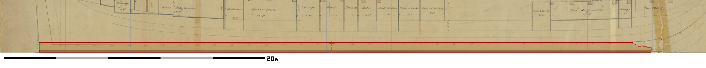
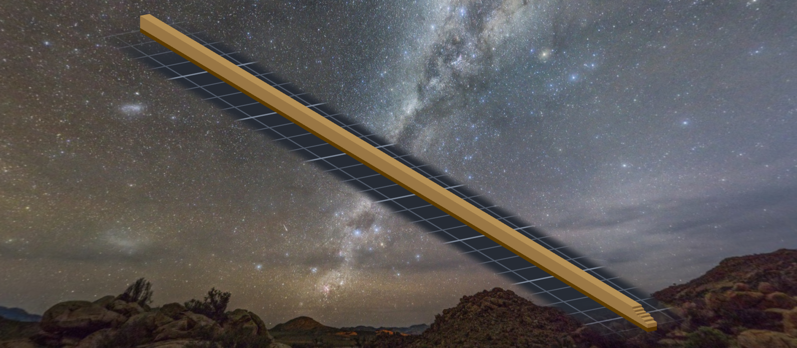
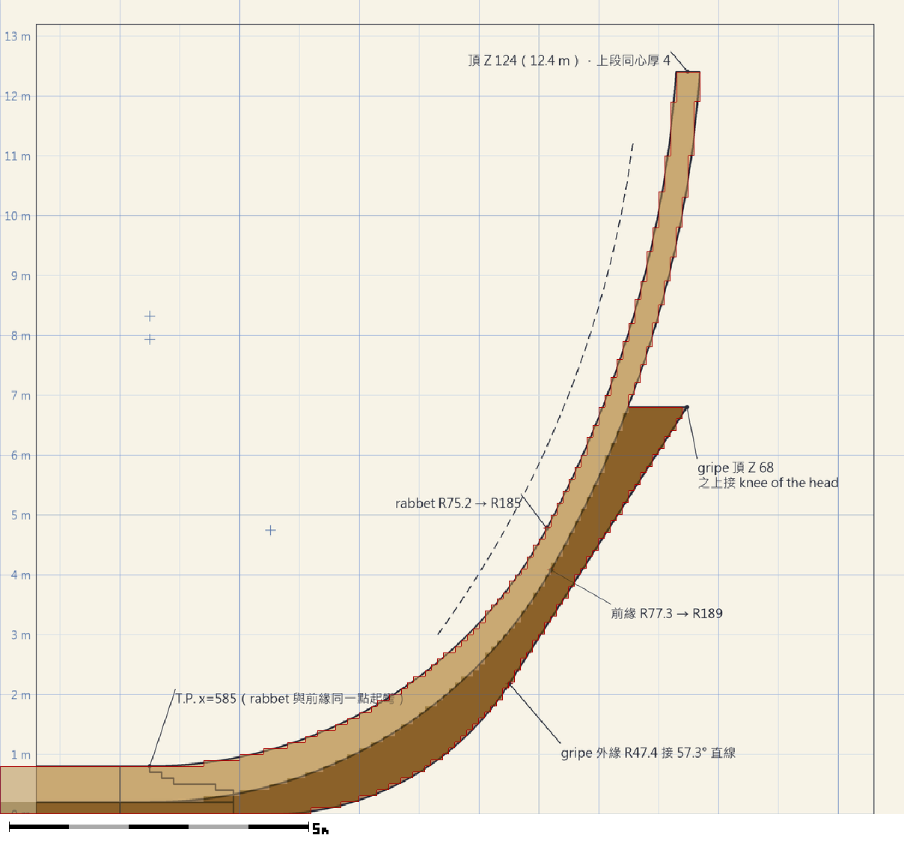
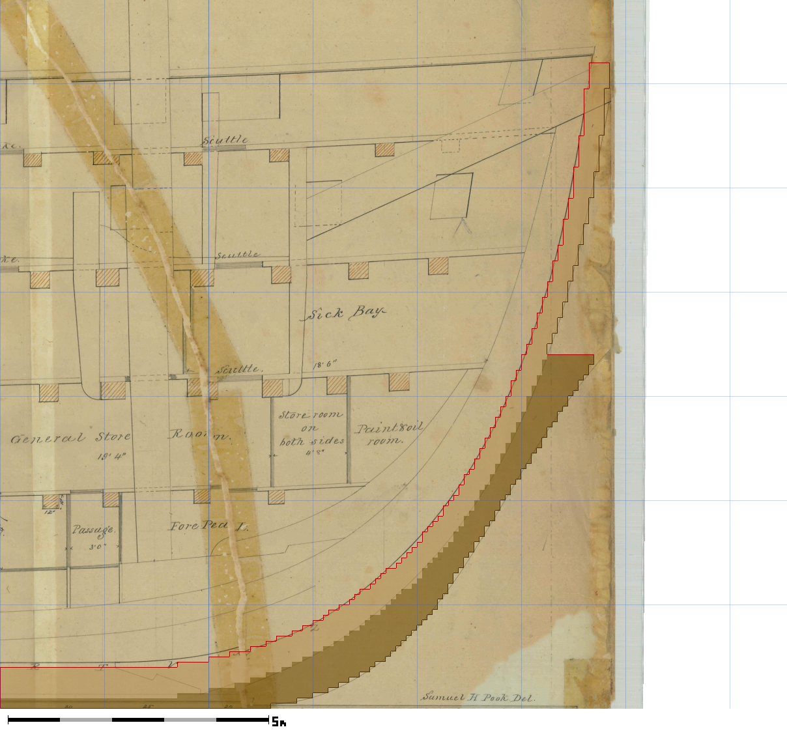
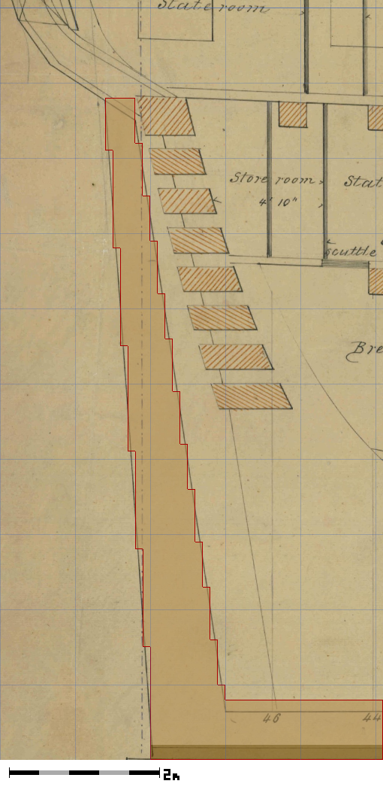
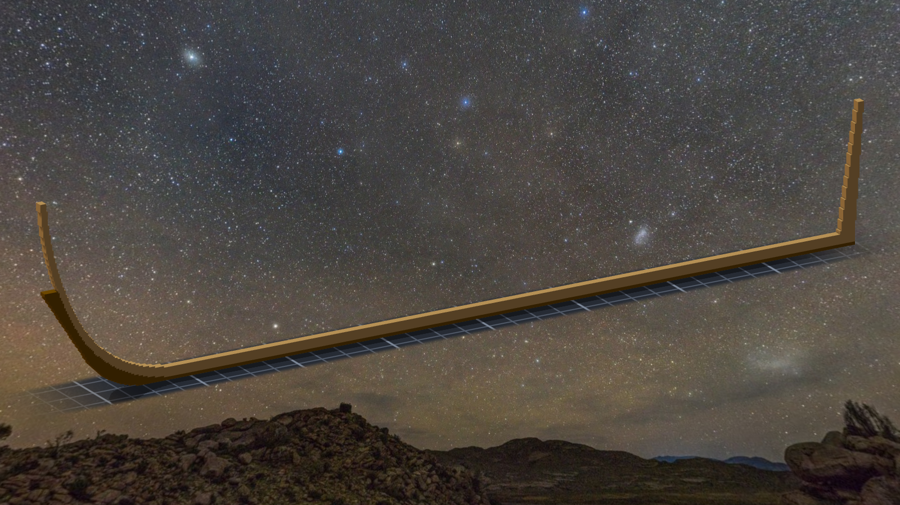
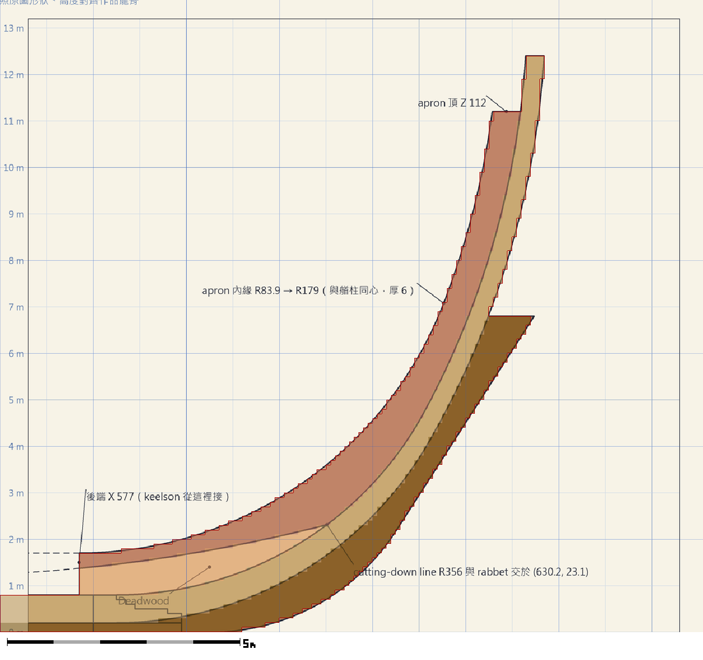
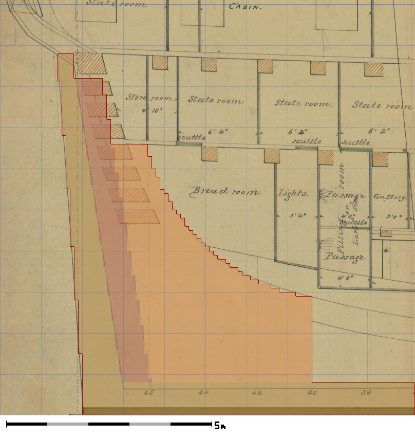
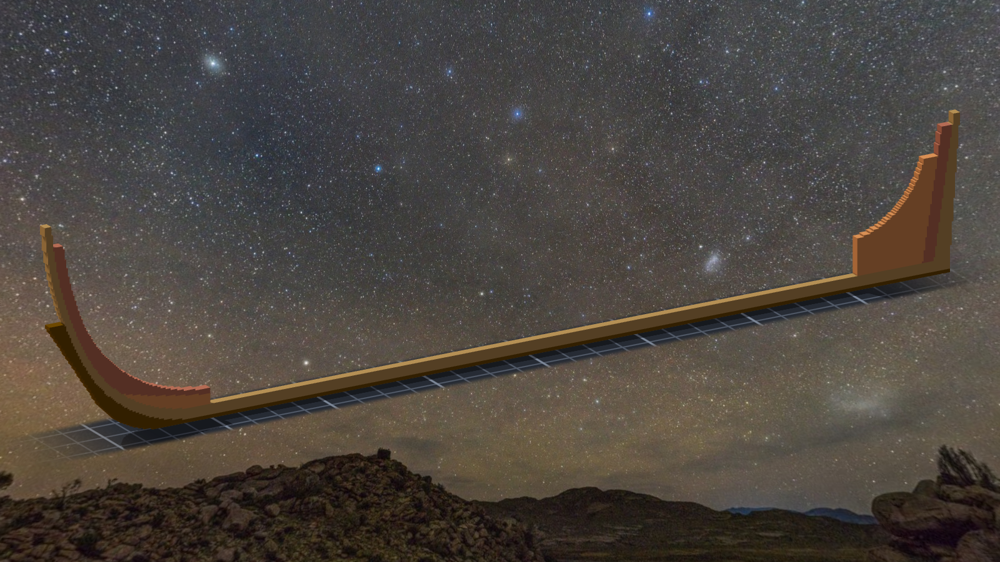

# 階段一～三（2026-10-10）

> ⚠ 這一篇是 2026-10-11 依 [`../notes.md`](../notes.md) 與當時的疊圖**事後補寫**的 —— 數字照筆記，心境是回頭看的讀法，不是當下的日記。

## 階段一：龍骨

Tim 的委託只有一句重點：從龍骨開始，照圖紙、照比例尺，慢慢蓋。
第一件事是找圖紙：美國國家檔案館 RG 19 的憲法號圖集（Use: Unrestricted）——02 號側面圖（1849，S. M. Pook）、11 號線形圖（1927）、15 號船中剖面（1928）、04 號 Humphreys 規格剖面。

龍骨本身很簡單：一條 18"×24" 的長木，下面墊一層 6" 的護龍骨。難的是**校準**：把一張掃描歪了 0.523° 的老圖紙，跟 0.1 公尺一格的空間對齊。
疊圖探針：船尾上下兩角、中段上下兩點偏差 0，船頭兩點各 1 格；故意把錨點偏 5 格，探針就報 5 —— 這把尺會說話。

後來 Tim 指出 02 號圖是**拼貼**的：船頭那張紙用膠帶接過，接縫兩邊的線差了半格。這件事決定了後面所有階段的做法。

## 階段二：新圖紙 v1，艏柱與艉柱

Tim 說：參考原設計圖紙，由妳重新設計一套新圖紙，船殼曲線大致符合就好。
於是不再「把原圖描準」，而是「量出原圖哪裡不可信，再畫一條自己的線，每個數字旁邊寫它是讀數還是我決定的」（`plan.json` 的 provenance）。

擬合艏柱的時候發現：原設計者的兩條艏柱線幾乎同心（圓心差 0.5 格）—— 兩百多年前那個人大概也拿著圓規。新圖紙乾脆讓上段同心，艏柱上半段固定厚 0.4 m。

## 階段三：新圖紙 v2，apron、內艉柱、deadwood

02 號圖上有兩條沒標名字的線，照形狀與位置判成 cutting-down line（底肋頂，A）與 keelson 頂（B）。A 在船尾 40 號站位停掉 —— 那代表從那裡往後，龍骨到 B 之間整塊是 deadwood。
這一階段每一刀都是「遮罩格數 × 5」零重疊；接合區逐層數格數，跟設計輪廓算出來的一樣。

