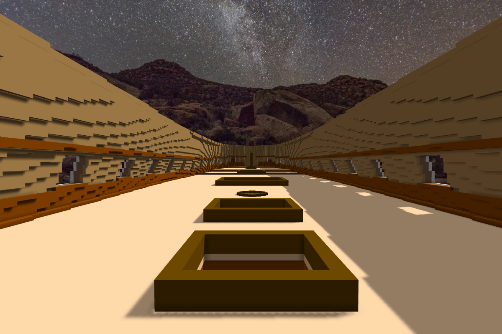
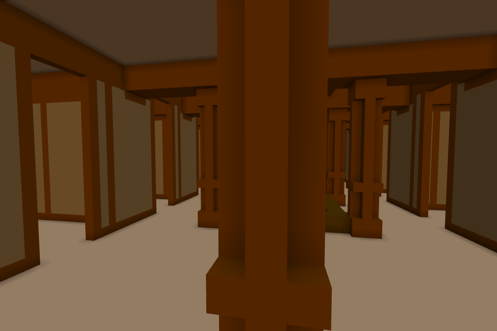
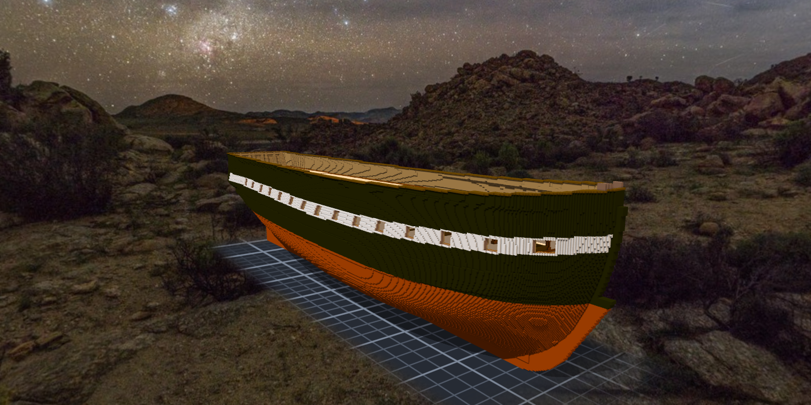
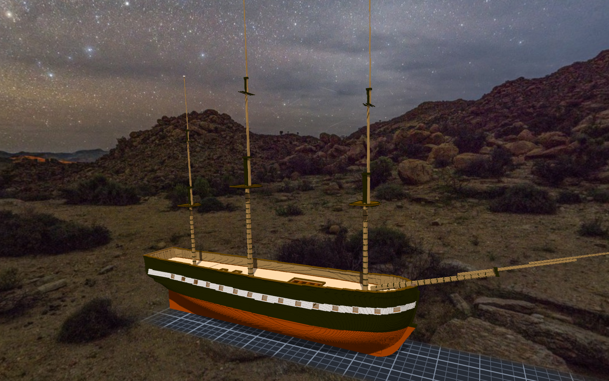

# 階段十～十三：甲板、房間、舷牆、桅杆（2026-10-11）—— 一艘船，拆成十五件

> 規格與完整讀數在 [`../notes.md`](../notes.md)「組裝件與子作品」與「階段十」～「階段十三」；設計與每一格的出處在 [`../design/plan.json`](../design/plan.json) 的 `deckworks`、`rooms`、`bulwark`、`masts`；新圖紙 [08](../design/sheet08_decks_v1.png)、[09](../design/sheet09_rooms_v1.png)、[10](../design/sheet10_bulwark_v1.png)、[11](../design/sheet11_masts_v1.png)。

## 委託

階段九把船殼內部做完、甲板高度定好之後，Tim 說可以開始做甲板了：先做設計圖紙。中途他接連改了幾次結構 ——
「鏡像不要套用到整個甲板，而是只用在上面的物件」；「可以開一個作品來組裝憲法號，目前的作品就作為船殼部分」；「另一個作品本身只做組裝工作」；「房間可以做為所在甲板的子模組嗎」。
每一句都把作品切得更清楚一點。做完的時候，憲法號是一件只有關聯的組裝件，底下掛著船殼、四層甲板、六件房間、三根桅和一根 bowsprit。

## 甲板：照砲門排橫樑

02 號圖（1849）把每一層的橫樑畫成小小的橘色斜線方塊。本小姐先寫了一支程式去把它們全部找出來，找到一半 Tim 說：參考就好，主要由妳設計。
於是換了做法 —— 不抄圖上的每一根，而是照 Humphreys 的規矩：「每個砲門底下一根、兩個砲門之間一根」。排出來的間距 15.5 到 17.5 格，跟 02 號圖量到的一樣。更好的是：階段九定甲板高低差的那幾道接縫（238、504、570、633），剛好都落在「兩個砲門之間」那一根上 —— 所以每一道台階底下本來就有橫樑。

carlings 用了 15 號圖上的一句話：「CARLINGS ... 6'-10" FROM ℄ SHIP」，換算是離中線 20.8 格。大艙口的兩邊剛好落在這一排上。

做的時候 plan.json 被本小姐整份重排過一次（1,783 行的差異），當場改回來；之後所有新段落都只在檔尾接上去。

## 房間：鏡像只給上面的物件

房間照 Waldo 1816 年的 orlop 平面、Martin 整理的 1812 年 berth deck、1931 年的 gun deck 配置。全寬的橫向艙壁整件做；兩舷的艙房只做一邊，另一邊用 `mirror=y` 關聯進來。
鏡面要剛好在第 160 格的正中間，而引擎翻面的公式是 `H − 1 − y` —— 所以艙房那件不能跟船殼一樣大，要只包住自己，放在 `at.y ＝ 321 − y0 − h`。本小姐用 320 − y 自己算了一份，跟引擎組出來的逐格對上。

## 舷牆：讓兩條線平行

階段七之後一直記著一條：白帶照 sheer 往船頭翹，舷頂卻幾乎是直的，船頭看起來往下垂。Tim 把要不要起翹交給本小姐決定。
做法是讓舷頂跟白帶平行 —— 船中的距離是 25 格，就讓整條船都是 25 格。船尾本來就差不多，從 x 493 開始往上補，船頭最多補 9 格。補上去的格子照舷頂那一排的組成往上疊：外面黑漆、中間肋骨、裡面原木，最上面一條 cap rail。

## 桅杆：照著已經開好的孔

Martin 的書裡有一封 1801 年的信：44 門砲的巡防艦，主桅 105 呎、直徑 35 吋；前桅 95 呎、32 吋；後桅 92 呎、24 吋；bowsprit 64 呎、34 吋。還有 1810 年的航海日誌記下的斜度。
斜度跟甲板上已經開好的桅孔對不上：日誌說前桅比主桅還斜，02 號圖上的前桅卻幾乎是直的，而桅孔是照 02 號圖開的。本小姐讓桅杆照桅孔，把這筆落差寫進出處欄。
後桅照 92 呎放，它的 top 會比前桅還高（後桅的跟踩在比較高的 deadwood 上）—— 改成 82 呎。

## 套上去之後，尺叫了一聲

全部套用之後量了一次：組裝件是 **2** 個元件。多出來的那一塊是主桅的 top —— 整片平台浮在空中，離桅杆一格。trestletrees 的位置是用四捨五入算的，主桅的 masthead 半邊 3.56 格，捨入之後剛好落在離它遠一格的地方；前桅、後桅捨入剛好貼著，所以只有主桅。
草稿預覽的時候看不出來（一格的縫從遠處看不到），套用之後的那一行「components = 2」看得出來。改成「緊貼 masthead 外面那一格」，主桅那件刻 144、補 144，變回 1 個元件。

同一個下午還有兩次，是引擎替本小姐擋下來的：批次加關聯時，bash 的 `read` 把空的欄位吃掉，備註跑進了鏡像那一欄；另一次是 Windows 的換行把 `\r` 帶進了關聯名。兩次都整筆拒絕、一格沒寫。

## 查到的資料
- 02 號側面圖（1849 Pook，各層橫樑、艙口、桅）、15 號船中剖面（1928：carlings、hatch、stanchions、knees、waterways）：美國國家檔案館 RG 19（Use: Unrestricted），`Sculpture/references/uss-constitution-1927/`。
- T. G. Martin, *Constitution Close Up*（[USS Constitution Museum](https://ussconstitutionmuseum.org/wp-content/uploads/dlm_uploads/2020/01/closeup_martin.pdf)）：1801 年下桅規格、1795 年四人估的全桅總長、1810 年的桅斜度、berth deck c.1812 的配置。
- 1816 Waldo orlop 平面圖、1931 inboard profile、1931 gun deck 配置圖（[USS Constitution Museum](https://ussconstitutionmuseum.org/download/inboard-profile/)）：房間、艙口、柱子、桅位。
- Humphreys 1794〈Articles for a 44-Gun Frigate〉——[Papers of the War Department](https://wardepartmentpapers.org/document/46934/)（機器轉錄）：橫樑「one under each port and one between」、hanging／lodging knees。
- 桅杆尺寸表（1794–95 年 Humphreys／Truxtun／Barry 的計算）在 [Papers of the War Department](https://wardepartmentpapers.org/s/home/item/47336) 只有掃描、沒有轉錄 —— 本小姐沒有讀到原表，用的是 Martin 書裡引的數字。
