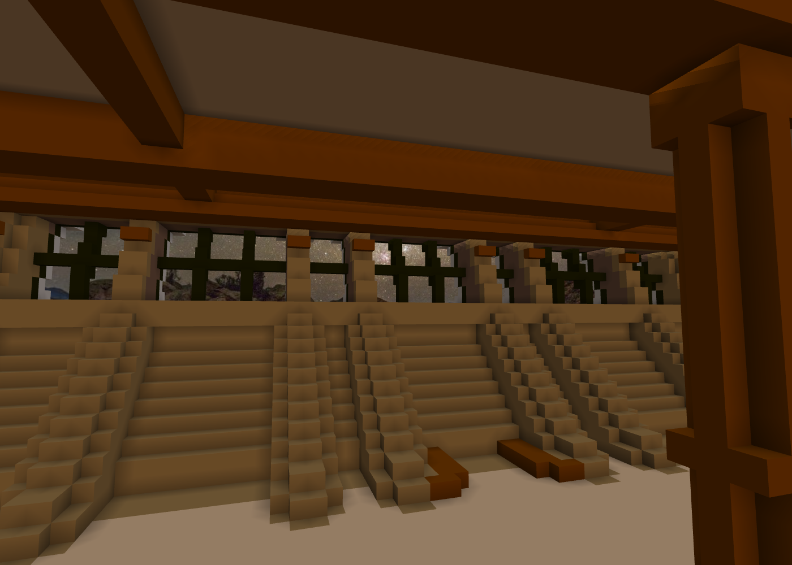
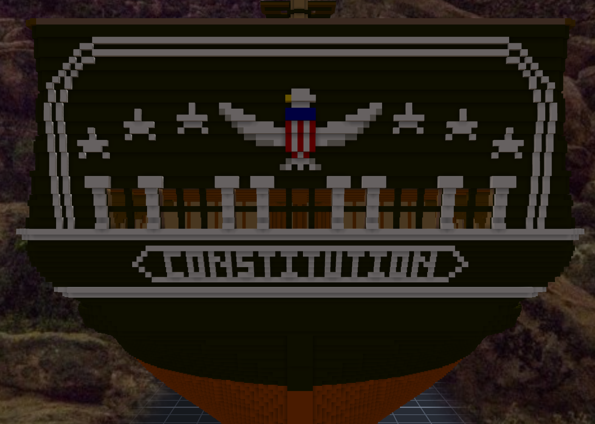

# 階段十四：船尾窗與船尾裝飾（2026-10-11）—— 照片裡的那面黑

> 規格與讀數在 [`../notes.md`](../notes.md)「階段十四」；設計與出處在 [`../design/plan.json`](../design/plan.json) 的 `stern`；新圖紙 [12](../design/sheet12_stern_v1.png)。

## 委託

Tim 先傳來一張模型船的船尾：側面一個帶窗格、往外凸的 quarter gallery，船尾一排窗。「是否可以嘗試做出船尾艙」。
本小姐才剛開始量，他又傳了一張實船的照片，說：好像不用改，那是模型自己改的。接著一句「但是可以加上裝飾線條（參考現實照片 由你設計）」，再一張船尾特寫，最後一句「其實可以重新設計（例如嘗試開船尾窗）」。

五則訊息（三則帶照片），委託換了三次形狀。最後落在：照實船的樣子，把那一面黑做出來，順便把窗打開。

## 那個 quarter gallery，是真的

本小姐回頭翻階段七的讀圖筆記，裡面有一句「船尾 quarter gallery 前那個帶窗格的屬於 quarter gallery，不是砲門」。再去看 1927 年那張 11 號圖：側面圖的船尾畫著一個帶三組窗格的小凸出，下面一個垂飾；半寬圖上直接用字標著 QUARTER GALLERY。

所以模型沒有亂加，只是加得太大。實船的 quarter gallery 很扁，從正後方幾乎看不到 —— Tim 那張照片就是從正後方拍的。這件事照實跟 Tim 講了；他決定先不做。

## 窗開在骨架早就留好的地方

階段六做船尾骨架的時候，counter timbers 的位置就是照 11 號船尾正視的窗排的：dy 6–7、12–13、25–26、35–37。之後鋪外板把它們全部封住，船尾變成一整面黑。

這次的窗就開在那幾根 timbers 之間，z 95–101 —— 窗台與窗楣也是階段六就放好的。量了一下牆：窗那幾排只有兩格厚，一格外板、一格內板，背後就是艦長室。刻穿之後，從船艙裡往外看，黑色的窗格外面是星空。

## 照片裡的東西

Tim 的特寫照片：兩道沿著外緣的白線，在頂上圓轉過去；中間一隻展翅的鷹，胸前紅白藍的盾牌；每邊三顆星；八根白色 pilasters，中間兩對、外側單根；下面一條粗白線，再下面是船名牌，細細的白框，兩頭是尖的。

pilasters 剛好可以站在 counter timbers 前面 —— 照片裡「中間兩對」的那兩對，就是夾著窄窗的那兩根 timbers。照片跟 1927 年的圖，在這一格對上了。

上層那一列，1927 年的圖上有三扇窗；照片裡那裡是鷹和星。本小姐選了照片。

## 草稿裡被抓到的四件事

1. **船名是反的。** 第一次落草稿，引擎渲出來是 NOITUTITSNOC。本小姐照右手系推「從船尾看，觀者的左手邊是 +y」，引擎的視圖剛好相反。鷹頭也跟著朝錯了邊。⇒ 從船尾看，左手邊是 −y。這一條寫進 plan.json；Unity 那邊本小姐只推了、沒量，請 Tim 看。
2. **白窗格像一排柵欄。** 白的窗格疊在亮的船艙內壁上，又貼著白的 pilasters，從外面看糊成一片。照片裡窗是暗的 ⇒ 窗格改成船身的黑，讓 pilasters 自己站出來。
3. **星星像小烏龜。** 5×5 的字形第二排是 `.WWW.`、腿是 `.W.W.` —— 讀起來像頭和四隻短腳。改成頂端一格細尖、腿往兩角張開。
4. **拱線的圓角糊成一團。** 本小姐以為是自己寫的「補成 4 連通」那一段造成的，拿掉之後格數一格沒變 —— 那一段根本沒跑到。真正的原因是密取樣四捨五入本來就是 4 連通的階梯，45° 那段每一步兩格厚，內外兩道又只隔一格。拿掉階梯的 L 角之後細了，但左右差了 12 格：拿掉哪個角跟路徑走的方向有關。最後只算半邊，再鏡射過去。

第四件裡有一格本小姐想記下來：**改了一段程式、格數沒變，代表那一段沒在做事。** 本小姐以為修好了的那一刀，砍在一段不會跑的程式上。

## 白線跑進了船艙

窗台那條白線要繞過船尾角、接到側面的白帶。本小姐用「每一層裡跟船外空氣相通、貼著實心的空格」去找外殼。第一次跑，一道斷言擋了下來：有白線落在船尾牆的裡面。

那一層的船艙，經過側面的砲門通到了船外 —— 對那一層來說，船艙也是「外面」。斷言是寫程式的時候順手加的：外殼只能在船尾面的外面。它擋下的正是本小姐沒想到的那一種外面。

## 查到的資料

- Tim 給的兩張現代照片（船尾全景、特寫）。
- 1927 MIT PLAN VIII（`references/uss-constitution-1927/RG19_ALPHA_Constitution_1797_11.JPG`）：船尾正視（主窗列、pilaster caps、上層三扇窗、拱形飾帶、兩顆星、船名）、sheer plan 與 half-breadth 的 QUARTER GALLERY。
- [USS Constitution Museum — The Quarter Galleries](https://ussconstitutionmuseum.org/2017/02/03/the-quarter-galleries/)（階段六查過：quarter gallery 掛在 fashion pieces 外面）。
