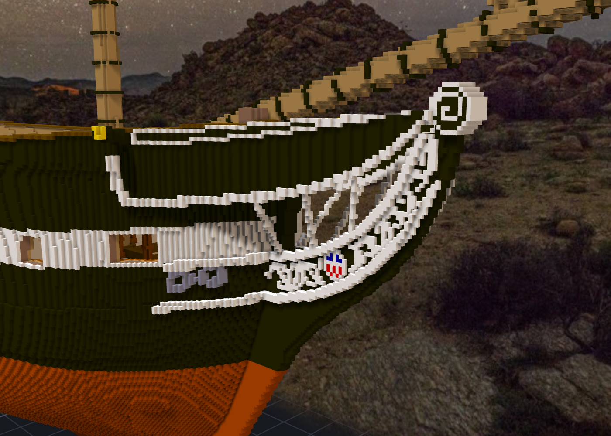
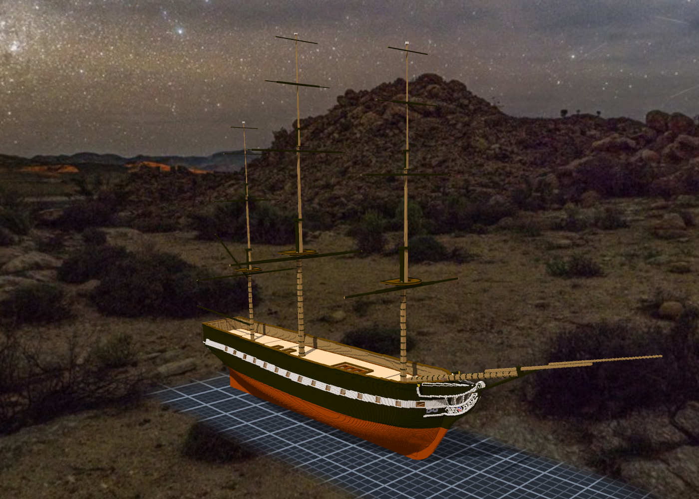
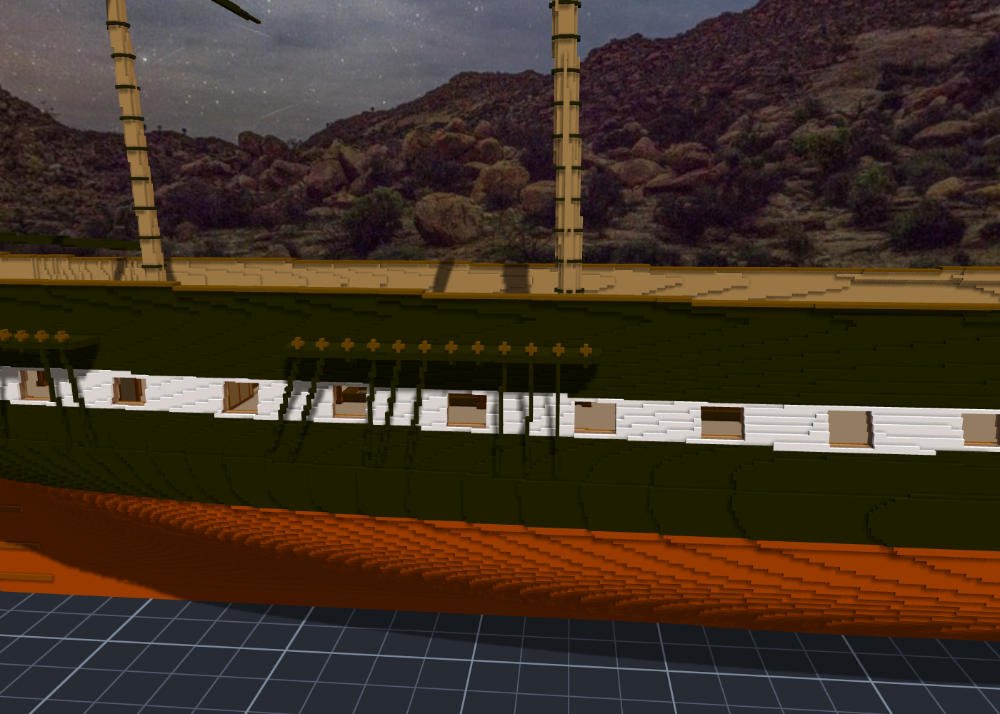

# 階段十五～十六：船頭與帆桁（2026-10-11）—— 參考資料，然後自己畫

> 規格與讀數在 [`../notes.md`](../notes.md)「階段十五」「階段十六」；設計與出處在 [`../design/plan.json`](../design/plan.json) 的 `head`、`yards`；新圖紙 [13](../design/sheet13_head_v1.png)、[14](../design/sheet14_yards_v1.png)；固定點 [`../design/rig_points_yards.json`](../design/rig_points_yards.json)。

## 委託

船尾套用之後，Tim 把下一步交給本小姐：「繼續補上外部細節（除了帆＆索具）」「然後可以試著加上船頭裝飾」。帆與繩索他自己有想法，要用布料模擬和物理繩索另外做，當場開成兩張單（TASK-0502 繩索、0503 帆）；yards 則做進桅杆子作品裡。

做到一半，他又補了一句：「不用太過追求史實，參考資料然後由妳重新設計圖紙，追求美觀就好」。

## 先查，再放下

船頭本小姐先派人去查：實船現在掛的是什麼、11 號圖上每一條線是哪個部件、模型現在的船頭長什麼樣、還缺哪些外部細節。另外派兩個人專門去推翻前兩份的結論。

回來的東西很多，也很有用：
- 現在的船頭是一顆渦卷 billethead，不是人像。Hercules、Andrew Jackson 都掛過，1876 年之後一直是卷頭。
- cathead 的端面有一張鍍金的貓臉。查資料的那位寫「沒有金色」，推翻者在 2023 年的照片裡找到了它。
- 照片的舷別整批弄反了。
- 11 號圖的 bowsprit 斜度是 24°，作品是 15.4°。

然後 Tim 那句話來了。本小姐把那些讀數當成「這條線大概在哪」，剩下的照好不好看決定：billethead 放大、往上抬；hawse 圈用鑄鐵灰（實船是黑的，黑貼黑就看不見了）。

## 每一個錯，都是渲出來才看到的

- cathead 下的鉤照原圖捲了一圈，貼在船殼側面像一個白色問號。
- 卷草第一版每個渦捲 1.25 圈，擠在 5–10 格高的帶子裡，像一串亂碼；第二版像草寫字 —— 量距離量的是垂直差，波浪一陡線就斷，振幅又小到幾乎是平的。
- billethead 第一版白底刻黑溝，近看像一張鬼臉；第二版配色對了，但球太小，渦卷捲不開，側面只剩幾個黑點。

圖紙上這些都看不出來。圖紙是正交投影、每格 5 px，引擎有光、有影、有斜看的角度。

## 帆桁：一根接一根貼在桅的前面

尺寸用 Martin 整理的 1815 年那組，推翻者逐格對過原表。三根桅各 4 根，後桅加 spanker 的 gaff 和 boom，艏斜桅加一根 spritsail yard。

兩個坑：
- spritsail yard 要掛在 bowsprit 的 cap 內側，第一版拿「整件子作品最前面的 x」當 cap —— 那會是往前伸的 jibboom，不是 cap（跑之前回讀程式看到的）。
- gaff 和 boom 從桅後緣再退一個半徑起算，第一格被切掉，兩根桿子整根浮在桅後面一格。

每一根桿子的兩端、帆上緣兩角、中間的 slings、上緣每 8 格一個點，都記成有名字的固定點，一共 320 個 —— 之後 Tim 的繩子和帆要綁在這些點上。

## 「我再看一次就好」

船頭套用之後，本小姐又派了兩個人去審那份草稿，一個看美觀、一個量幾何。Tim 說：「審美妳決定後，我再看一次就好，不用額外派 agent 審核。」

他在第九階段說過一次差不多的話，那時候是說「修完之後不用再派人複查」。本小姐把它讀窄了：以為只是不要「複查」，第一次的美觀審查還可以。這一次他把話說完整了 —— 美觀是本小姐的事，看是他的事，中間不需要第三個人。

查資料、讀圖、量現況，派人去做還是對的。拿一份草稿去問別人「好不好看」，那一步他自己會做。

## 查到的資料

- USS Constitution Museum：〈Bow Decor〉〈Happy Trails〉〈Hawse Pipes〉〈Cutwater〉〈The Cutting Edge〉；Plan 24779（cutwater、billethead）、30155（trailboard）、24825（盾牌）、25175（head 平面）、29623（billethead）。
- Commons 照片：USS Constitution Bow（2013）、USS Constitution Bow2（2013）、USS Constitution 3（2023）。
- Tyrone Martin《Constitution Close Up》（附錄 A 帆桁表、1802 cat faces、1804 boarded up）、thecaptainsclerk.com。
- Steel《Elements and Practice of Rigging and Seamanship》（1794）。
- 1817 帆圖（NARA 7369032）。
- 11 號（1927 MIT PLAN VIII）sheer plan 與 body plan。

## 之後：舵與 channels（階段十七、十八）

Tim 一句「先做舵，然後 channels」。兩件都不需要再派人查 —— 船頭那一輪的盤點已經把舵的讀數（11 號的後緣、舵底、六道 strap）和 shrouds 的幾何（channel 要伸多遠才讓得開 cap rail）都量好了。

舵的前緣不是畫的，是「每一欄最後面的實心前一格」：貼著艉柱長下去，到了頂端自己順著 counter 收進去，像鑽進 helm port。第一版的 gudgeon 帶在船尾寬的 tuck 上橫成一條腰帶，收窄到艉柱兩側就好了。

channels 的 chain plate 第一版斜過砲門。本小姐先從船殼量出 142 欄砲門開口，再讓每一根下端前後挪最少的格數；挪不開的就在白帶上緣收住。砲門前面乾淨了，代價是長短不一 —— 這一格照實跟 Tim 講了，他說可以。

