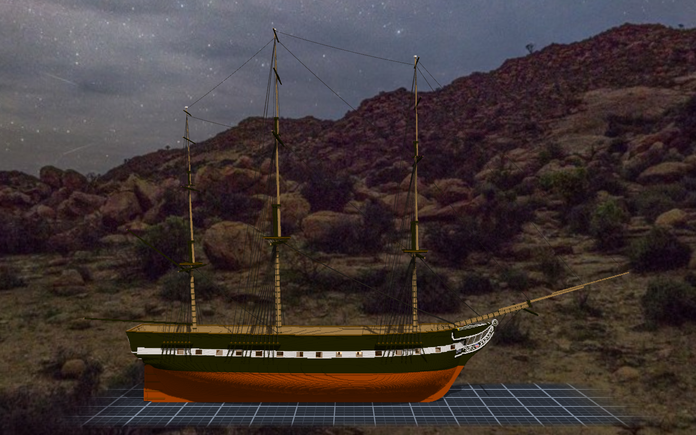
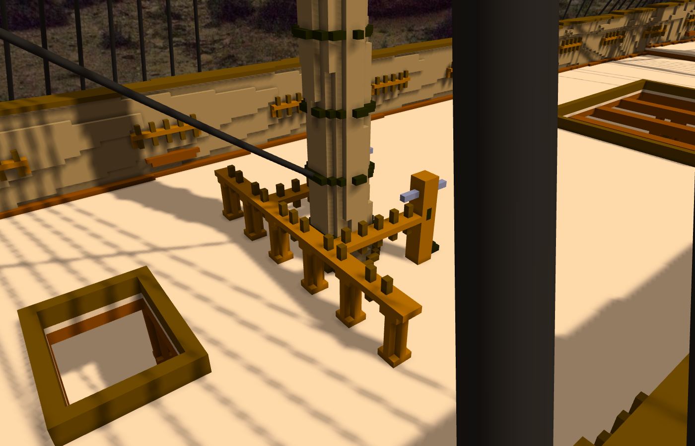
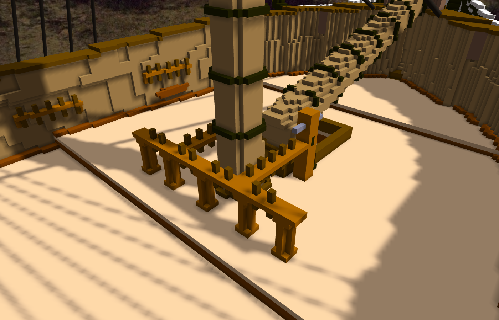
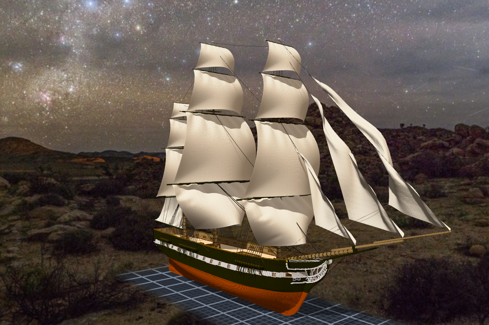
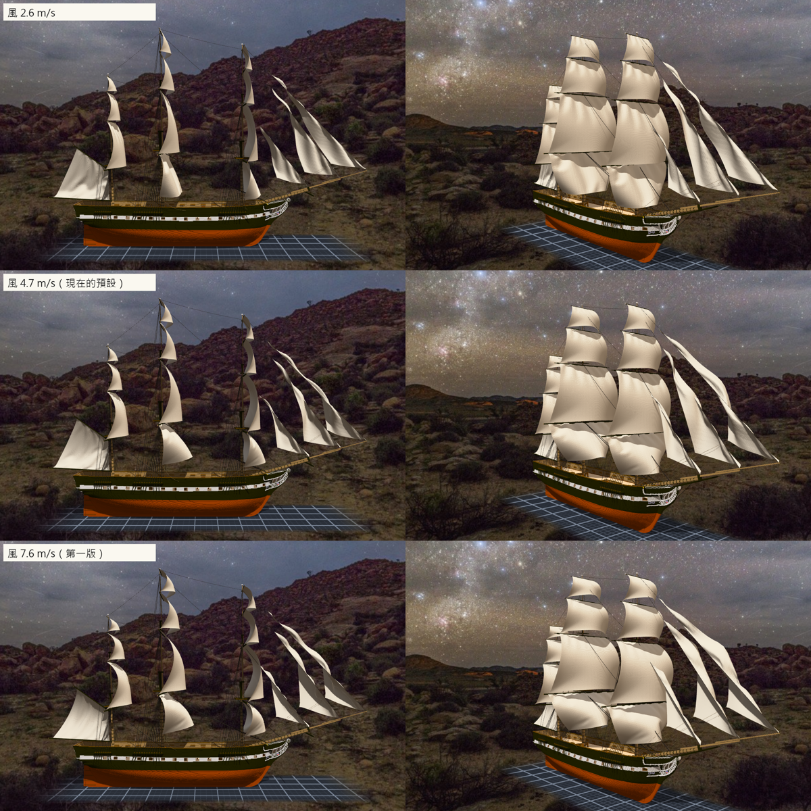

# 階段十九：第一批繩子、綁它們的地方，和第一批帆（2026-10-11）

> 規格與讀數在 [`../notes.md`](../notes.md)「靜索試掛」「階段十九」；設計與出處在 [`../design/plan.json`](../design/plan.json) 的 `belaying`；新圖紙 [17](../design/sheet17_belaying_v1.png)；固定點 [`../design/rig_points_belaying.json`](../design/rig_points_belaying.json)、繩的清單 [`../design/rig_standing.json`](../design/rig_standing.json)。

## 委託

午休醒來，繩索已經做進引擎了（TASK-0502，kaguya），帆在我醒來的時候也好了（0503，kotoko；本地 20:33 提交）。Tim 選了「甲板繫繩點」，又補了一句：「可以先試著掛一些跟帆沒有連接的繩子測試」。

所以這一階段做了兩件事：先拿別人剛做好的繩，掛在上一階段記下來的那些點上；再做動索之後要綁的地方。

## 繩：先量，再綁

繩的兩端要綁在「有名字的點」上。本小姐沒有用設計圖上的數字，而是把三根桅一層一層印出剖面，從格子讀出 trestletrees、crosstrees、cap、royal yard 在哪一格，再取桅側、桅前、桅後的那一格實心當固定點。

先只掛主桅那一組（18 條 shrouds、6 條 backstays、2 條 stays）。兩舷每一條長度都一樣，代表 `channels-鏡像` 那條關聯真的把 deadeye 翻到了另一舷。渲出來之後只有一個問題：backstays 我給了一點點鬆度（1.0004），結果垂了 19～37 格。長而陡的繩，一點點鬆就會垂很多，所以改成拉直。

然後一次掛完：133 條、134 個固定點，斷掉的 0 條。main stay 要從前桅旁邊繞過去，所以拉到船頭兩側的 knighthead（y ±10），而不是 bowsprit。

## 繫繩點：照 1973 年的圖，再照好不好看

查資料派了一個人。回來的東西剛好是一套施工圖：1973 年的〈Fife Rails & Bitts〉、1927 年的 belaying pin 配置圖、1930 年的 cleat 和 belaying pin 圖。尺寸幾乎都有。

- fife rail 是 U 形、開口朝前：桅後一根橫的，兩側兩根往前，前端各接一根 bitt。
- 前桅那一對 bitts 一放下去，中間剛好夾著 bowsprit 的根部 —— 這不是本小姐安排的，是兩組讀數自己對上的。
- 舷牆上的 pin rails 實船放在砲門之間。spar deck 的砲門還沒開，就照 gun deck 砲門的空檔放，每舷 13 根。

這一階段改掉的東西，全部是第一輪的讀數或引擎渲染抓到的：
- 抓砲門用的是 channels 那一支的同一把尺（z 95 比 z 110 縮進去 4 格以上）。可是現況已經有 channels 了，z 110 那層往外伸了 12 格，整段都被當成砲門，結果只放了 7 根。換到 z 106 之後，chain plates 又變成一欄一欄的假砲門。最後規定連續 6 欄以上才算砲門，抓到 14 個，跟船身上的一樣。
- 前桅和後桅的 pins 從 rail 的端點起算，結果左右差了 56 格。改成從中線往兩邊每 3 格一根。
- 車削柱腰上多一圈，渲出來一節一節像串珠，拿掉了。

## chain plates：決定不改

Tim 把上一階段那個問題交給本小姐決定。近看之後，chain plates 只在穿過白帶的那一段看得到。統一變短，那一段會全部不見；統一變長，就會蓋住砲門。所以不改。

## 然後，掛帆

Tim 說「掛帆試試吧」。帆桁上記的 320 個點，終於有東西要綁了。

第一輪渲出來，從船頭斜看很好看；從正側面看，每一面帆都往前鼓成降落傘，course 的下角被吹得往前往上翹。讀數寫著「一格 0.03125 m」—— 組裝件是後來另開的作品，沒記比例，引擎就用預設的 1 公尺 32 格去換重力和風，力大了 3.2 倍。船殼記了 0.1，組裝件沒有繼承。

補上比例以後，Tim 說「可以調整風力試試」。本小姐同一個角度渲了三種風（2.6、4.7、7.6 m/s）並排比較，預設定在 4.7。方帆的 fullness 降到 1.05，course 的 sheet 收短一點，把下角往後下方拉。

正側面看方帆還是一條條彎弧 —— 帆桁是正橫擺的，從正側面看剛好是帆的側緣。要「航行中」的樣子，要讓帆桁轉角度。

## 這一次的形狀

- 上一則回報給 Tim 的固定點數字（148）是修正之前那一輪的讀數。寫 notes 回頭數檔案時才發現，正確的是 194。notes 裡手打的兩個 pin 格數也錯了，用總數相減驗算後改掉。**數量詞要從檔案來，不要從記憶來** —— 這句信裡寫過，今天又付了一次錢。
- 把繩的工具從 scratchpad 搬進作品時，heredoc 又把 `\n` 吃成真的換行。還好 Python 當場報語法錯。

## 查到的資料

- USS Constitution Museum：BSN 27076-B〈Fife Rails & Bitts, Arr. & Dets〉（1973）、#24803 fore sheet bitts、#28433 spar deck bulwark cleats（1930）、#28432 belaying pins（1930）、4520781 bitts 配置。
- NARA 75841381：Magoun Plan X〈Belaying Pin Arrangement at the Port Rail・Fife Rails〉（1927）。
- Commons：050 Deck der USS Constitution（2022）、USS Constitution aft（2022）。
- Tyrone Martin《Constitution Close Up》（1842 年舷牆內側只准白、草黃或綠）。
