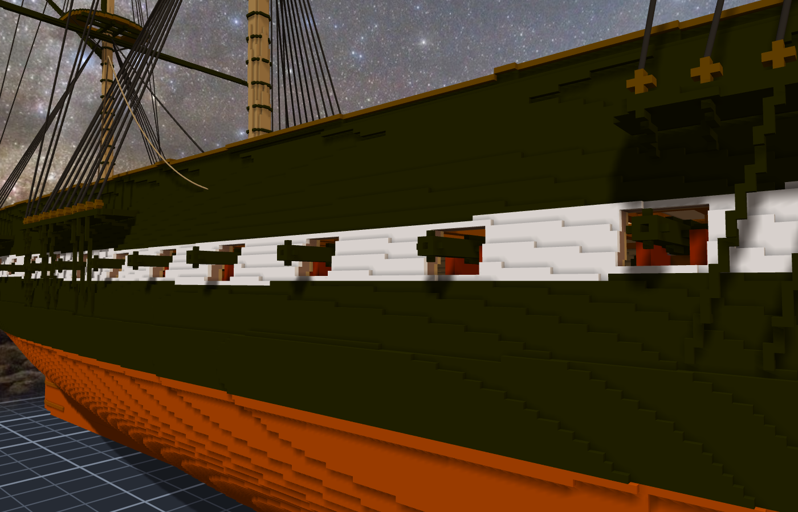
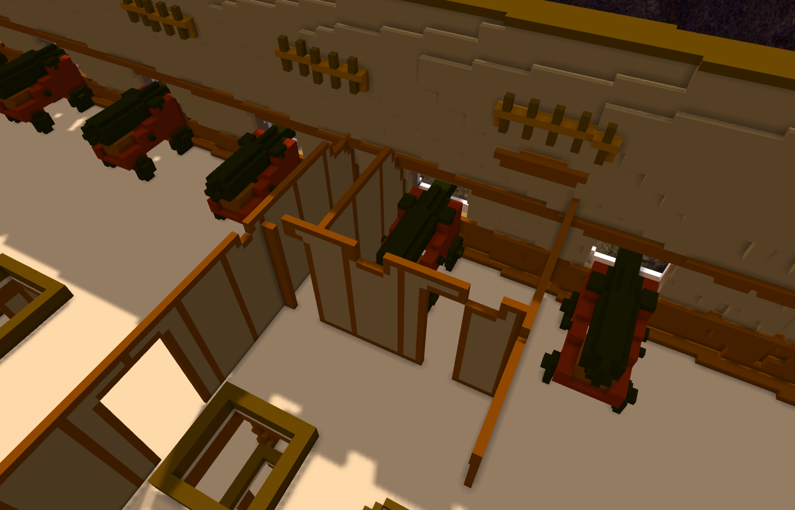
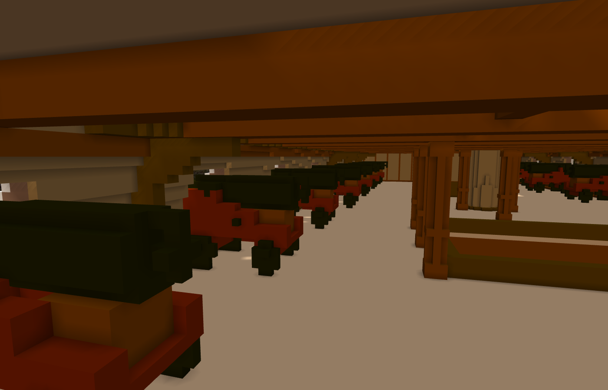
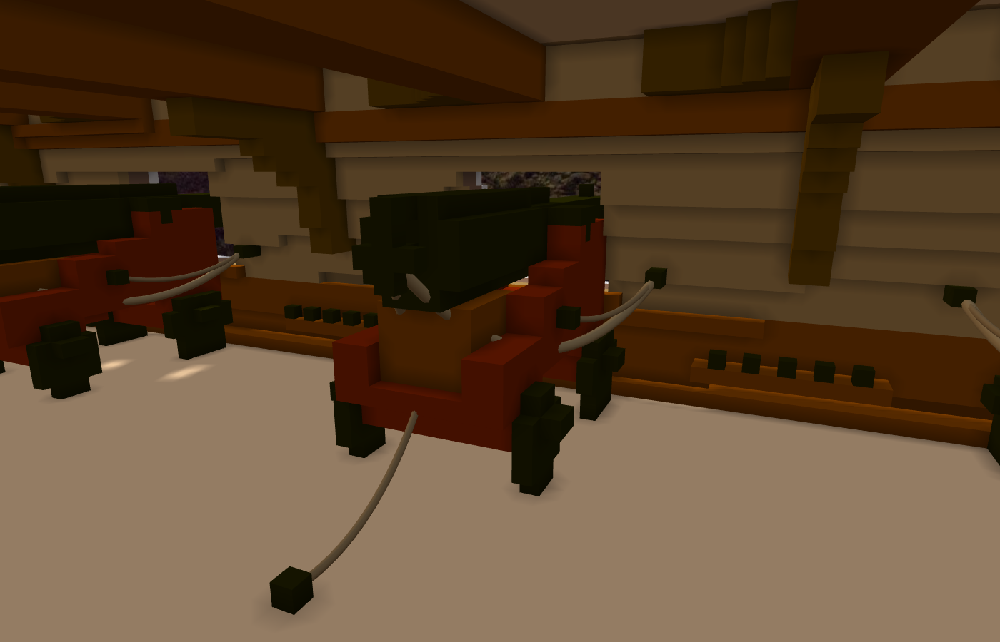
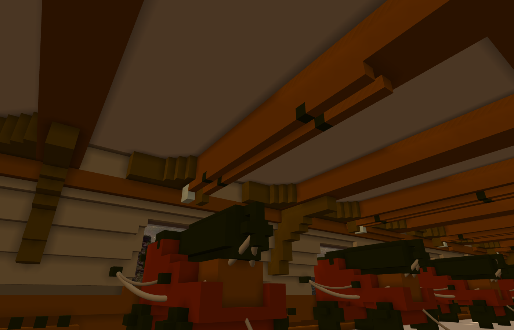

# 階段二十：一門砲，二十八次（2026-10-11）

> 規格與讀數在 [`../notes.md`](../notes.md)「階段二十」；設計與出處在 [`../design/plan.json`](../design/plan.json) 的 `guns`；新圖紙 [18](../design/sheet18_guns_v1.png)；擺放 [`../design/guns_placement.json`](../design/guns_placement.json)。

## 委託

Tim：「接著開始裝飾細節吧，可以加炮了。」

範圍備註第一天就寫好了：大砲這種重複出現的東西，先做成子作品，再匯入很多次。現在關聯可以掛同一件作品很多次、也可以鏡像，所以只雕一門。

## 先量砲門，再畫砲

查資料派了一個人：一八〇九到一八一六年 Cecil Iron Works 鑄的 24 磅砲，9 呎 6 吋，外徑從砲尾的 20 吋收到砲口的 12 吋；truck 前 18 吋、後 16 吋；axletree 4 呎 9 吋；cheek 分四階。今天船上那 30 門是一九二九年鑄的複製品。

本小姐這邊量 15 個砲門：中線離甲板 10 到 12 格，牆 4 到 5 格厚。作品的砲門比實船高一點（實船一八三三年之後下緣統一離甲板 2 呎），所以軸心放在甲板上方 11 格 —— cheek 前段因此 8 格高，比 26 吋的 cheek（約 6.6 格）高一格多：砲門比實船高，砲架就得跟著高。（原本這裡寫「約 7 格、對得上」，寫第二冊第十二章回讀時量出來是 8 格，更正。）

格子上的圓只有幾種形狀：9 格、13 格、21 格、25 格。外徑 20 吋和 19 吋在格子上是同一個圓。所以剖面不照尺寸逐吋抄，而是挑「會換形狀的那幾個半徑」，讓 base ring、兩段 reinforce、chase、muzzle swell 各自看得出台階。

## 擺：先貼牆，撞到就退

每一門先讓砲架前緣貼著船殼內面，撞到東西就往裡退一格；每一格都先試沿著船長左右挪一兩格。

- 第 2 個砲門在艦長室的側艙裡。第一版只撞到 4 格：兩個輪軸頭碰到艙房的隔牆。輪子改窄以後，它剛好塞在兩道隔牆中間 —— 實船也是，砲就放在艙房裡。
- 第 15 個在船頭。那裡船身半寬只剩大約 30 格，砲連砲架 32 格，兩舷的砲會在中線撞在一起。實船那個砲門是給 chase gun 用的。不放。

所以是 28 門，不是 30 門。

## 渲出來才看到的

- base ring 我給了最大的圓（5×5），從後面看像一塊黑磚。改小一級。
- 輪子兩格厚，從後面看像一顆顆黑球。改一格厚，外面加輪軸頭。
- 砲架的紅，渲出來偏亮橘。暗一級。

輪子改窄之後，擺放也跟著變了：第 2、13、14 門不用再挪那麼多。舊的位置其實也不撞，但掛在作品上的必須等於程式算出來的，不然下次重產就對不上 —— 6 條關聯改過去。

## 這一次的形狀

- 上一則跟 Tim 說「10 門不用動、2 門退 1～2 格、砲口伸出 4～7 格」，混了兩輪的讀數。寫 notes 時從 verify 重讀，最後是 9 門不動、5 門退 1 格、砲口伸出 5～7 格。數量詞要從檔案來 —— 又一次。
- 兩個環首螺栓第一次叫 eye-P／eye-S。砲自己的座標裡 x 是沿著船長，那兩個其實是船尾側和船頭側；右舷的砲鏡像到左舷，名字還是同一個。改成 eye-aft／eye-fwd。

## 然後：繩與砲彈（階段二十一）

Tim：「接著做 breeching 繩以及其他細節吧，GO。」

砲上已經有固定點了（砲尾的環、兩側的環首螺栓），缺的是另一頭：船牆上的環。每個砲門兩側各一個，甲板上砲後面一個；砲與砲之間靠牆一條 shot garland，上面排一顆一顆黑色的砲彈。

每一個環放下去之前，先量繩：砲尾拉到環、cheek 拉到環，這兩條線不准穿過別的東西；穿過自己這門砲的砲架不算 —— 實船的 breeching 本來就穿過 cheek 上的孔。另一舷鏡過去，也量一次。

艦長室那一門，船頭那一側貼著艙房的隔牆，找不到一個不穿牆的位置。那一側就不放環、不掛繩，照實記下來。

garland 有一條第一版插進了甲板：它跨過 570 那一道甲板的高低差，我拿兩門砲裡低的那層甲板去放，高的那一段就埋進了木板。只放在中心那一段甲板上，就好了。

一百三十六條繩，每一門五條。breeching 我留了一點鬆，砲推出去的時候，它本來就垂著。

## 再然後：梯子與桿子（階段二十二）

Tim：「接著做吧，GO。」照清單往下：ratlines、rammer 與 sponge、艦長室那一門缺的環。

ratlines 是繩，一道一道橫在 shrouds 之間。它們要綁在 shroud 上的某一點，而那些點不是固定點 —— 所以先試了一條：引擎把整數座標當格心、帶小數的照原值用。之後每一個端點都寫成帶小數，從 shrouds 的直線內插出來。340 道。topmast shrouds 往上收成一點，最上面幾道只剩一兩格，像一顆一顆的點，就不畫了。

rammer 和 sponge 是格子，加在砲具那一件裡。第一輪本小姐找牆的高度選在甲板上方 12 格 —— 那正好是砲門，找到的「牆」是砲管。第二輪放進去了，從上面看一對一對很整齊；從艙裡抬頭看，一根都看不到：它們貼在兩根橫樑之間的甲板板底下，橫樑有三格深，斜著看全被擋住。實船是掛在橫樑底下的鉤子上，那就掛在橫樑底下。

艦長室那一門，船頭那一側沒有牆可以釘環 —— 釘在艙房的隔牆上，朝著砲。

