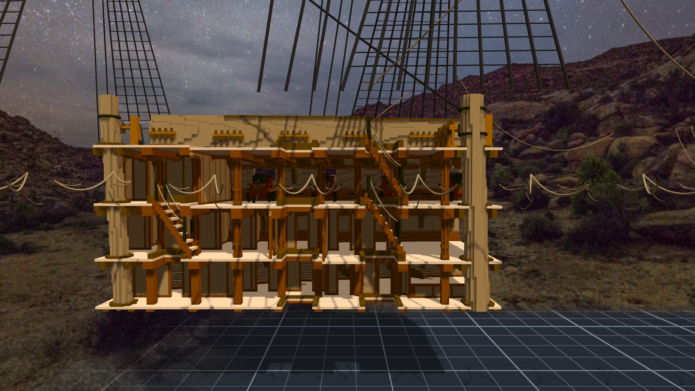
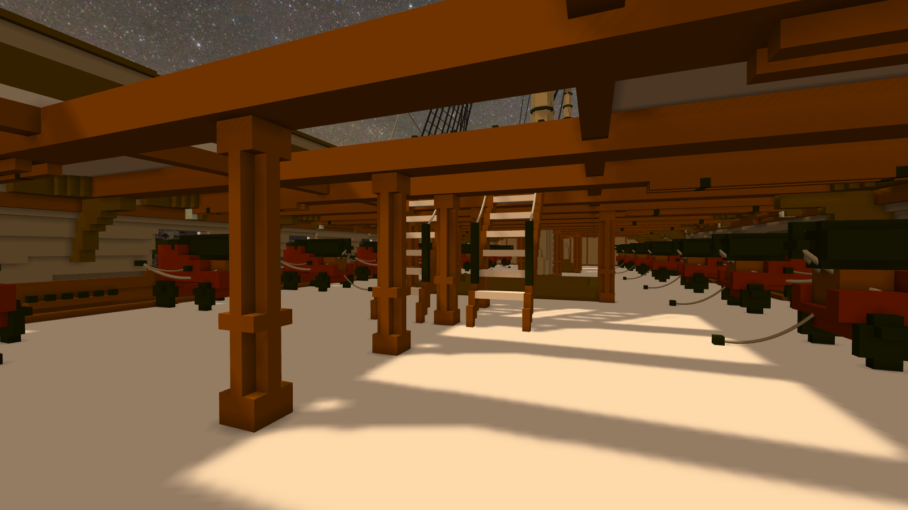

# 階段二十三：從艙口下去（2026-10-11）

> 規格與讀數在 [`../notes.md`](../notes.md)「階段二十三」；設計與出處在 [`../design/plan.json`](../design/plan.json) 的 `ladders`；新圖紙 [20](../design/sheet20_ladders_v1.png)。

## 委託

Tim：「接下來可以試著加樓梯嗎？（或是實際上船員是如何上下甲板的？）」

船上沒有樓梯間。甲板之間走的是艙口裡的陡梯：兩根側板、中間一階一階開放的踏板，上端扣在艙口的圍板上，旁邊垂一條 man rope 讓手抓。主要的幾座叫 main ladder、after ladder、fore ladder，艦長和軍官另外有一座 companion ladder。從小艇上船是爬船側釘的一排木條；上桅是 ratlines —— 那個上一個階段已經掛了三百四十道。

## 先量艙口

甲板階段開艙口時就寫了「不放格柵與梯子，之後另外做」，所以洞都在：七種，有的四層上下對齊，從上面看一路通到底艙。

量完第一件事是：梯子不能落在正下方。下一層同一個位置也是洞。梯子從上一層的圍板斜下來，要跨過下一層的圍板，腳落在洞外面。斜度定成每 3 格一階、往前 2 格，after hatch 的開口 13 格長（x 307–319），剛好不夠 —— 梯腳會多伸出去三四格（323、322），踩在下一層的甲板上。

## 讓它自己挑

每一座梯子試的順序是：往哪一邊斜、側板高 4 格還是 3 格、上端比圍板多出幾格。第一個「梯子每一格是空氣、頭頂淨空、梯腳外有路走、扶手繩不穿東西」的就用。先放的梯子算現況，後放的會讓開。

卡住的有三處：

- **fore scuttle 上面是 bowsprit 的根部。** 它從艙口正上方斜過去，中線上它的底面離甲板只有 6～9 格（x 605 → 617）。「頭頂淨空」那一條原本一路量到甲板上面，把 bowsprit 也量進去了。爬出艙口的人本來就要彎腰 —— 改成只量兩層甲板之間。
- **companion 的扶手繩擦到上一層（gun deck）艙口邊的橫樑。** 下柱改成可以往梯頂方向挪、柱子可以降低；最後是柱高 9 → 8 格解掉的，下柱位置沒動。
- **orlop 那一層一座都放不下。** after hatch 在 orlop 同一處也是洞，那一段梯子短，落不出去；fore scuttle 底下的 orlop 是實的甲板，但梯子會落進艙房（艙壁在 x 608、621）；companion 底下，梯腳正對著一根中線柱子。三處照實記下來，不硬塞。

after 和 fore 那兩組，上下兩座最後是平行疊著的：上面那座先放，佔住了反方向。從剖面看，像兩道一樣的斜線，一層一層往下。

## 這一次的形狀

- 回報給 Tim 的數字，這次是先從 verify 檔讀回來才送出的：7 座、1,872 格、扶手繩 14 條、組裝件 1,443,188。午休前那封信的「今天的形狀」寫的就是這一步。
- 而日記裡我把「bowsprit 離甲板不到一公尺」換成「7～10 格」—— 那是從一片不在中線的字元圖看出來的。一句模糊但沒錯的話，被換成一句精確、沒量過的話。量了：中線上 6～9 格。
- 那張工作用的側剖面圖，標籤第一次全部疊在一起。改成一列三張、標籤分兩行。

