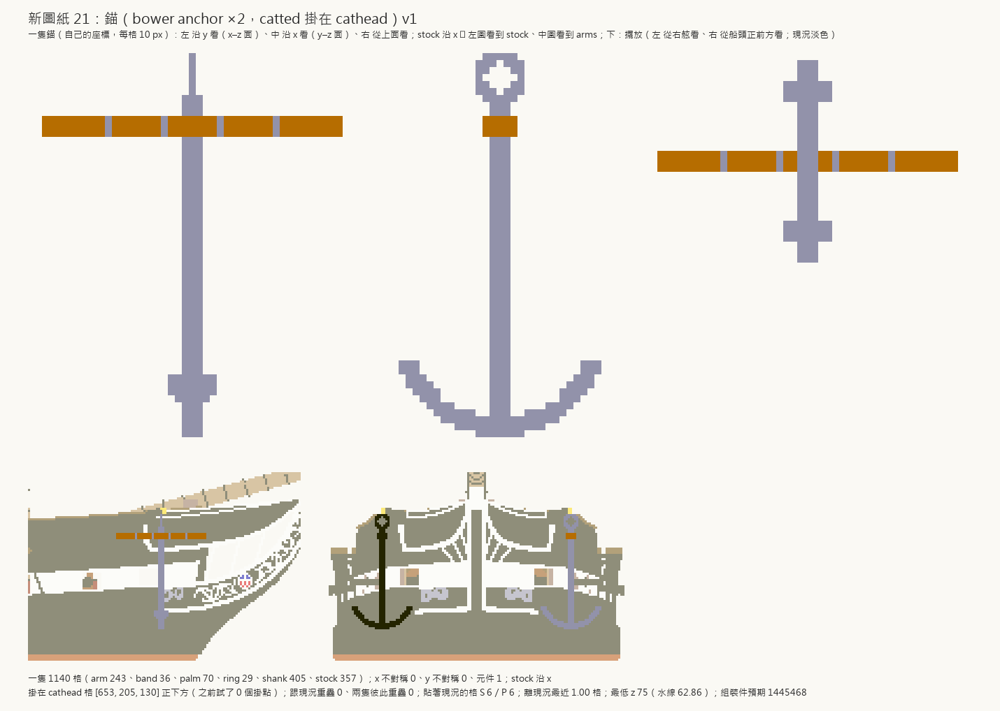
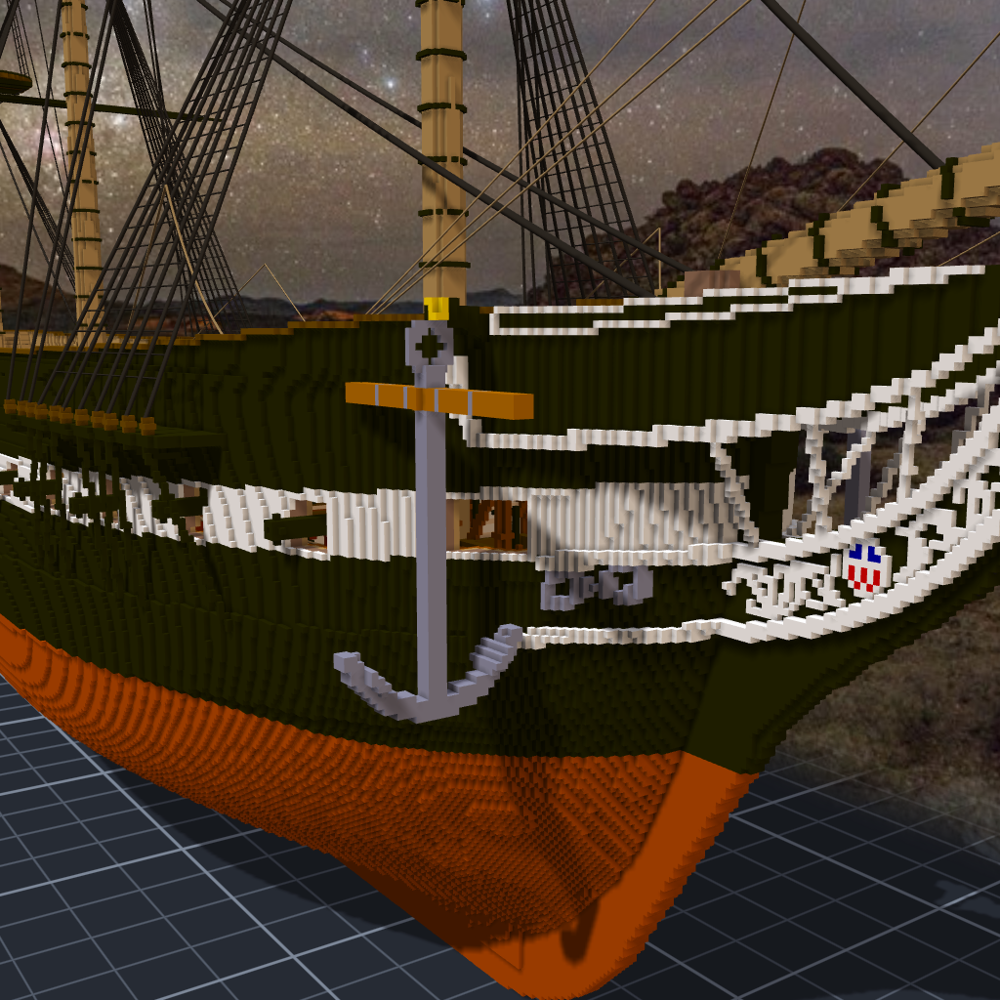
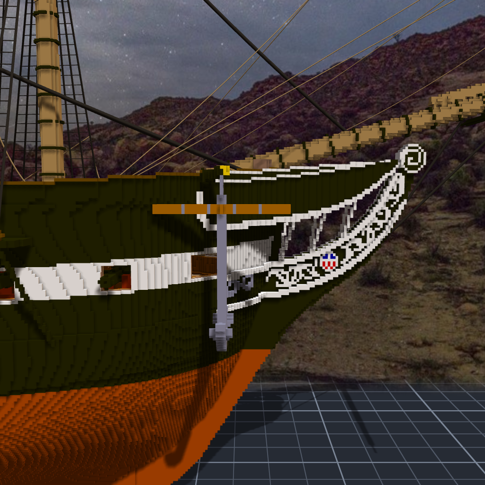

# 階段二十四：吊在船頭的那一隻（2026-10-12）

> 規格與讀數在 [`../notes.md`](../notes.md)「階段二十四」；設計與出處在 [`../design/plan.json`](../design/plan.json) 的 `anchors`；新圖紙 [21](../design/sheet21_anchors_v1.png)。

## 委託

Tim：「478 繼續造船吧」。沒有指定做什麼，候選清單排第一個的是錨。

## 一隻做一次

錨跟砲一樣：做一隻，用兩條關聯掛到兩舷，左舷那一隻是右舷的鏡子。樣子是 old pattern —— 一根直的 shank、底下兩隻彎上去的 arm、arm 內側貼一片 palm、頂上一個 ring，ring 下面橫著一根木頭的 stock，套兩組鐵箍。shank 4.8 公尺。這是這種錨常見的比例，我沒有查到憲法號原船那幾隻錨的數字，provenance 裡照實寫了「未查證」。

掛法選 catted：ring 吊在 cathead 的端面底下，錨直直垂下來。實船出海時會再把 crown 拉上來、綁在船側（fish），那一步留到之後。

## 讓它自己找掛點

程式從 cathead 的端面往船裡一格一格試：ring 頂貼在那一格正下方，兩舷都不撞現況的第一格就用。

第一輪一格都沒找到。量了才知道撞的是 stock：它沿船寬橫著，靠船裡那一頭插進船殼 57 格 —— 船頭這一段，船比我想的寬。換成沿船長，只剩 2 格：stock 的船尾端碰到一欄黑色的木料。stock 從 46 格縮成 42 格，端面那一格就過了。

## 兩個我自己的洞

錨本身量出來是 8 塊。七塊是 ring：一個半徑 3 的圓，每一格只靠斜角跟下一格碰在一起，6 連通的尺量起來是斷的。加粗一點就連成一塊了。

第一張渲染圖裡幾乎看不到錨，只看得到一根橘色的木頭浮在船頭外面。錨是黑的，船殼也是黑的。階段十五做 hawse 圈的時候已經撞過一次同一件事（黑貼黑看不見 ⇒ 鑄鐵灰）—— 這一次我又用了砲的黑，渲出來才想起來。改成同一個灰。

## 套上去

Tim 看了預覽：「測試ok 可以套用了」。組裝件 1,443,188 ＋ 2 × 1,140 ＝ 1,445,468，一塊、沒有空腔、兩隻錨跟船一格都不重疊。

最低的那一格在 z 75，水線上面十幾格。這艘船還在船台上，錨還沒有碰過水 —— 它現在的工作只是吊在那裡，讓船頭看起來像一艘要出海的船。
