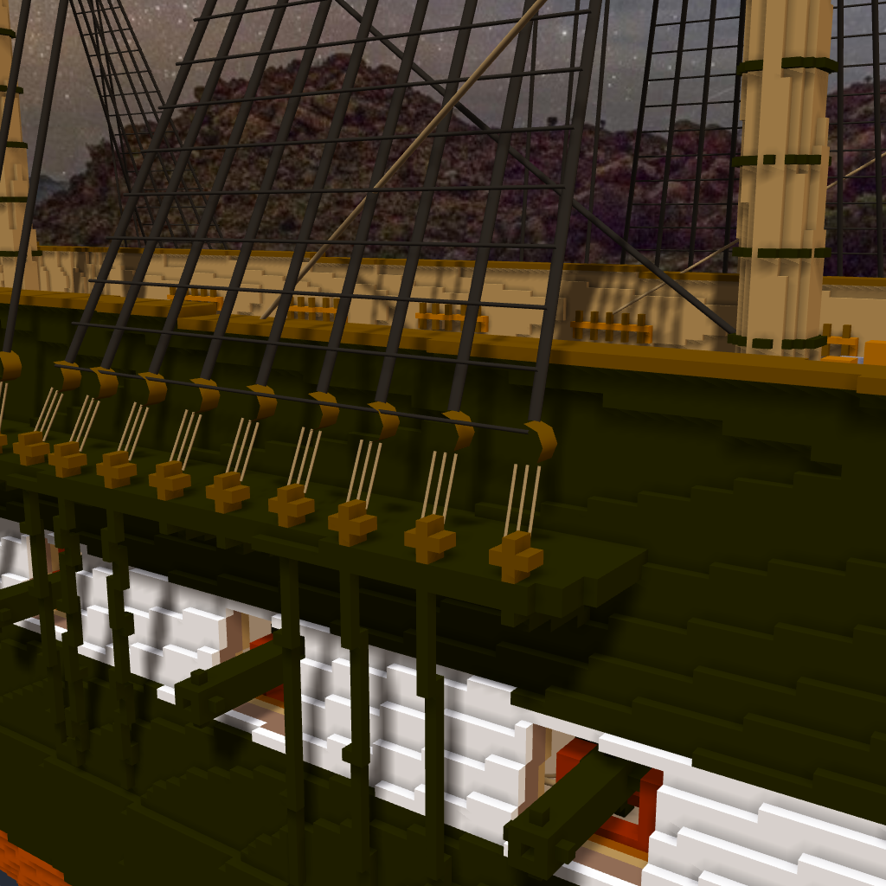
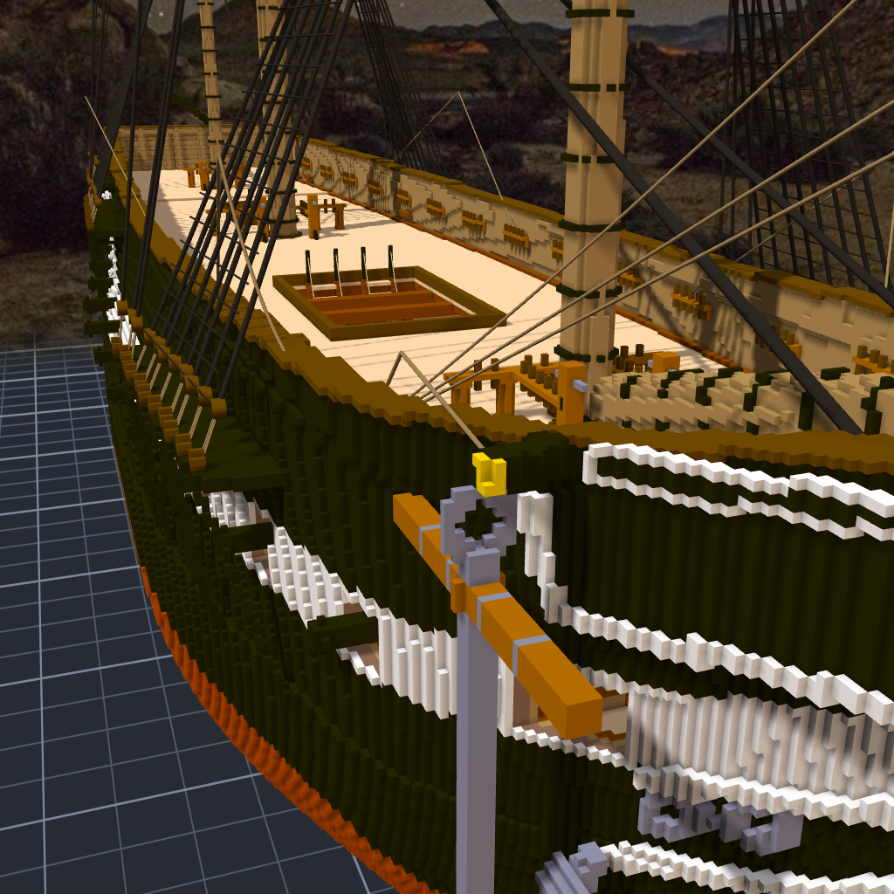

# 階段二十五：兩顆 deadeye 之間（2026-10-12）

> 規格與讀數在 [`../notes.md`](../notes.md)「階段二十五」；清單 [`../design/rig_deadeyes.json`](../design/rig_deadeyes.json)，工具 `design/tools/rig_deadeyes.py`。

## 委託

Tim：「照順序繼續做下一階段 GO」。

錨的下一步原本是 cat tackle —— 把錨吊在 cathead 上的那組滑車。量了才知道看不出來：ring 頂離 cathead 只有一格。看得到的只有 cat fall，從 cathead 拉回前甲板的那一條。它撐不起一個階段，所以順手掛上，然後往下一個候選走：lanyards 與上 deadeyes。

## 一條 shroud 的下端

之前的 shroud 是一條直線，從 channel 上的 deadeye 拉到桅頂。真的船不是這樣：shroud 的下端包著一顆上 deadeye，兩顆 deadeye 之間用細繩來回穿三次，收緊那條細繩，就把整根 shroud 拉緊。那條細繩叫 lanyard。

上 deadeye 不能用 voxel 做：它掛在空中，只靠繩子連著，做成格子就是一塊浮在空中的東西。我用的是一段很短、很粗的繩子 —— 軸朝舷外、直徑 3、長 2，跟下 deadeye 一樣大、一樣深的木色。從側面看，就是一個圓盤。

62 條：lower shrouds 46、backstays 16。每一條多一顆圓盤、三條 lanyard，shroud 本身短了將近九格。

## 一條會穿牆的繩

cat fall 第一版是一條直線：cathead 端到前甲板的 pin。渲出來，繩子往船尾拉，直接鑽進舷牆。量了一下，200 個取樣點有 52 個在實心裡。

真的 cat fall 要越過 rail 才進得了甲板。我讓程式在 rail 上方找一個轉折點，條件是兩段都不碰實心。試了 x、y、z 一整片，只有最高那一層（z 133.5）過。那時繩子從 cathead 端往上越過 rail，再落到 pin 上。

## 量的時候

中間那條 lanyard 最下端，每一條都碰到實心。量了碰到的是什麼：全是下 deadeye 自己的顏色，而且只在最下端那一點。那是 lanyard 穿進 deadeye 的地方 —— 本來就該碰到。

## 拿掉

Tim 看了船頭那張：「錨我覺得不用繩子 看起來有點怪」（原文打成「茅」，我讀成「錨」）。

我回頭看那張圖，也看得出來：一條細繩從金色的端面斜斜往上越過 rail，在那個角度像是有人忘了收的一根線。它是照真船的做法掛的，量過不穿牆，可是好不好看是另一把尺。四段都拿掉了，工具也不再產生它。上面那張圖留著，當作掛過的紀錄。

這一階段一格 voxel 都沒動。船還是 1,445,468 格，多了 248 條繩 —— 都在兩顆 deadeye 之間。
