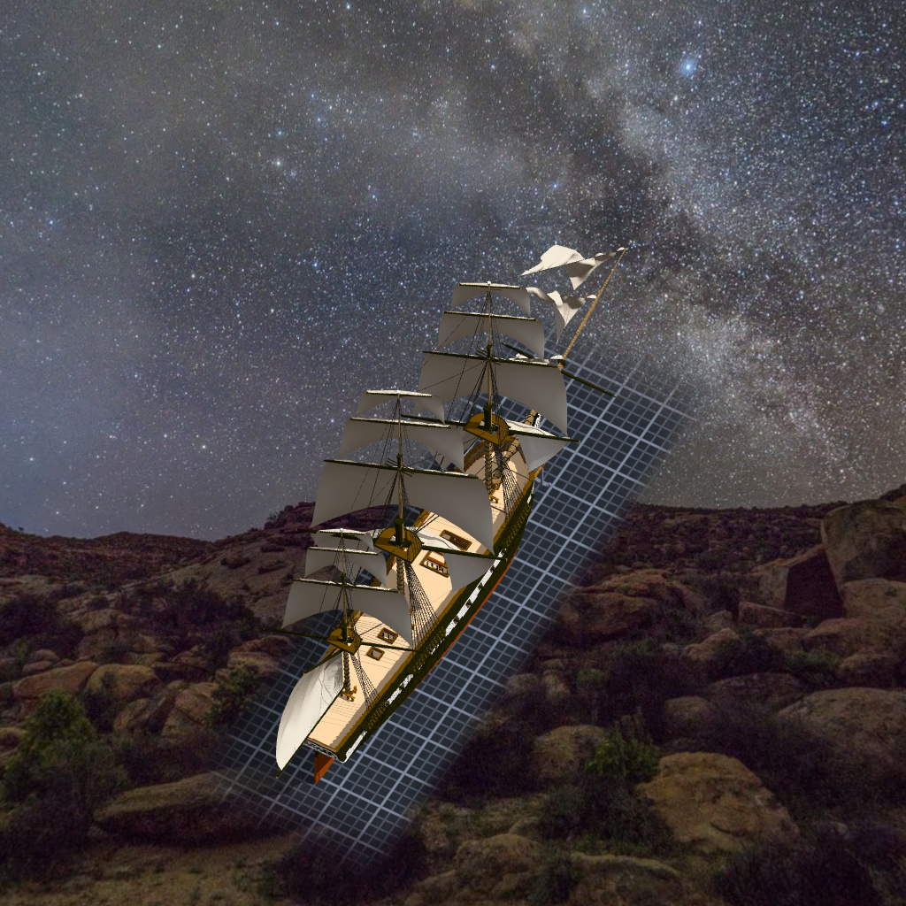
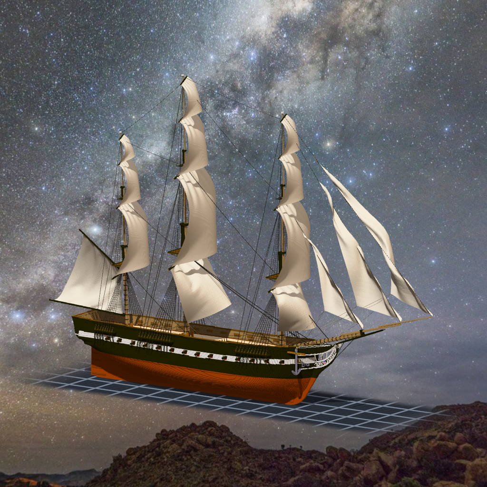

# 階段二十六：帆桁轉過來（2026-10-12）

> 規格與讀數在 [`../notes.md`](../notes.md)「階段二十六」；設計在 [`../design/plan.json`](../design/plan.json) 的 `brace`；新圖紙 [22](../design/sheet22_brace_v1.png)。

## 委託

Tim：「照順序繼續做下一階段 GO」。候選清單往下數，輪到帆桁轉角度。

掛帆那天我寫過一句：從正側面看，方帆像一條條彎弧 —— 帆桁是正橫擺的，從側面看剛好是帆的側緣，不是錯。不是錯，可是船看起來像停在港裡。真的船出海時，帆桁會繞著桅轉一個角度，讓帆對著風。

## 先證明我重做得出原本那一份

帆桁是三天前用另一支程式雕進桅杆裡的。要轉它，得先刻掉舊的、再蓋上轉過的 —— 而新程式算出來的「舊的」，要跟真的雕在那裡的逐格一樣，否則我刻的是我以為的東西。

所以第一件事是把角度全設成 0 跑一次：三根桅 15,341 格逐格相同、320 個固定點逐點相同。對上了，才跑真的角度。

中間停過一次。summit 在同一棵樹上給作品書卡加標籤，新的書卡舊引擎讀不懂，組裝件一匯出就被擋下。我在酒館跟她說了，等她出廠再接 —— 那是她施工到一半的東西。

## 角度

預設的風從右舷後方吹來。帆要對著風，所以右舷那一頭往前。正對風是 18.4°，我取下層 20°、往上每層多 2°：上層多轉一點，整根桅看起來像一棵往一邊彎的樹，不像一排複製的十字。

後桅 topgallant 兩頭的 yardarm 浮空了 7 格。只有一格粗的地方轉了角度，變成一級一級的階梯，格子之間只靠斜角碰在一起。把最細的截面從 0.5 加到 0.75 —— 斜線上的格心離軸不會超過 0.71 —— 就連起來了。

## 帆跟著走

帆的四個角綁在帆桁的固定點上。固定點沿轉過的軸重算、重新登記，帆就跟著轉了。只有一個地方要先改：算帆下角的程式，左舷那一角原本是拿右舷鏡過去的。帆桁一轉，左右就不再對稱。改成左舷讀左舷自己的點，先在沒轉的狀態重算一次，跟原本逐位元組相同，才拿去用。

Tim 看了：「測試ok 可以套用了」。三件桅杆一起套上去，組裝件 1,445,468 → 1,445,296，一塊、沒有空腔。

船還在船台上。但從側面看過去，帆已經不再是一條條側緣，是一片片斜著吃風的布。
