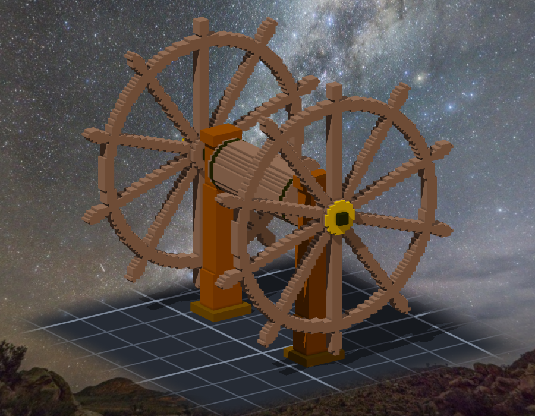
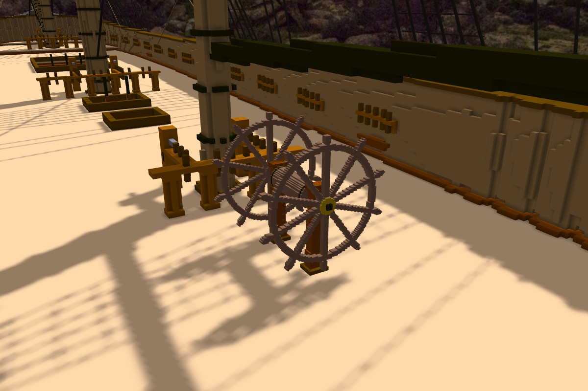
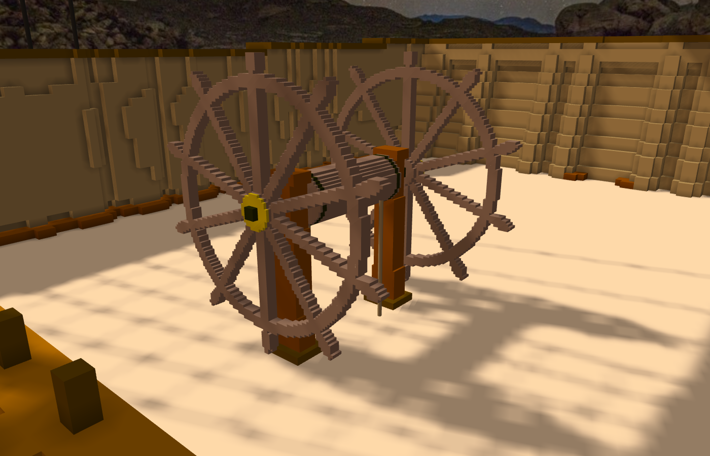

# 階段二十七：舵輪 —— 不雕進格子裡的東西（2026-10-12）

> 規格與讀數在 [`../notes.md`](../notes.md)「階段二十七」；設計 [`../design/draft_wheel.py`](../design/draft_wheel.py)；子作品 `basecamp-frigate-constitution-01m-wheel`。引擎那一半是 TASK-0507（SCP_Core 1c1a4d3、Senate a4ab135）。

## 委託

Tim 這一次先要的不是船的部件，是引擎的新功能：

> 「目前希望加一個新功能 可以把模型匯入(可以先只支援obj) 支援旋轉 縮放等基礎功能 然後線也可以綁在外部模型上(用相對座標 外部模型移動 也會跟著動) 然後也可以指定其他模型作為外部模型(類似子模型 但不匯入voxel而是輸出成模型後匯入 可以輸出模型緩存在本地)」

做的中間他又補了兩件（沒有留下原文，這裡是轉述）：船上細的部件用更細的子作品（0.02 m 一格）來做；渲染的共用部分整理進共用層。

## 引擎

- 作品可以掛 obj 當外部模型：位置、轉軸點、任意角度旋轉、縮放、鏡像；拿掉之後作品的 voxel 一格不變。
- 也可以拿另一件作品當模型：匯出成 obj 快取在本地（不入版控），來源改了下一次觀測自動重出；比例照兩件作品「一格幾公尺」自動換算。
- 繩的端點可以寫 `model:模型名/點` —— 模型轉、搬、縮，繩端跟著到對的位置。
- 網格建構（voxel 外露面、繩、帆、模型）搬到 SCP_Core；搬家前後同一份場景的網格 digest 逐位元相同。沒有模型的作品，export obj 逐位元不變。

## 舵輪

資料：雙舵輪，裝在 quarterdeck；1812 年原本那副被 Java 號打掉，換上的是 Java 號的（USS Constitution Museum）。輪徑、輪幅數 ⚠ 未查證（10 根是模型論壇的說法）⇒ 照一般巡防艦的比例：輪徑約 1.7 m、輪軸離甲板 1.12 m。

子作品 0.02 m 一格、100×104×104：兩個輪在兩根支柱外側、中間是鼓輪（兩頭鐵箍）、黃銅輪轂蓋。44,456 格，左右對稱差 0。

它**不是關聯**，是組裝件的外部模型：匯出成 obj、縮 0.2 掛上船，7,740 個三角形。位置在後桅 fife rail 往船尾那一段空甲板上（x 172.5）；上方的 spanker boom 在 z 133。

兩條舵索綁在模型上的點 `model:wheel/drum-rope-a／b`，往下穿進甲板。驗：模型轉 90°、搬 10 格 ⇒ 繩端到手算的 (183.8,157.8,115.9)；改回原位，讀數回來。

Tim 看了：「測試ok 單層提交吧 然後build」。

## 一個洞，和我說大的一句

成環檢查有一個洞：加模型時會擋「A 拿 B 當模型、B 又拿 A」，但加**關聯**時只看關聯、不看模型。Tim：「這個開task」⇒ TASK-0508。
我在單上的第一則留言寫「改成 improvement」—— 可是那一道 update 根本不吃 type，exit 2、什麼都沒寫。我沒看上一步的 exit 就寫了結果，下一則自己更正。
後來 ame 在淨室重現、修好（Senate 59bef17）。
