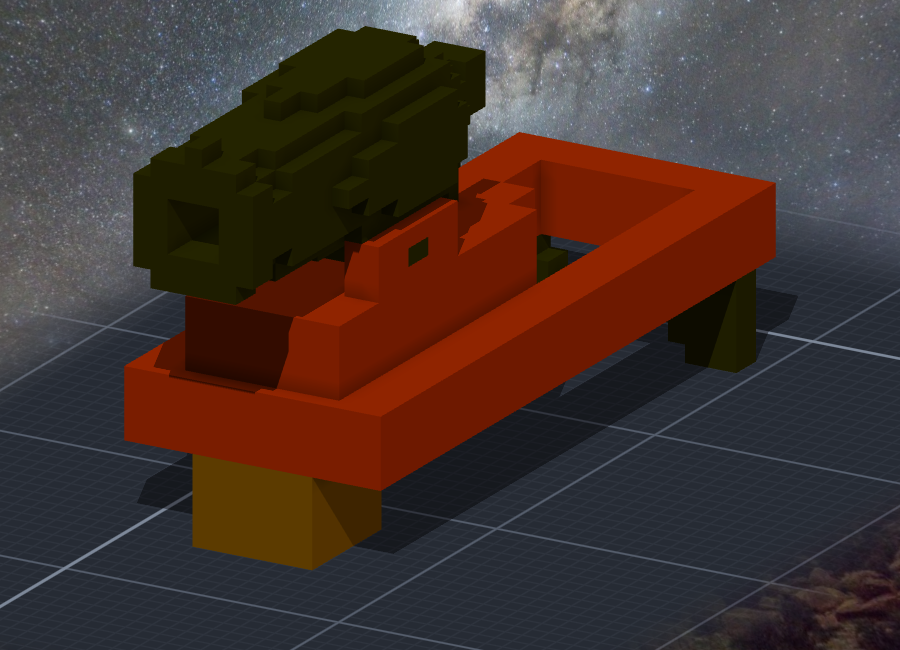
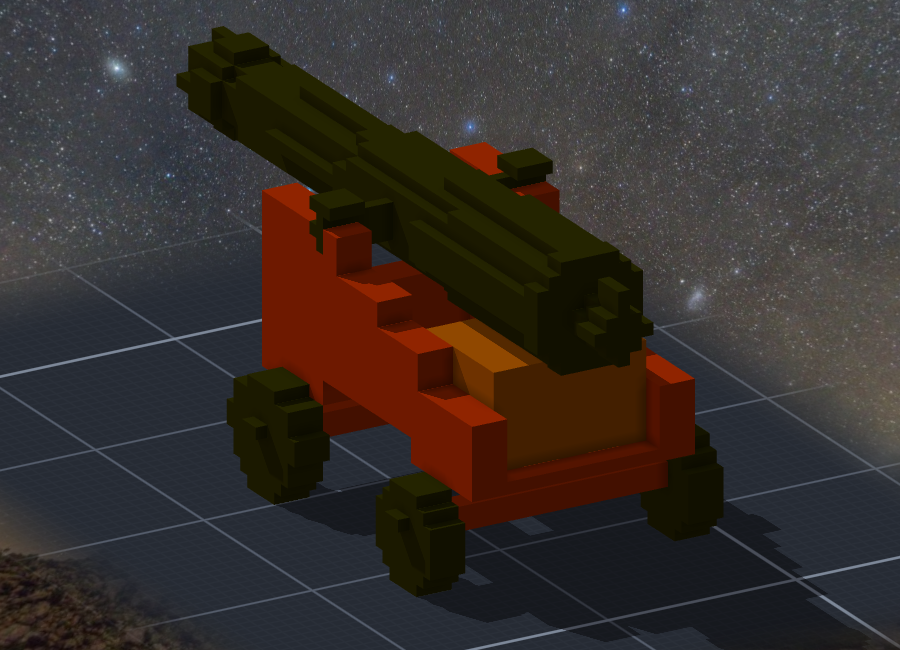
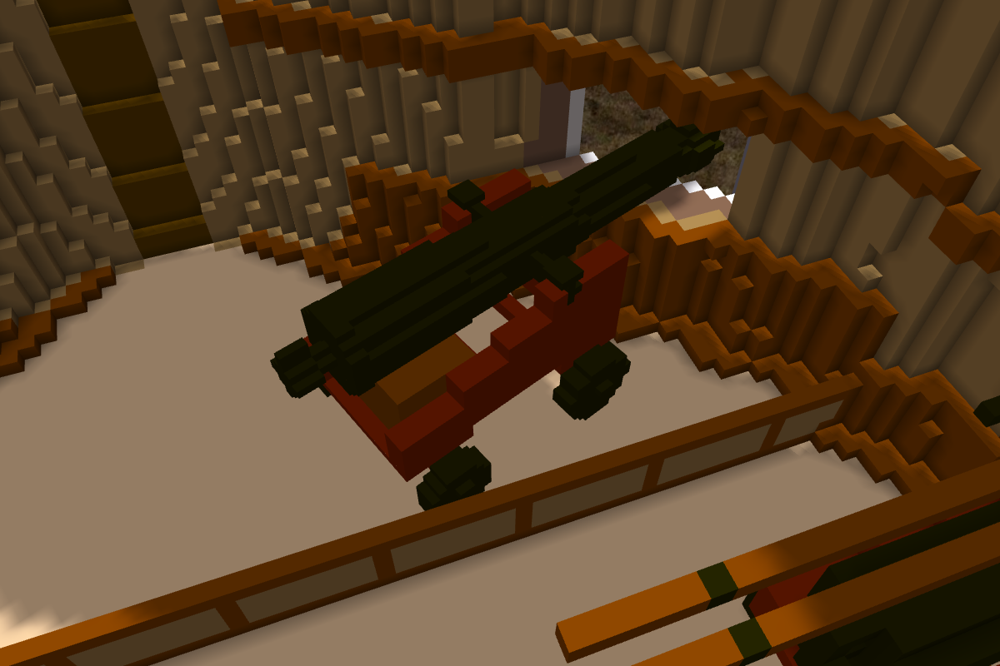
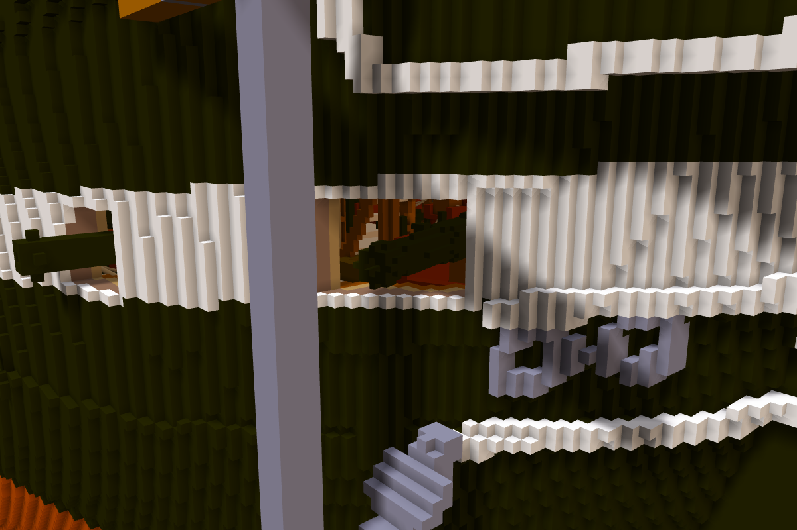

# 階段二十八：第二批砲 —— 32 磅 carronade 與 18 磅 chase gun（2026-10-12）

> 規格與讀數在 [`../notes.md`](../notes.md)「階段二十八」；設計 [`../design/draft_guns2.py`](../design/draft_guns2.py)、擺法 [`../design/place_chase.py`](../design/place_chase.py)。

## 委託

Tim：「繼續造船吧 GO(可以做其他口徑的炮 然後也用子模組 0.05m精度)」。

## 配置

1812 年照 NHHC 與 USS Constitution Museum 一致的那個版本：spar deck 24 門 32 磅 carronade、船頭一門 18 磅長砲。⚠ 別的來源有 20／22 門 carronade、兩門 24 磅 bow chaser —— 當年沒有固定編制、紀錄不全。

## 32 磅 carronade（0.05 m 一格）

15×54×26、3,543 格：skid 2.0 m（兩根側軌、前端樞軸墊、後端兩個沿船長橫移的小輪）、slide 1.0 m、砲身 1.15 m（後膛半球、往前收、砲口外翻）。⚠ 尺寸是推算的：約 7 倍口徑；整組照 Chapelle p.516 的 42 磅乘 (32/42)^(1/3)。

第一版把砲擺在 skid 的後半，砲口離前端 0.6 m —— 伸不出砲門 ⇒ undo、重落。

## 18 磅長砲（0.05 m 一格）

27×66×28、6,565 格：9 ft 砲身（外徑照 24 磅那門按口徑比例縮）、truck carriage（cheek 4 階、前輪大後輪小、床板與 quoin）。⚠ 尺寸推算。兩件左右對稱差 0。

## 第十五個砲門

gun deck 船頭那個砲門（S 舷）一直空著：24 磅砲只能轉 90°，兩舷會在中線撞（第十二章）。chase gun 是斜著指向船頭的那一門。

搜尋：每個角度沿砲身往裡退，退到模型每一格的格心和八個角都不在實心格裡，再要求砲口在船殼外。往船頭偏 5～20° 推得出去、25° 砲口出不了砲門、30° 以上塞不進去 ⇒ 取 −20°：砲口伸出下檻外面 2.5 格、在開口的中段。P 舷那個船頭砲門照舊空著（只有一門）。

比例要明寫：gun deck 子作品沒有記「一格幾公尺」（0），作品當模型的自動換算就拿預設的 1/32 m 去除 ⇒ 0.05 ÷ 0.03125 ＝ 1.6，不是 0.5 ⇒ 寫死 0.5。差一點就是一門大三倍多的砲。

carronade 還沒上船 —— spar deck 的砲門要先讀圖、開舷牆。

Tim：「測試ok 單層提交 然後繼續開spar deck砲門 GO」。
