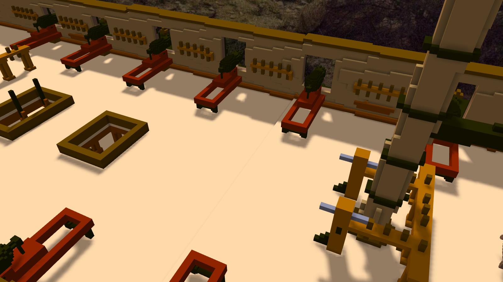
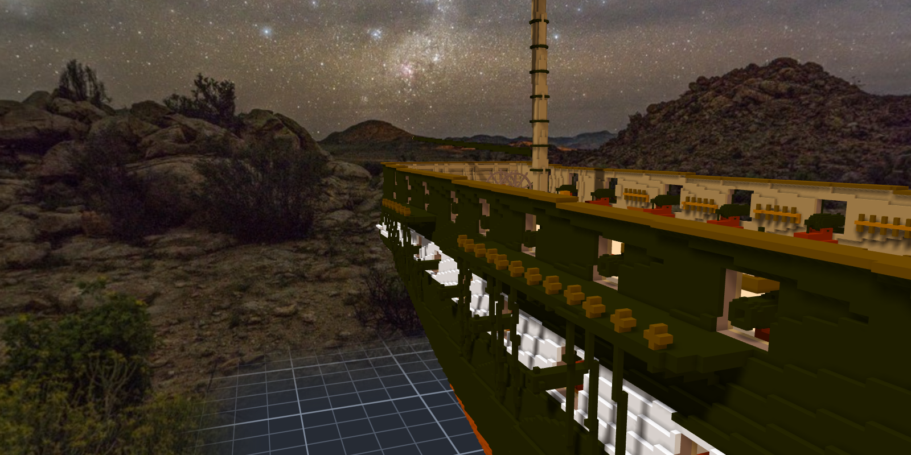
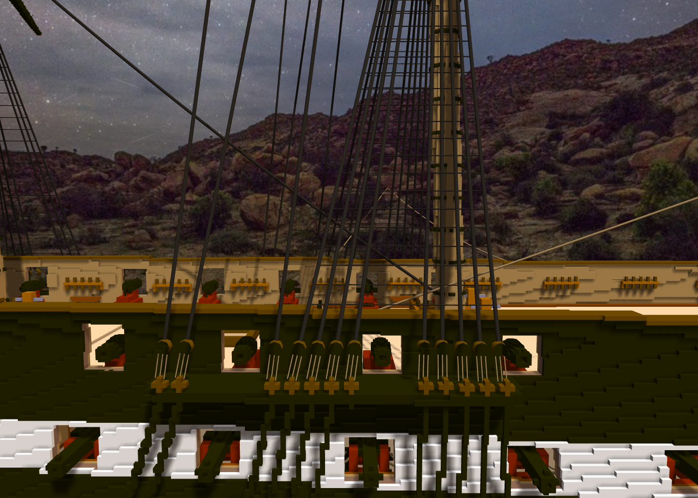
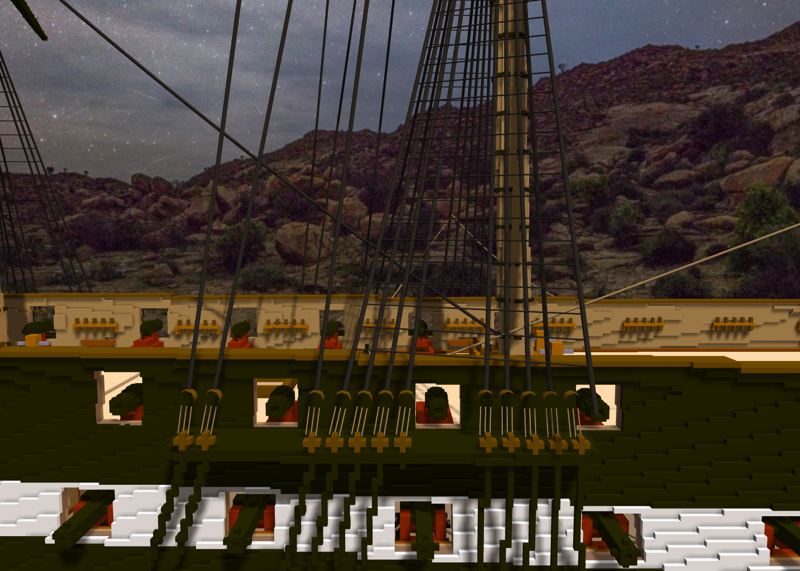

# 階段二十九：spar deck 砲門、24 門 carronade、掛在繩上的繩（2026-10-12）

> 規格與讀數在 [`../notes.md`](../notes.md)「階段二十九」；讀圖 [`../design/read_spar_ports.py`](../design/read_spar_ports.py)、設計 [`../design/draft_spar_ports.py`](../design/draft_spar_ports.py)、[`../design/draft_channels_v2.py`](../design/draft_channels_v2.py)、擺砲 [`../design/place_carronades.py`](../design/place_carronades.py)。引擎那一半是 TASK-0511（子繩）與 TASK-0512（繩分組）：SCP_Core d48e4ab、Senate 2f5cf4c。

## 委託

Tim：「測試ok 單層提交 然後繼續開spar deck砲門 GO」。spar deck 的砲門原本說好跟可動件一起做 —— 外部模型做好了，條件到了。

## 讀圖與量測

11 號 sheer plan 舷牆上那一排方框：逐欄數亮像素找豎線，相鄰兩條配成一個砲門，再沿豎線找上下端點。一舷 12 個：quarterdeck 8、forecastle 4（最前面那個寬 13.6 格）。上緣都在 cap rail 下面。

動刀前先量：舷牆 4～5 格厚；z 109～110 舷外有一條黑木（channels 那件），有幾個砲門連牆厚範圍裡都有它 ⇒ 下緣統一從 111 起。舷牆內面的 pin rails 壓在第 4、5、9、12 個砲門上。

船殼刻 10,676 格（兩舷各 12 個）。pin rails 改照砲門的空檔重排：拿掉 337、放 330 格；第 12 根的空檔只夠四根栓 ⇒ pinrail-12.pin-5 拿掉（上面沒有繩）。

## 24 門 carronade

上一階段做好的 carronade 當外部模型掛上 spar deck，每個砲門從舷牆外面往裡退到零碰撞。skid 前緣只能頂到舷牆內面（下檻以下的牆還在），牆 0.45 m 厚、砲口只超出 skid 0.35 m ⇒ 縮在牆裡一兩格。把砲身在 slide 上往前推 4 格（砲口超出 skid 0.55 m）⇒ 齊平到伸出一格。24 門砲軸都在開口的中段，兩舷逐門對稱。

## 「這幾個被纜線擋住了」

Tim 貼了兩張截圖。channel 上的 deadeye、lanyard、shroud 擋在後桅、主桅、前桅那幾段砲門前面 —— channels 是第十八階段做的：deadeye 從桅前往後等間距排，只有 chain plate 會避開 gun deck 的砲門；那時 spar deck 還沒有砲門。

channels v2：deadeye 的數量和名字不變，改擠在砲門之間 —— 間距 4 格（deadeye 3 格寬、空 1 格），本體和上面那段 shroud 離砲門至少 1 格。第一輪用間距 5、餘裕 2：後桅最後兩個掉出子作品的框、主桅最後一個散到 248 ⇒ 收緊。

途中量到一件事：todo 寫「照 rig_points_channels.json 重新登記固定點」—— 引擎裡登記的其實是 rig_standing.json 那 31 個，那份從沒登記過。

Tim：「另外先記錄一下計畫 準備先告一段落休息一下」。計畫寫進 todo，午休。

## 掛在繩上的繩

醒來，channels v2 跑完、要重拉繩子的時候，Tim 說先不要：

> 「另外目前想追加一個新功能 所以纜索相關先不加(目前想要可以在繩子之間掛子繩 且子繩渲染儘量精簡)」
> 「用來處理之前掛在虛空的線(且目前現有點太多 應該要可以分組開關控制 而非單條控制) 這個也開task」
> 「子繩本身不用算物理(直接綁定母繩的某個位置 例如0.1 0.2位置 跟著兩端的母繩動)」

量了一下：909 條繩裡有 652 條至少一端是裸座標。ratlines 340 條兩端都在 shroud 上，是我用程式沿 shroud 內插出座標、再一條一條下的 —— shroud 一動，它們就掛在虛空裡。

TASK-0511（子繩）、0512（分組）。端點寫 `rope:<繩名>/<比例>`，落在母繩實際的曲線上；子繩兩端拉直、不算物理，畫成 3 邊的細管（一段 6 個三角形，一般細繩 16 個）。繩可以歸組，一組一組開關。

## 套上船

ratlines 改成掛在最前與最後那根 shroud 上。起點改從上 deadeye 頂往上 7 格 —— 以前從下 deadeye 起算，最下面幾道跟第二十五階段才加的上 deadeye、lanyard 擠在一起 ⇒ 340 → 328 條。897 條全部分進 17 組。

驗的時候我先說了一個數：關掉 shroud 那一組應該藏掉 374 條（46＋328）。量出來是 218 —— topmast 的 ratlines 掛在 topmast shroud 上，是另一組。那個數是我在腦子裡加的。

Tim：「測試ok 套用草稿然後單層提交吧」。船殼、pin rails、channels 三份草稿一起套上去：1,445,296 → 1,434,874，一塊、沒有空腔；繩 897 條，斷掉的 0。

## 套上去之後補量

關掉 ratlines 那一組：橫繩全部沒了，shroud 照畫。

把一根 shroud 的下端往舷外挪 14 格：ratlines 的那一頭跟著收到新的線上（看完改回原位）。

驗收時自己抓到一個錯：只畫 ratlines 那一組（`rope_groups=ratlines/lower`）時一條都沒畫 —— 母繩只是沒被點到，子繩卻跟著藏起來。改成只被「這次只畫哪幾組」篩掉的母繩不連帶。
