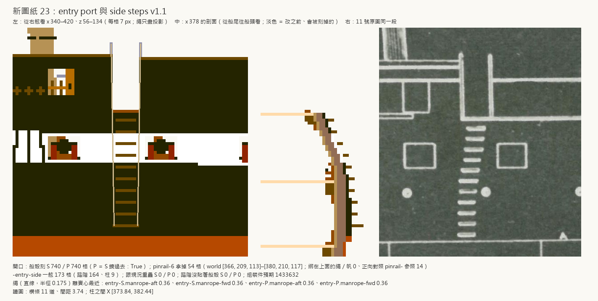
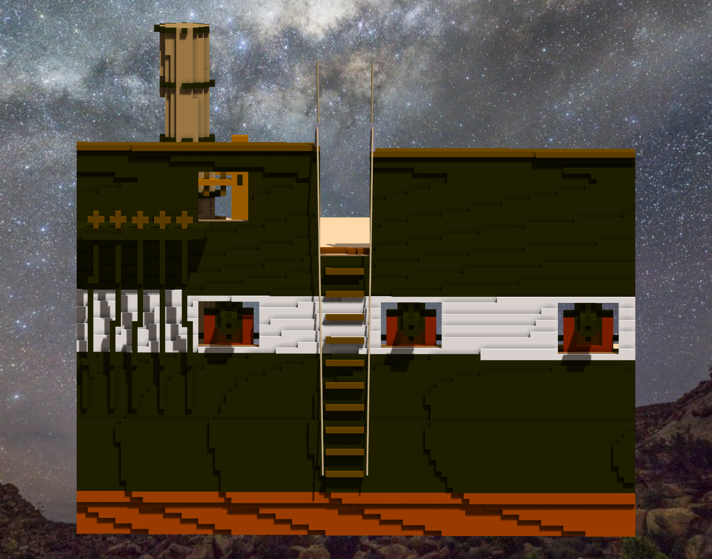
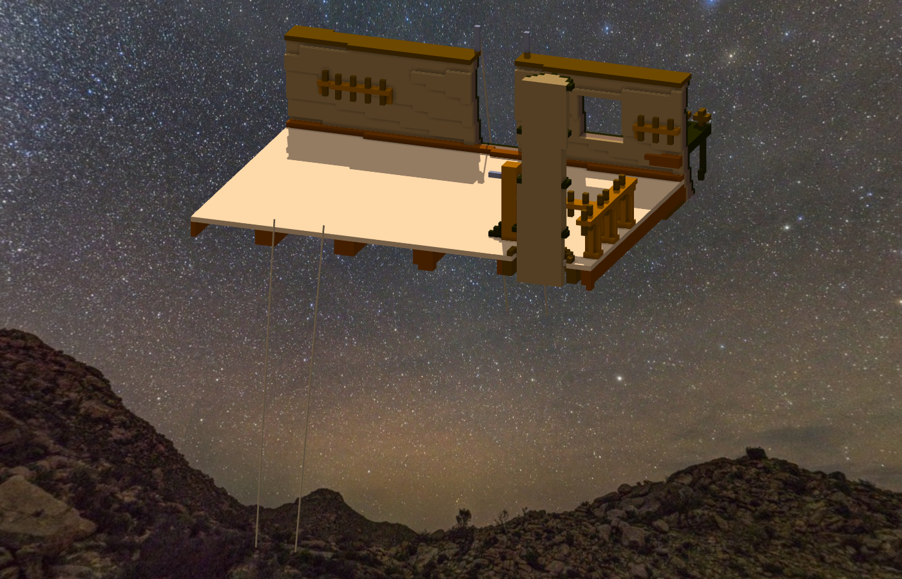
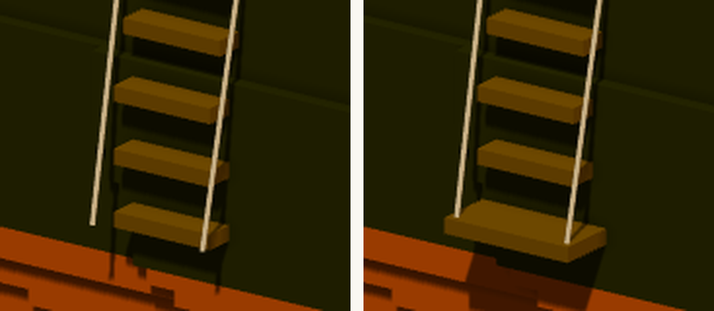
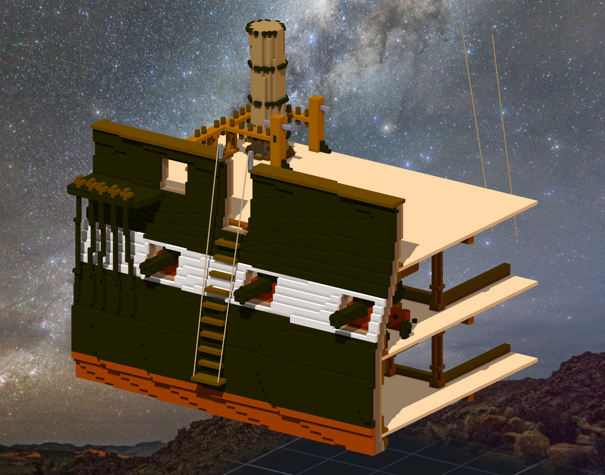

# 階段三十：entry port 與 side steps —— 從小艇上船的那一處（2026-10-12）

> 規格與讀數在 [`../notes.md`](../notes.md)「階段三十」；讀圖＋設計 [`../design/draft_entry.py`](../design/draft_entry.py)（設計在 plan.json `entry`）、新圖紙 [`../design/sheet23_entry_v1.png`](../design/sheet23_entry_v1.png)、驗收 [`../design/verify_entry.json`](../design/verify_entry.json)。提交：Sculpture f2175e7（v1）、828ddf2（v1.1）。

## 委託

Tim：「繼續造船吧 GO」—— 沒指定 ⇒ 照候選清單第一個：船側 side steps 與 entry port（階段二十三的筆記寫過「從小艇上船走船側 side steps」，一直沒做）。

## 讀圖

先上網查：只回來幾句搜尋摘要（Falconer 海事辭典的 gangway 條：船側釘一排踏階到接近水面；1771 大英百科 entring-ladders：港內、天氣好時走船側的踏階）—— 原文沒打開，也沒有這艘船自己的資料。

回到 11 號（1927 MIT PLAN VIII）sheer plan：主桅 channel 前、gun deck 第 6／7 個砲門之間畫著一排 11 道橫條，正上方舷牆斷開一個口、兩側各一根柱子。上一階段讀 spar deck 砲門時，框的右緣停在 x 2130 px，第一根柱子在 2168、橫條在框的下面 —— 同一張圖讀過一次，沒框到。

讀數（`source_entry.json`）：橫條 Z 64.96–102.38、間距 3.742、寬約 7 格，最上一道的中心比最下一道往船頭偏 3.83 格；柱內緣 X 373.84–382.44、頂 Z 129.58／128.85。水線那條讀出 62.65（作品 LWL 62.86）。

## 設計（美觀優先）

- 開口 x 374–382（9 格），從甲板面上一格切穿 cap rail，兩舷各刻 740 格（左舷 ＝ 右舷鏡過去）。
- 踏階 10 道，等距 4（z 66–102；圖上 3.74 取整數讓每道一樣）、取直、照開口置中；一道 1 格高、凸出 2 格，一欄一欄從船殼外面貼上去、外面齊平；色 104（cap rail 的深木色）。
- 兩根鐵柱（146）立在開口兩側 cap rail 的外緣、頂 z 128 —— 放外緣是手算的：繩從柱頂往下往外走，柱在欄杆中間的話繩會穿過欄杆。
- 開口裡站著 pinrail-6（5 根栓）：綁在上面的繩／帆 0（同一把查詢查所有 pin rail 有 14 筆）⇒ 整根拿掉。
- 子作品 `-entry-side`（一舷）＋組裝件關聯 舷梯／舷梯-鏡像（mirror=y）。

## man ropes

每舷兩條，柱頂 → 最下一道踏階的兩端。第一版下端在踏階兩端旁邊 ⇒ 直線的中心線在 z 87–91（白帶下緣一帶）進到船殼裡 —— 船身往下變寬。往外 1 格 ⇒ 前面那根在 z 85 還差 0.06（x 382 的船殼比 x 374 寬一格）⇒ 1.5 格。引擎的固定點只收整數格、要在子作品框裡 ⇒ 框 y 14 → 15、鏡像 at.y 91 → 90。最近 0.43（不算兩端）。

一條繩寫入時 IOException（要被取代的檔案移不掉），讀回 3 條 ⇒ 補那一條、讀回 4 條。另外三張預覽圖寫進了同一個檔（shell 把 `\\$n` 吃成字面的 `$n`），三次都回報成功 —— 檔在自己的 scratchpad，刪掉、改用正斜線重渲。

## 套用

草稿：組裝件 1,434,874 → 1,433,588（＝ −1,480 −2×54 ＋2×151），一塊、沒有空腔。Tim：「測試ok 套用草稿然後單層提交吧」⇒ 三件 apply、unanchor pinrail-6 的 5 個固定點。

重跑產生程式要對 sha256 —— 跑不起來：找 pinrail-6 的種子讀的是作品**現在**的 anchors.json，那 5 個剛剛才拿掉 ⇒ 改讀設計檔 spar_ports_anchors.json；三份清單跟套用前逐位元組相同。提交 f2175e7。

## 「好像綁在虛空中」

Tim 貼了一張截圖：「另外這個好像綁在虛空中(船的外殼梯底部)」—— man rope 的下端停在最下一道踏階外面 1.5 格的空中。

我量了繩離船殼多遠，沒量繩端綁在什麼上面。上一階段才把 652 條「掛在虛空的線」改成子繩，這一階段自己又掛了四條。

v1.1 改踏階、不改繩：最下一道加寬到開口那麼寬（x 374–382）、凸出 4 格 ⇒ 外側兩角正好是繩端那一格；固定點與繩都不動。一舷多 22 格（舊的 151 格一格不變），組裝件 1,433,632；繩離實心最近 0.36（繩端要埋進踏階角的上面那一格）。Tim：「測試ok 套用草稿然後單層提交吧」⇒ 828ddf2。

