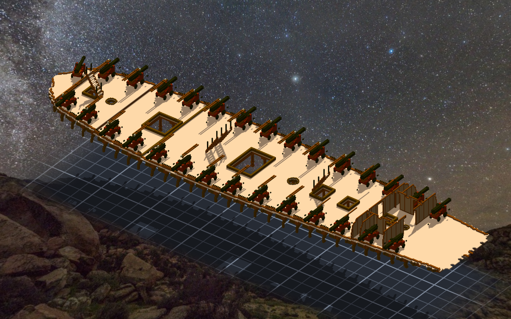
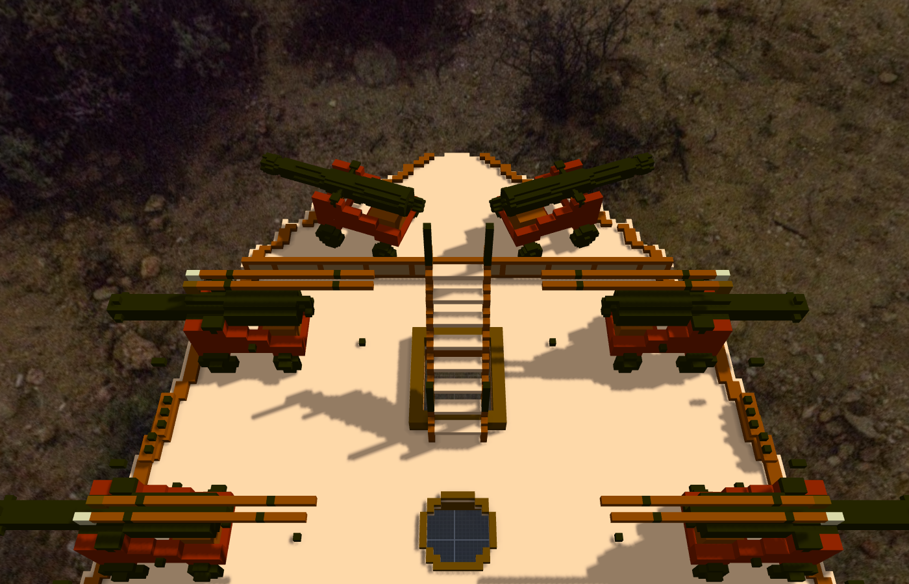

# 階段三十一：主甲板的砲換成模型 —— 和船頭少的那一門（2026-10-12）

> 規格與讀數在 [`../notes.md`](../notes.md)「階段三十一」。提交：Sculpture 366a440（與階段三十二同一筆）。

## 委託

Tim：「是否可以先把炮全部換成甲板炮的匯入模式(非直接匯入voxel 而是轉成模型)」；問到砲索時：「砲索繩可以重綁」。

「甲板炮的匯入模式」＝ 階段二十九 spar deck 那 24 門 carronade 的放法：外部模型（另一件作品匯出成網格掛上去，一格 voxel 都不進船）。主甲板的 28 門 24 磅砲還是階段二十的放法：`-gun-24`（1,125 格）用關聯組進來，一門一門是真的格子。

## 換算

關聯和模型的座標公式不一樣。關聯的 `mirror=y` 是在零件自己的框裡翻：第 y 格 → at.y＋31−y（框 32 格）；模型是 p ＝ at＋mirror(v − pivot)。pivot 放 0 ⇒ 右舷（S）at 不變、左舷（P）at.y 要加 32。

量一格對過：P01 的 cascabel 讀數 134.5 ＝ 104＋30＋0.5。兩件作品都沒記比例（meters_per_voxel 0）⇒ scale 不給會自動換算 —— 兩邊都是預設值、算出來也是 1；照階段二十八 chase gun 的教訓（那次自動會變 1.6）還是明寫 1。

## 先換兩門

S01、P01 先換：加模型 → 把綁在它們上面的 10 條砲索（breeching 兩條、tackle 兩條、train 一條）的端點改成 `model:甲板-gun/砲-xx/<固定點>`（其他欄位照原值帶）→ 拿掉關聯。

10 條繩兩端的座標，跟換之前逐位相同。模型外框 S (184,186,83)–(197,217,97)、P (184,104,83)–(197,135,97)，正好是同一門砲的鏡像。

## 剩下 26 門

同一支程式跑完。全船 901 條繩換前換後逐條比（去掉 `model:` 前綴），差 0、broken 0；綁在模型上的 140 條。

組裝件 1,433,632 → 1,402,132（＝ −28 × 1,125），一塊、沒有空腔、部件之間沒有重疊。設計檔 `design/gun_ropes.json` 的端點一起改；`draft_gunfittings.py` 產的仍是舊路徑（重產要改那支）。

## 「好像缺一門炮」

Tim 在預覽圖上圈了船頭左舷：「好像缺一門炮」。

不是這次弄掉的。階段二十八只在右舷第 15 個砲門放了一門 18 磅 chase gun（「船頭一門 18 磅長砲」那個版本），左舷那個砲門從階段二十就空著。

先量兩舷一不一樣：x 625–660、z 85–110 的格子，右舷跟左舷鏡過去逐格比 —— 9,977 格、差集 0；砲要放的那個框裡，兩舷的實心格都是 595。再把 chase18 對 y 321 鏡過去：at.y 321 − 183.455 ＝ 137.545、往船頭偏的角度 −20° → +20°、mirror=y。外框 (633.2,125.9,88)–(650,155.1,101) ＝ 右舷那門的外框鏡過去。

主甲板現在 30 門：24 磅 28 門、18 磅 chase gun 2 門。組裝件的模型 55 個。

Tim：「測試ok 單層提交吧」。

## 旁邊的事

《憲法號對轟》（ame 的遊戲）那天排的工作是「長砲損壞分級，只看砲自己的格子」—— 換成模型以後，那些格子不在格子清單裡了。我在酒館先講；ame 回：Tim 稍早已經叫停那一項，改成砲走模型那條路（打到扣血、血條歸零整門飛出去），要我配合的只有名字不動、外框照讀。
