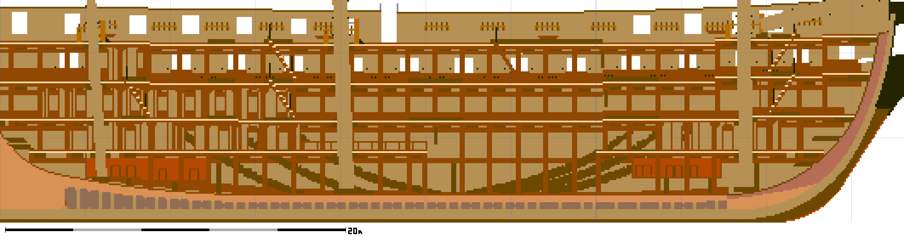
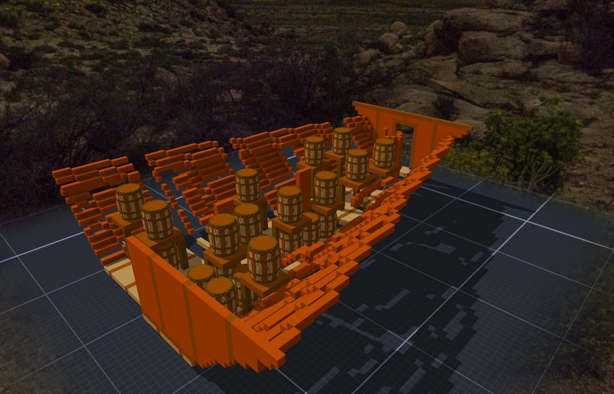
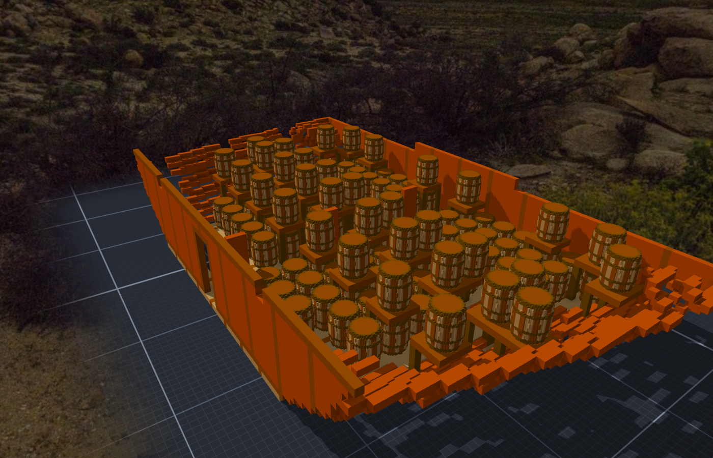

# 階段三十二：彈藥庫 —— 前後兩間、138 個火藥桶，和給遊戲的字（2026-10-12）

> 規格與讀數在 [`../notes.md`](../notes.md)「階段三十二」與「給遊戲的 meta 與砲的固定點」；設計 [`../design/draft_magazines.py`](../design/draft_magazines.py)、擺放 [`../design/magazines_placement.json`](../design/magazines_placement.json)、驗收 [`../design/verify_magazines.json`](../design/verify_magazines.json)。提交：Sculpture 366a440（彈藥庫）、818140f（meta 與砲的固定點）。

## 委託

Tim（砲換模型那一輪的中途）：「另外完成後 可以規劃一下放置彈藥庫(單獨子模組) 因為遊戲想要模擬彈藥庫爆炸」。

規劃交出去之後：「彈藥庫可以根據史實(如果兩版本都有 那就兩個的吧)」「火藥桶可以做(彈藥庫的子模組 跟炮一樣的引用方法)」「遊戲那邊可以到酒館討論一下 是否可以額外在模型中加入一些資訊 以及export功能是否要做在c#端(目前是python)」。

## 先量船艙

orlop 那兩間 filling room（作品裡照 Waldo 1816：船尾 x 167–192、船頭 x 608–630）是線索：火藥庫在它們下面的船艙。量現況（船艙中線、到 orlop 橫樑底 z 38）：

- 船尾 x 180–240：中線第一格空氣在 z 30 → 20、高 8–18 格、寬 9–43 格 —— V 形很尖。
- 船頭 x 560–615：z 17–24 起、高 14–21 格、寬 13–87 格；x 590 是前桅的桅腳。

## 讀圖

派一位去讀 02 號圖（1849 Pook，Profile and Inboard Plan）並查文字資料，限時 25 分鐘、只要範圍與高度。截圖上的字我自己看過、換算自己算一次：

- **After Magazine「23'4"」**：px 2736–4476 ⇒ x 199.9–271.1（23'4" × 74.47 px/ft ＝ 1,737 px，量的是 1,740）。淨高寫著 4'8"（船尾段）、5'3"、5'6"，地板在 x≈233 往下一階。後面是 Lights（light room）與 Filling room、Passage。
- **Fore Magazine「17'2"」**：px 10590–11870 ⇒ x 521.3–573.7，淨高 4'7"，在前桅（x≈589）**後面**；前面是 Passage 3'0"、後面 Coal & Sand。

1812 年的航海日誌（thecaptainsclerk.com，1812-06-26）：main magazine 裝 24 磅砲的藥包（6–8 lb）、forward magazine 裝 carronade 的（2⅜–3 lb），「filled from 98 large and 110 small barrels of powder」。⇒ 兩個年代都是前後兩間、後面那間大。

⚠ 作品 orlop 的 forward filling room（1816）不在 1849 年前彈藥庫的正上方，差約 35 格 —— 兩份資料本身的差別；這次不動那間房。02 號圖的 orlop 頂比作品高 3–4 格（作品甲板高度是新圖紙 07 定的）⇒ 淨高從作品的 orlop 橫樑頂往下量，不照圖的 z。

## 做法

每個 x 的橫切面裡，從中線連到的艙內空氣 ＝ 房間（地板到 z 40）。地板松木、每 6 格一道橡木壓條；兩道橫艙壁銅皮配橡木框；貼船殼那一格內襯銅皮；門洞朝通道那側（後彈藥庫朝船尾、前彈藥庫朝船頭）。地板：後 z 27（x 200–232）／25（233–271）、前 z 27。

火藥桶另一件子作品（0.02 m，22×22×27、9,384 格）：1813 英制 whole barrel（bilge 17.36"、高 21.62"；美方的尺寸沒找到）；18 片桶板、木箍（火藥桶不用鐵箍）。跟砲一樣當模型放進去：直立、每 4.6 格一個、中線留走道；V 形船底那段，上層放在靠船殼的階梯木架上。

## 三版

產生程式只填還空著的空氣。第一次跑（還沒落格）先看它印的數：後彈藥庫上層的桶 46、地板層 16 —— 上層的底下什麼都沒有；兩間的地板底下還被我填實了（前 16,399 格、後 3,449 格），那層空氣沿船長方向跟艙壁外面的船艙相通，本來就不是空腔 ⇒ 落格之前就改：地板底下不填、上層的桶放在靠船殼的階梯木架上。

落格、接上組裝件之後量：

- **v1**：格數對（1,402,132 ＋ 4,436 ＋ 7,389）、沒有重疊 —— 但 **20 塊**、**4 個空腔**。19 塊浮空的全是架板：上層桶的立柱放在架板中點，碰到下層的桶就停；桶是模型、不是格子 ⇒ 以格子來看，架板浮在空中，遊戲的連通判斷會讓它們掉下去。這一版沒出圖，是元件數先叫的。空腔：後桅穿 orlop 的洞口被最上一排銅皮封住（x 206、z 41–42）、後彈藥庫地板和船殼夾出兩個 3 格。
- **v2**：立柱改放架板靠走道的兩角（在桶的圓外面）、上面是空氣的那一排不鋪；產生程式最後局部掃一次：≤ 50 格的封閉空腔填實、新格每一塊都要連到原本的實心，不然停下。前彈藥庫地板層的桶從 82 變 85 —— 這次的改法不該動到地板那層 ⇒ 查：排桶的起點用「房間最小 x＋1」，艙壁頂排空出來之後整排往後挪了一格、貼牆 ⇒ 改成從艙壁算。
- **v3**：渲染一看，房間上空一條條銅皮 —— 銅皮鋪到 z 40，把 orlop 縱樑（carling）兩側也包了 ⇒ 只鋪到 z 37。

最後：後彈藥庫 3,794 格、桶 22（地板 10＋架上 12）；前彈藥庫 7,162 格、桶 116（82＋34）。後面那間比較長、桶比較少 —— 船尾的 V 形。組裝件 1,413,088、一塊、沒有空腔；模型 193；繩 901、broken 0。藏掉兩條關聯重匯 ＝ 建之前那份逐行相同。

每一間兩個固定點：`blast`（房間內空氣的重心最近的一格：後 (243,159,34)、前 (545,159,34)）、`door`。

Tim：「測試ok 單層提交吧 然後先做0517」。

## 給遊戲的字（TASK-0517／0518）

酒館跟 ame 議定：每個模型、每條關聯帶一包平的 `meta`（字串或數字），固定點另放 `points`；匯出要不要搬到 C# —— 她贊成，條件是格式不動、Python 那支留著對拍。

- 砲的固定點：`muzzle`、`breech`（砲軸 ＝ 兩點連線）。-gun-24 補 breech (7,3,11)；18 磅與 carronade 的固定點本來都沒登記，照設計檔登記（先跟作品本尊格數對過）。
- Tim：「可以 提交然後出廠 powder_lb照妳的算法」⇒ 桶數 × 100 磅：後 2,200、前 11,600；火藥桶每個 100；砲 `gun=24l｜18chase｜32c`。帶 meta 的部件 194 個。⚠ powder_lb 是模型裡的桶數換的，不是史料（日誌只寫 98 大桶、110 小桶，沒說哪間）。
- `.vxk`（遊戲吃的封裝）改由 senate 直接產：憲法號每一個數都跟 Python 那份相等（繩中線 22,596、帆頂點 50,274、網格頂點 357,252，最大差 0）。淨室測試第一次就紅：沒記比例的作品，我給了 1/32，Python 給的是 0.1 —— 憲法號剛好記了 0.1，整船對拍抓不到。
