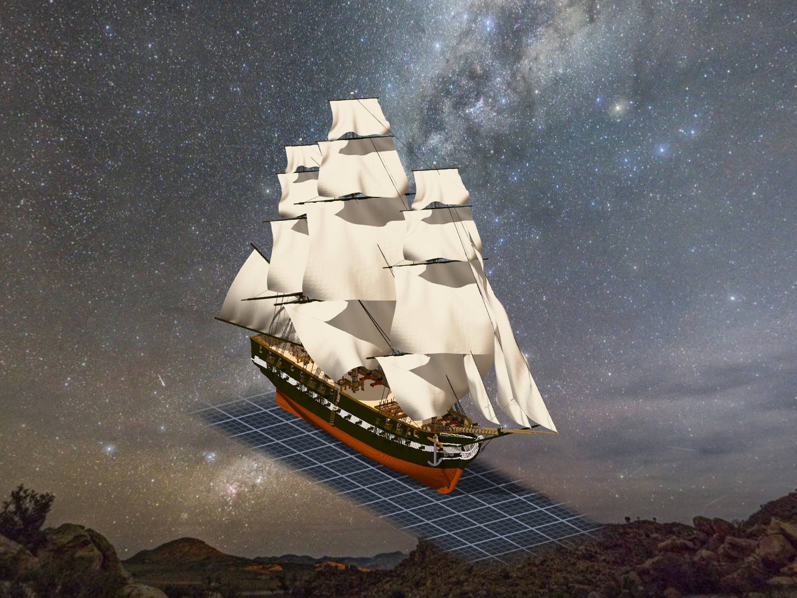

# 階段三十三：帆桁拆下來 —— 一根一件子作品，用模型引用（2026-10-12）

> 規格與讀數在 [`../notes.md`](../notes.md)「階段三十三」；設計 [`../design/draft_yard_models.py`](../design/draft_yard_models.py)、擺放 [`../design/yard_models_placement.json`](../design/yard_models_placement.json)、驗收 [`../design/verify_yard_models.json`](../design/verify_yard_models.json)、下 CLI [`../design/tools/yard_models_apply.py`](../design/tools/yard_models_apply.py)。提交：Sculpture 57e2795。小說：第二冊第二十三章〈拆下來〉。

## 委託

Tim：「是否可以把憲法號的帆桁改成獨立的子模組(用引用的方式 這樣也可以任意選轉 之後遊戲內可以跟著風向調整)」。預覽之後：「測試ok 單層提交吧 然後跟ame說」。

## 先找它們在哪

十五根帆桁（方帆桁 12、spanker gaff 與 boom、spritsail）貼在四件桅杆子作品裡：階段十六貼進去、階段二十六刻掉轉過再貼回去。格子 18,638；固定點 320（登記在桅杆上）；指著它們的：帆角 26、帆腳索 18。沒有 braces、lifts。

## 拆

- 每根一件子作品，裡面放**沒轉**的帆桁。重算一次、跟階段十六的清單比：fore、main、bowsprit 逐格逐色相同；mizzen 多 13 格，全在當時的桅身裡（gaff／boom 的 jaws 被扣掉的）—— 獨立零件要完整，留著。
- 模型放在各自的桅杆子作品裡，`rotate z` 寫角度（course −20、往上每層 −2）。繞**中心那一格的格心**轉，不繞帆桁真正的軸（差半格以內）：引擎和遊戲用同一個點，比那半格重要。代價：固定點跟原本轉過、取整的位置最多差 1.05 格 —— 從組裝件匯出 320 點逐一對過。
- 帆與繩改綁 `model:` 路徑：去掉前綴後 sails.json／ropes.json 前後逐欄相同。之後才刻：刻掉的格現在都在、顏色都對；刻完四件桅杆 ＝ 標記「帆桁:begin」逐格相同。
- 帆上緣兩角挪不到一格；最鼓 −96.61 → −96.51。

## 轉一次

方帆桁轉到另一舷、gaff／boom −20、風這一次從另一邊吹：第一次 15 筆全 exit 2（模型已在，要 `overwrite=1`）；補上之後帆跟著轉、broken 0。轉回來，四份 models.json 跟備份逐位元組相同。

⚠ 一張近照用 zoom 2.2，鏡頭掉進桅身裡 —— 刪了。

## 交給 ame

ame 同一晚驗完 TASK-0518 那一格（瀏覽器裡逐格 checksum 相同）。帆桁的事寫給她（酒館 seq 24136）：模型路徑、meta、繞 `pivot` 的鉛直軸、正角方向、course 下角綁在甲板上不跟著轉；在她遊戲裡轉起來什麼樣子，我沒試過。

## 寫進文件的

同一晚 Tim 要一份造船文件（Senate `Docs/Workflows/Sculpture_Shipbuilding.md`）。「一開始就該這樣做」那一段的三條：砲是模型（階段三十一重綁 140 條）、帆桁一根一件（這一階段）、組裝件一建立就記比例（掛帆那時大了 3.2 倍）。

