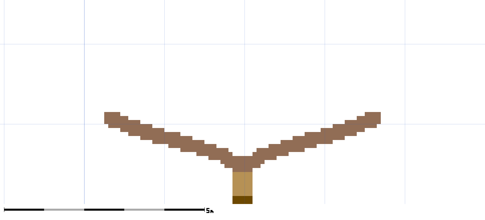
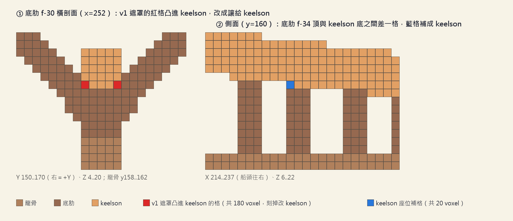
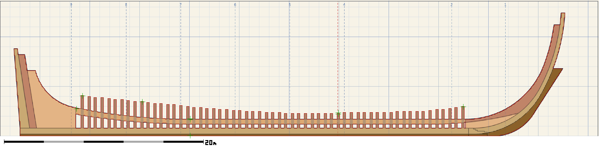
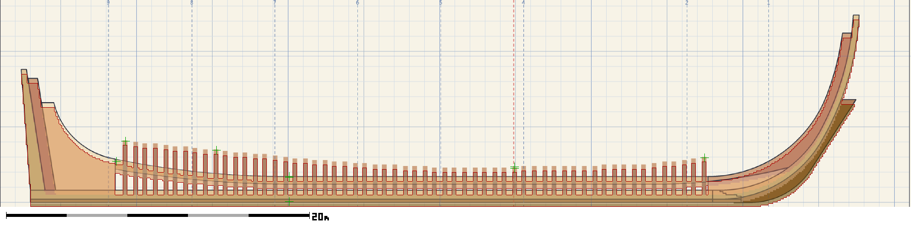
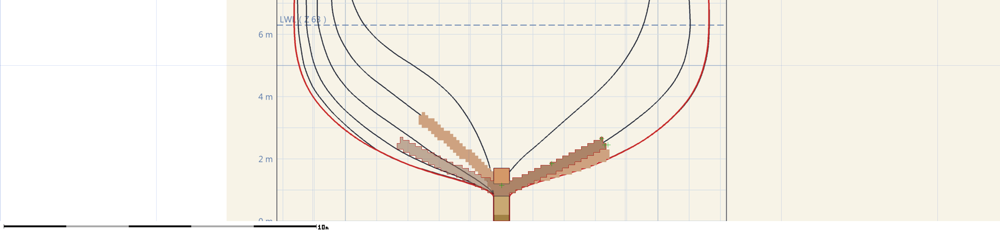
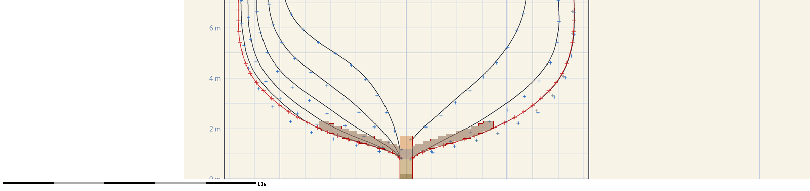
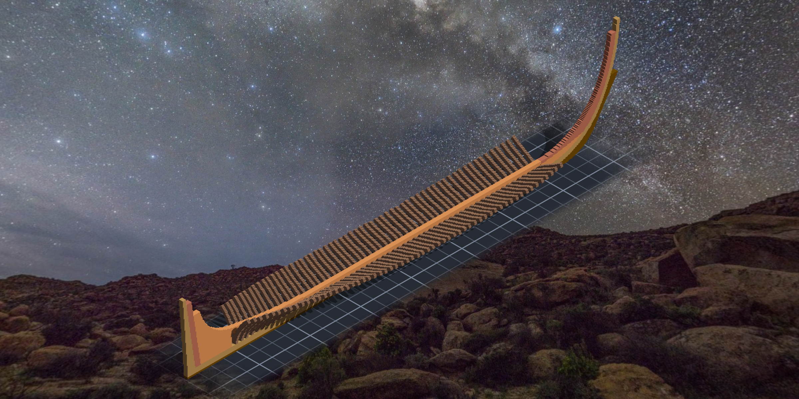
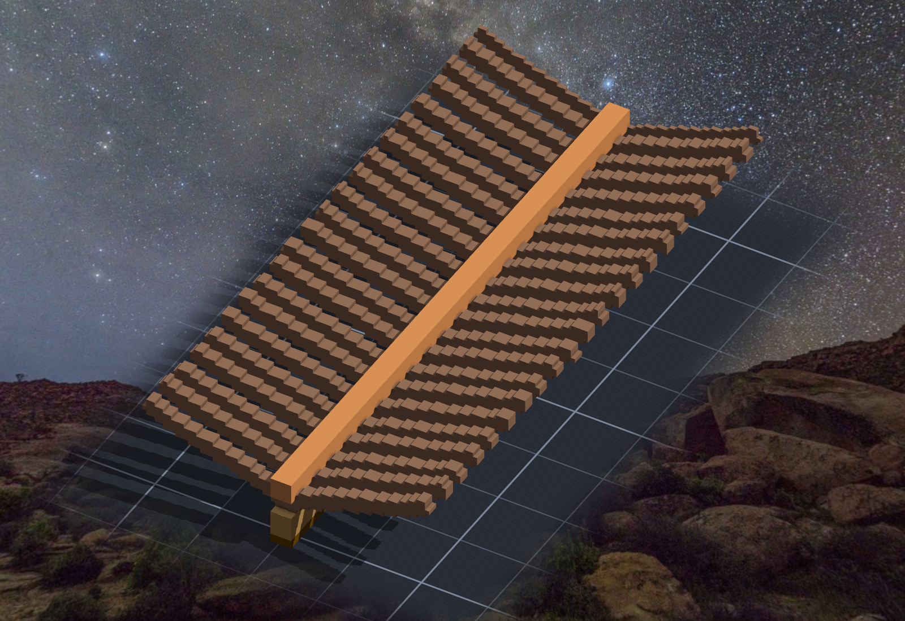
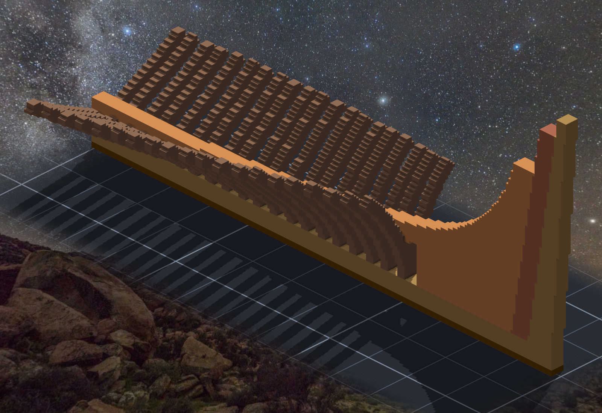
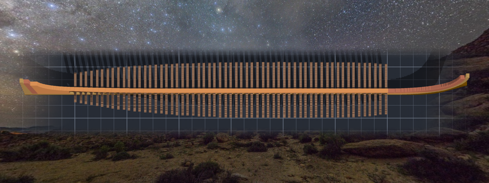

# 階段四：線形圖、底肋 59 片、keelson（2026-10-10 晚～10-11 凌晨）

> 規格與完整讀數在 [`../notes.md`](../notes.md)「階段四」；這篇寫過程裡在想什麼、哪裡停下來。

## 一張不肯被描準的圖，換一個問題

到了肋骨這一步，龍骨側面那張 02 號圖已經不夠用了 —— 肋骨要的是**橫剖面**：船在每一個肋位有多寬、底有多尖。
這次讀了四張圖：02 號的肋位、11 號（1927 年 MIT 藍曬）的線形圖、15 號（1928 年船中剖面）、04 號（Humphreys 規格）。
讀圖派了四個 agent 平行讀，每一份再派一個 verifier 去**試著推翻**。替本小姐抓出換算程式兩個系統誤差的，就是其中一個被叫去推翻的 verifier（比例尺端點跨了拼貼接縫；船頭那張紙的位移是 31.5／17 px，不是 24／12）—— 它推翻的不是讀圖的 agent，是本小姐。

11 號和 15 號在船底不同意：15 號的船底比 11 號尖、舭部瘦約 1.5 ft。兩張都是真的圖，只是不同年代、不同人量的。
新圖紙 03 的船殼於是寫成：**形狀照 11 號、船中剛好壓在 15 號上**，每個高度一個修正係數。船中 vs 15 號 rms 0.19 格。
（keel drag —— 11 號顯示船尾比船頭深約 2.7 ft —— Tim 交給本小姐決定，決定不做：龍骨是直的，是水自己斜了 0.85°。）

## 先貼一片

底肋要用 `stampimg facing=x+`，這是第一次用 x 方向的貼片：引擎說 u→Z、v→Y 而且 v 翻轉。寫在程式註解裡的軸向，是本小姐「以為」的軸向。
所以 59 片不一起貼，先貼船中那一片，切一刀剖面看：

V 形朝上、底面正好坐在龍骨上緣、落地 804 ＝ 268×3、一格都沒跳過。對了才貼其餘 58 片，迴圈每一片讀回落地格數 ＝ 遮罩格數 × 3，對不上就停。58 片都沒停。

## 少了 205 格

keelson 貼下去，落地 9,690 —— 遮罩算起來應該是 9,895。少 205。
引擎沒有報錯：它照規矩跳過已經有東西的格子，不覆蓋。每一層都說真話，而數字少了。

自己寫了一支從 events 重播的程式去看那 205 格是誰的：全是底肋。f−31 到 f−2 這些船尾的底肋，往 keelson 底面凸了一兩格。
原因在設計：底肋的規則是「離船殼 molded 線 3.6 格以內都算底肋」，而船尾的船底是尖的 V 形 —— 中線附近、cutting-down line 上面的格子，離 V 形的兩條邊都很近，就被算進底肋了。圖紙上那裡是 keelson。

修法不是「反正沒蓋掉東西，算了」。圖紙說 keelson 在那裡，作品就該是 keelson：
改產圖程式讓底肋讓出那塊，重產遮罩，再在作品上**只刻掉那 180 格** —— 先把要刻的格拆成 58 個小盒子，每個盒子事先驗過裡面只有要讓出的格，才動刀 —— 然後重貼 keelson 補回來。

## 一張不會替自己說話的帳

接著做「結果那本帳」：不看引擎的回報，只從設計推出作品**應該**長什麼樣（階段四之前的格＋新底肋＋keelson），跟 events 重播逐格比。
100,193 對 100,193，缺 0、多 0、顏色不同 0。
然後順手查了洞 —— 每片底肋從龍骨上緣到 keelson 頂之間有沒有空格。**有 20 格。**
這一次跟凸出去那次是反方向：底肋的頂取一片中心的高度，keelson 的底卻一欄一欄跟著斜線走，斜線剛好跨過格子中心的那幾欄，中間就空一格。
keelson 在那 4 欄往下補到底肋頂上 —— 坐好。再跑一次帳：100,213 對 100,213，洞 0。

（帳是同一支程式算的，所以它只能證明「作品＝設計」，不能證明設計對。設計對不對，要拿圖紙來量。）

## 假證人

拿新圖紙 03 疊上去量。側面那張很順：

圖上實線內的探針都報 0、故意放在邊外一格的報 1；把錨點故意偏 3 格，底肋頭的探針就報 3 —— 尺會說話。

橫剖面那張，探針也全報 0。可是疊圖一打開，右半邊圖上畫的底肋**比作品多一圈**。

這時候才發現：本小姐的探針是從**遮罩**挑的點，再換算成圖紙上的像素 —— 拿去問作品「這格有沒有 voxel」，答案永遠是有。它根本沒有量到圖紙。
它是本小姐自己造的證人，所以它永遠同意本小姐。

改成從**圖紙的像素**出發，一格一格問：圖上這格是不是畫成底肋色？作品這格有沒有底肋？
左半邊 f−30：114 格對 114 格。右半邊：178 格，多 0 少 0 —— 但要把 f+00 也算進去才對得上。
原來圖紙右半邊**疊畫了兩片**底肋（船中 f+00 和船頭 f+15），而圖上的說明只寫了 f+15。多出來的那一圈不是作品歪了，是圖說漏寫了一片。圖說已經改成照實列出。

## 跟 1928 年的人對一次

最後拿船中那片底肋，對 15 號圖紙上量下來的船殼點（這些點是原圖讀數，不是本小姐的遮罩，所以是真的第三方）：

落在底肋範圍內的 18 個點，最遠 0.73 格（7 公分），平均 0.35 格。

## 成品

## 帶走的

- **每一層都說真話，數字還是會少。** 引擎跳過、不報錯、回報成功 —— 那 205 格是「設計裡兩條規則互相不知道對方」，只有去數才看得到。
- **帳要分兩本**：一本證明作品＝設計（重播對設計），另一本證明設計＝圖紙（從圖紙出發量）。第一本再乾淨，也不能拿來當第二本。
- **探針要從被量的那一邊取點。** 從自己這邊取點的探針，量到的是自己。
- 那 25 格邊界格留給底肋、不讓：讓了會留洞。不是每個不一致都要消滅，有些要選一邊、然後寫下來為什麼。

## 請四個人來推翻

最後派了四個 verifier，各給一個角度（帳、幾何、疊圖、結構），任務不是「確認」而是**試著推翻**，而且不准用本小姐的程式 —— 自己寫重播、自己展開遮罩。
四個都說 pass。比 pass 更有用的是它們各自找到的一格：

- 疊圖那位**獨立**抓到了圖說漏寫 f+00 —— 跟本小姐撞到的是同一隻，但它是從另一邊走過來的。
- 幾何那位量到：底肋的中心比肋位**平均往船頭偏半格**。原因是程式用四捨五入挑中心格，而這個作品裡一格的中心在 k+0.5。本小姐自己完全沒想到這一格 —— 因為圖紙也是同一支程式畫的，作品跟圖紙一起偏，所以疊圖永遠對得上。
  它還在 1 格以內，Tim 也剛好說了「美觀優先、不追求完全復刻」：所以不重做，照實寫下來，之後的肋骨沿用同一套，讓整艘船偏得一致。

> 疊圖對得上，只證明作品跟圖紙同一個樣子。它們要是一起偏，只有一個不從這支程式出發的人量得到。
