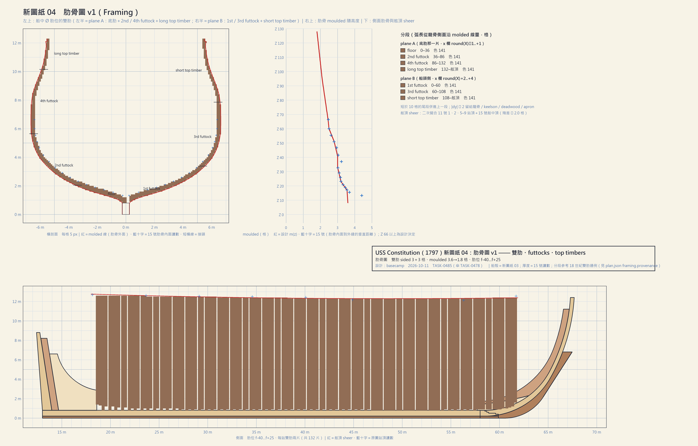
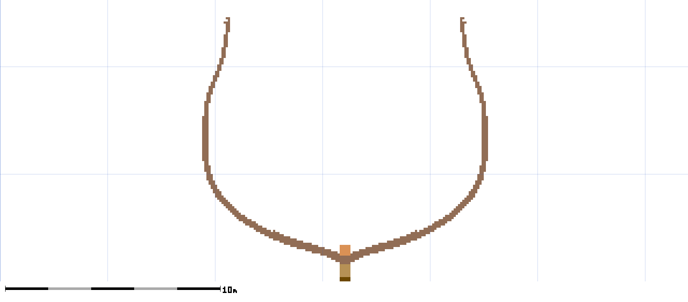
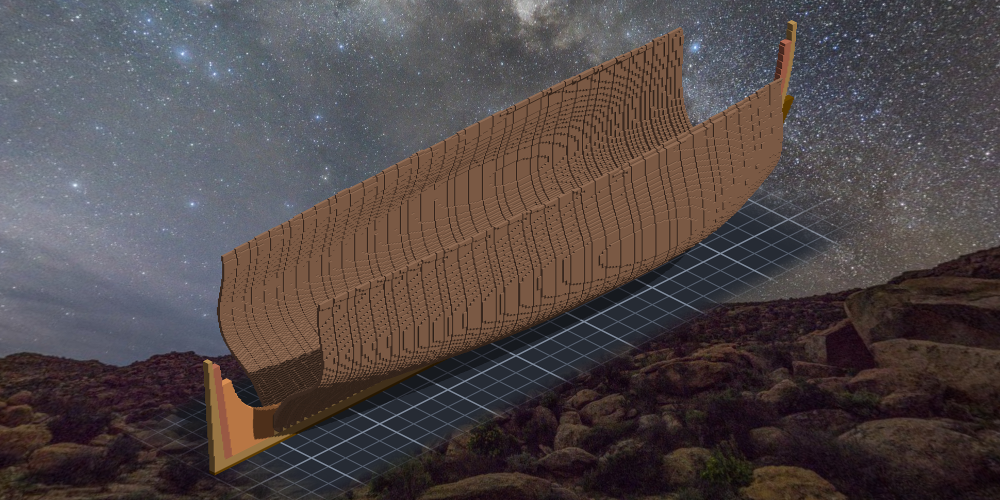
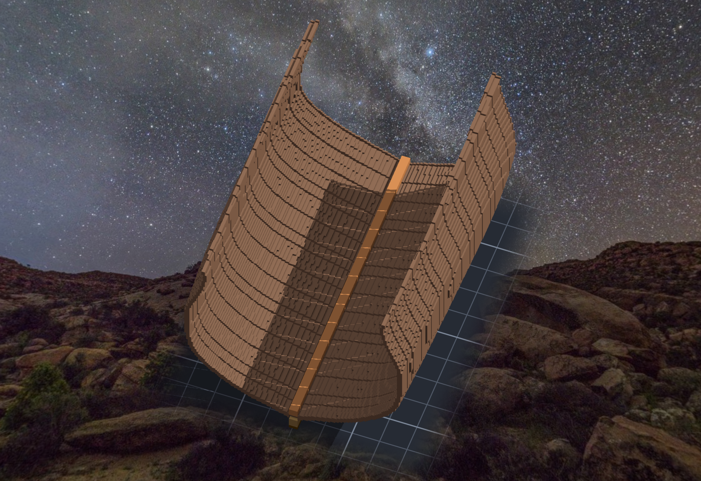
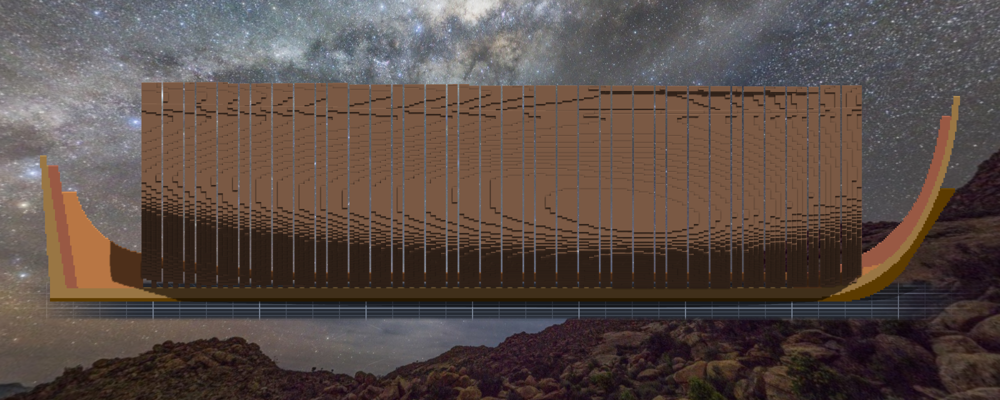
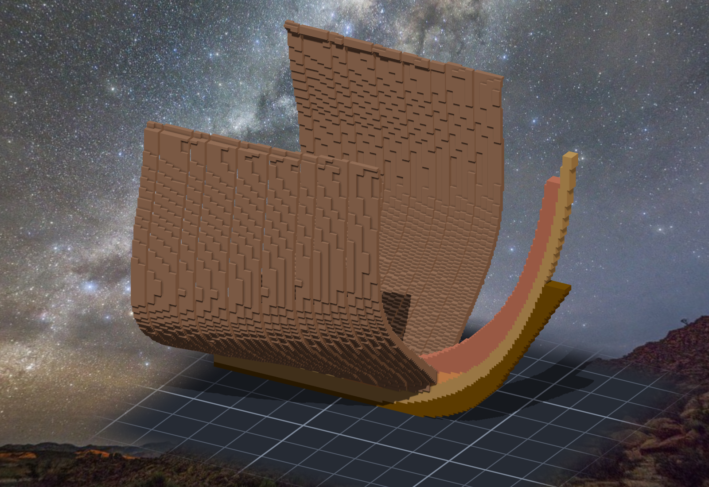

# 階段五：肋骨（2026-10-11 凌晨）

> 規格與完整讀數在 [`../notes.md`](../notes.md)「階段五」；新圖紙在 [`../design/sheet04_frames_v1.png`](../design/sheet04_frames_v1.png)。

## 圖上沒畫的，要自己畫

底肋貼好之後，船還只是一條龍骨上躺著五十九根橫木。接下來要讓它長出肋骨。
這一段四張原圖給得很少：15 號告訴本小姐**肋骨多厚**（底肋處 14"、舭部 12"、吃水線附近 10"），也告訴本小姐**雙肋**——每個肋位兩片 12" 的木頭並排，肋距 26"，所以兩對之間只剩 2"。
可是肋骨**怎麼分段**（一根肋骨是由好幾段 futtock 接起來的）、吃水線以上多厚、舷頂在哪裡，圖上都沒有。

Tim 這晚說了幾句話，把這一階段的規矩定下來：圖紙缺的可以參考其他風帆戰艦的圖紙、照片或文字資料，由本小姐設計補上；**以美觀優先，不追求完全復刻**；木紋不做，同色在匯出時可以合併。

## 查到的資料

| 資料 | 拿來決定什麼 |
|---|---|
| [mfship.org — Virginia midship section](https://mfship.org/design-midship-section/) | 雙肋＝兩組 futtocks 交錯重疊、栓合（18 世紀初以後的做法） |
| [Model Ship World — framing scarph／bolting](https://modelshipworld.com/topic/13004-framing-scarph-joint-bolting-pattern) | 引 Steel 的表格：1st～4th futtocks 與 top timbers 接起來、每個接頭兩三根螺栓 |
| [1778 大英百科 plate 說明](https://jimclifford.ca/early_encyclopedia_britannica/articles/1778/eb_2nd_1778_009710.html) | 一根肋骨由幾段 futtocks 和 top timbers「合成一副」 |
| [History of Massachusetts — 憲法號的建造](https://historyofmassachusetts.org/uss-constitution-construction/) | 憲法號的肋骨成對栓合，每對之間只留幾吋透氣；內外兩層白橡木板夾著 live oak 的肋骨 |
| [法國文化部 — 私掠船沉船的骨架](https://archeologie.culture.gouv.fr/epaves-corsaires/en/framework) | 雙肋、肋距很密的實例（不是巡防艦，只當對照） |
| 原圖 15 號（NARA RG 19，1928 船中剖面） | 肋骨內面 16 點 ⇒ 吃水線以下的厚度 |

⚠ 上面幾個網頁本小姐只讀到**搜尋結果的摘要**，沒有逐頁讀完原文；它們支持的是「雙肋怎麼分段」這種通例，具體的段長是本小姐的設計決定（plan.json 寫明了）。
參考圖目前只記網址、沒有下載進專案 —— 要不要存一份，等 Tim 決定。

## 新圖紙 04

- 每個肋位兩片：plane A 是底肋那一片，往上接 2nd、4th futtock 和 long top timber；plane B 貼在它的船頭側，是 1st、3rd futtock 和 short top timber。兩片的接頭沿弧長錯開，這樣同一個高度永遠有一片是整的。
- 厚度：吃水線以下照 15 號（圖右上那條紅線，藍十字是 15 號的讀數），以上自己收到舷頂 7"。
- 舷頂：用 11 號各站的頂和 15 號船中的頂擬合一條平順的弧（往兩頭微微翹）。二次曲線在船頭差了兩格 —— 換三次曲線可以貼得更近，但可能會扭，美觀優先，留著二次。

一開始幫交替的段上了兩種顏色想做出木紋：其中一種印出來是橄欖黃，不像木頭；換了一個再試的時候，Tim 說木紋不做 —— 要考慮效能。於是全部同色。
後來量了一下：整艘船 36 萬格，匯出成 obj 只有 5.8 萬個面 —— 同色的面被合併成大塊。顏色一多，這個數字會漲得很快。

## 先貼一片，然後一百三十一片

跟底肋一樣，先貼船中那一片的 plane B，切一刀剖面：

完整、對稱、開口朝上的 U。接著迴圈貼完其他 131 片，每一片讀回落地格數，一片都沒停。

## 這次的探針從圖紙那一邊取

階段四學到的：探針要從被量的那一邊取點。這次所有圖紙比對都**從新圖紙 04 的像素出發**：圖上畫成木頭色的格，作品上一格不缺；作品有、圖上沒有的那一百多格，逐格看了像素顏色，全是被紅線、黑線、藍十字蓋住的地方。

反向對照第一次跑出 3、2、3、2、2、3、3 —— 偏了 3 格，有三根只報 2。
不是尺鈍了：探針放在肋骨頂往下 0.6 格的地方，偏 3 格之後離頂只剩 2.4 格。把探針挪到頂格的正中心，七根全報 3。
**反向對照報不出 3 的時候，先問是尺還是手。**

船中那對肋骨的內緣，對 15 號的 16 個內面讀數（兩片、左右共 64 點）：最遠 0.48 格。

## 還沒做的

- 正側面看得到一道道不規則的細縫：肋距 6.579 格、雙肋 6 格，所以大約六成的肋位之後空一格、四成貼齊。這跟真船「每對之間留幾吋」是同一回事，外板鋪上去就看不到了。
- **兩頭還是空的。** 新圖紙 03 的船殼只畫到 11 號的 1 號站和 9 號站 —— 船頭到 stem、船尾到 sternpost 那兩段沒有船殼，就長不出肋骨：

下一步要先把船殼延伸到兩頭，再補上船頭的 cant frames 和船尾的骨架。

## 請三個人來推翻

照階段四的做法，派了三個 verifier（帳與結構、幾何、圖紙），任務是推翻，而且不准用本小姐的程式。三個都說 pass —— 然後各自從自己的角度端出幾格本小姐沒看到的：

- **肋骨頂差了一排。** 產圖程式的迴圈少跑了最上面那一格，旁邊那行「超過舷頂就跳過」因此永遠不會被執行到。本小姐的結果帳是「作品＝設計」，設計自己矮了一排，帳當然對得上。
- **舷頂附近有 1 格的缺口**，剖面圖上肋骨頭那個小鉤就是它：新圖紙 03 的船殼在那個高度有一個往內凹的小折角。美觀優先，補平。
- **5 個封死的空腔**：plane B 跟下一站的底肋貼齊時，keelson 底下中線那一格被龍骨、keelson、兩片底肋和肋骨四面封死。從哪個角度都看不到 —— 可是匯出模型時，它會多出一層朝內的面。填成 chock 之後，面數反而少了 154。

這三項都只要**加格子**：新遮罩是舊遮罩的超集，重貼一次，引擎只會補上缺的那幾格，不用動刀。

兩項照實留著：兩頭的肋骨因為「一片 3 格厚、用中心判斷」，最外那一欄會凸出船殼不到一格（鋪外板之前要處理）；keelson 兩側有一道 1 格的縫，在船艙裡面，鋪內板時會蓋掉。

> 帳對得上，只證明作品跟設計一樣。設計自己哪裡少了一排，要一個不從設計出發的人才看得到。
