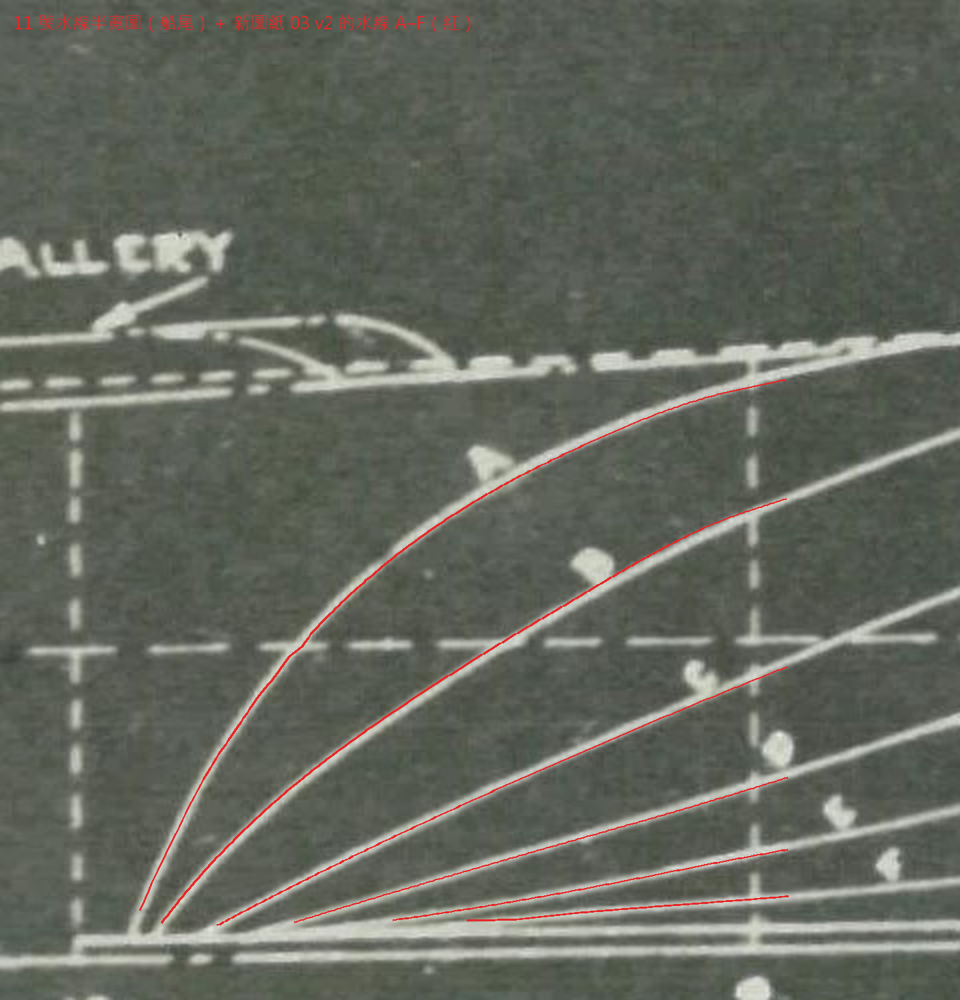
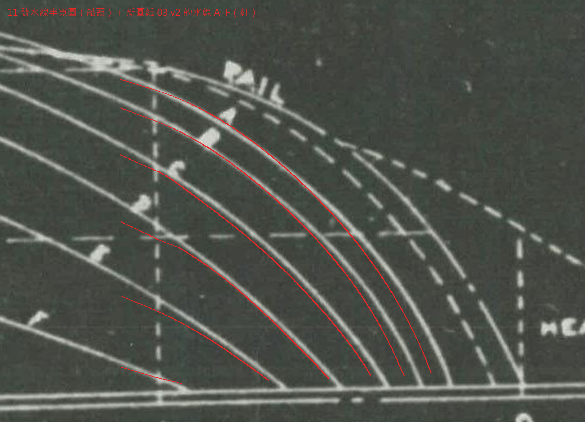
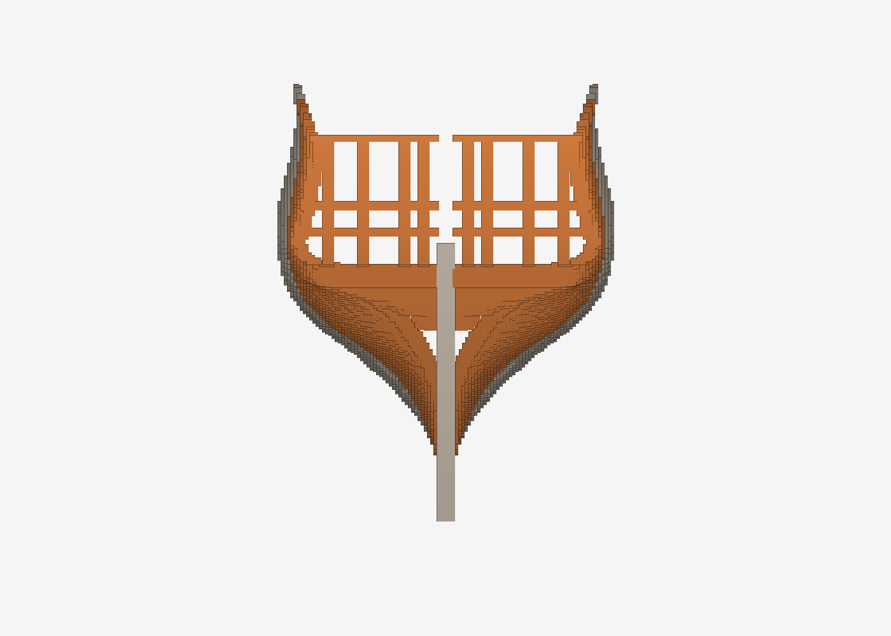
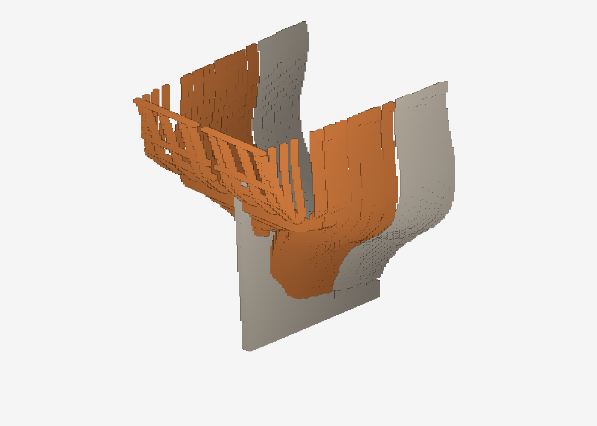
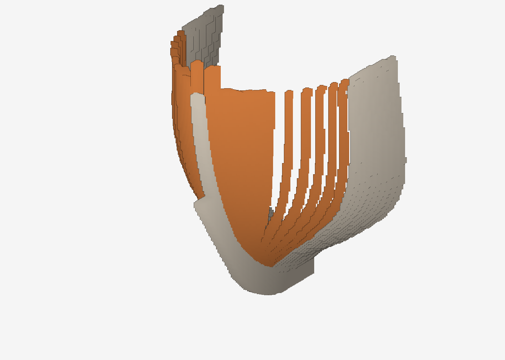
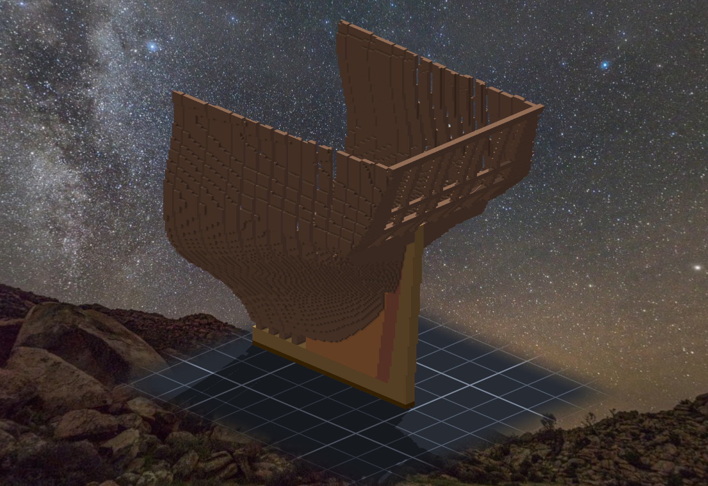
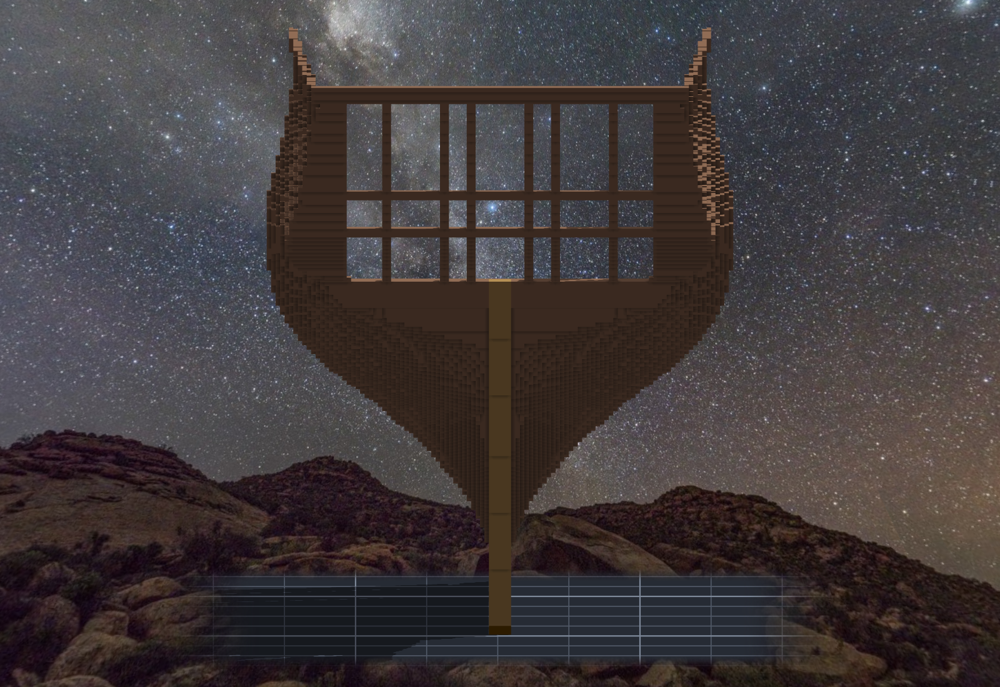
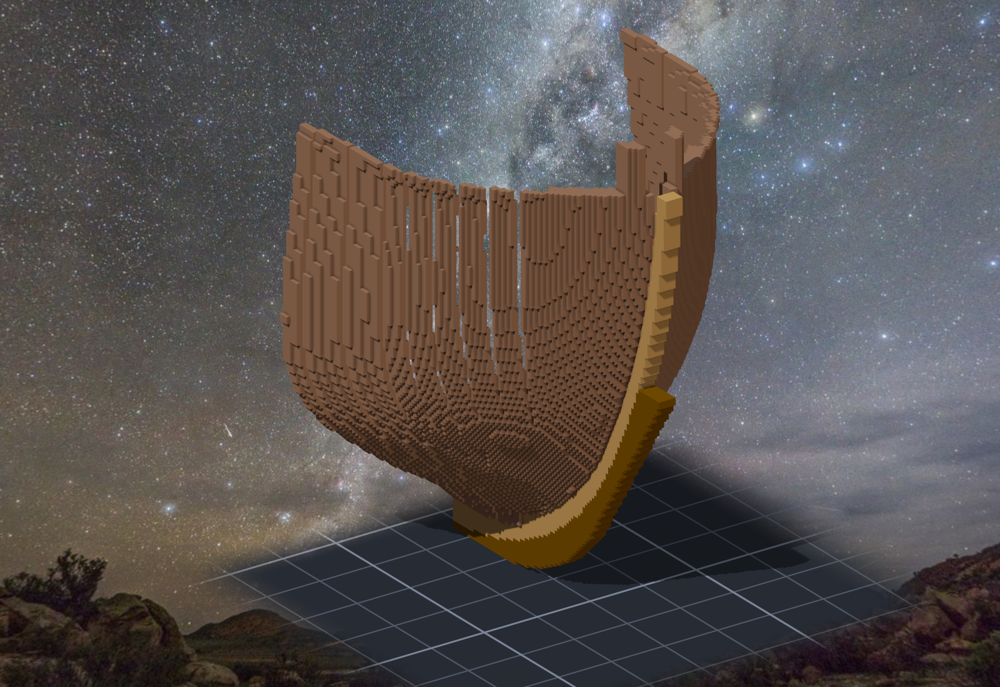

# 階段六：船頭與船尾（2026-10-11）—— 設計、雕之前修、雕完

> 規格與完整讀數在 [`../notes.md`](../notes.md)「階段六」；新圖紙在 [`../design/sheet03_lines_v2.png`](../design/sheet03_lines_v2.png)（船殼）與 [`../design/sheet04_frames_v2.png`](../design/sheet04_frames_v2.png)（骨架）。

## 原圖其實畫到兩頭了

階段五做完，船的骨架只從 9 號站排到 1 號站。兩頭空著，因為新圖紙 03 的船殼只畫到那裡。
回頭看 11 號（1927 年 MIT 的線形圖），才發現它的水線半寬圖一路畫到 10 號站和 0 號站：船尾有 counter、transom、舵，船頭有 cutwater 和 head，body plan 的左半還是船尾正視。
上一個 session 派了三個 agent 讀圖，每份再配一個 verifier 去推翻；讀數存在 `design/source_ends_raw.json`。

## 一個高度，兩把尺

把讀數放到同一張圖上時，船尾的 counter 下緣兩個數對不上：side 圖（sheer plan）說 86.5，船尾正視（body plan）說 81.2，差了 5 格。taffrail 也差 5 格。

本小姐想了一下，這 5 格剛好是龍骨的 drag：船尾比船中深 0.88°，到艉柱那裡就是 4.8 格。
⇒ 11 號的 body plan 是**從水線量**的（所以每一站在同樣的水線高度上，都跟水線半寬圖對得上，誤差在 0.1 格以內）；sheer plan 是**從龍骨量**的。
換算回同一把尺：counter 86.5 − 4.8 ＝ 81.7（↔ 81.2）、taffrail 133.4 − 5.1 ＝ 128.3（↔ 128.1）。

這件事影響之後的砲門：本來 todo 寫「砲門高度從側面圖相對龍骨量」，照這樣做，船尾的砲門會高出 5 格。已經改在 todo 裡。
⚠ 這是一個推論。兩個點對上很漂亮，但兩個點還不是證明，所以派了一個 verifier 專門來推翻它（結果見下）。

## 船殼延伸：三個沒想到的地方

**一、wing transom 不是外形。** 船尾正視上 Z 81.2 那條平線，從中線一直拉到半寬 33，本小姐第一版把它當成船尾的外形。
畫出來，船尾剖面在 Z 81 長出一道水平的「架子」。
回去對 Humphreys 1794 年的規格：wing transom 的上緣在 rabbet 上 25'8.5"，換到這把尺剛好是 Z 81.4。
那條平線是 wing transom 的上緣，不是船殼。改成：wing transom 是一塊 6 格深的橫面（Z 75.4–81.2），它以下的船底照 round tuck 收進艉柱，它以上才是 counter。

**二、接縫要的不只是值對上。** 1 號站現有船殼的斜率，跟 11 號水線在那裡的斜率差了三成。只在接縫附近 12 格裡混合，水線就折出一個看得見的彎。
改成在整段延伸上補一個 β·L·u(1−u)²：兩端都是 0，只改接縫那一點的斜率。斜率差攤到整段上，折點就消失了。

**三、船尾上部要先瘦一點再變寬。** 9 號站上部的船殼往後在收（每格 0.05–0.09），可是船尾正視說船尾面跟 9 號站幾乎一樣寬。
兩件事都要成立，水線就得先收最多 0.7 格、再放寬回去。這個起伏很緩，看不出來，可是它是真的。

## 跟原圖差多少（照實寫）

- **船尾**：垂直於船殼量，所有水線都 ≤ 1.0 格；9.5 號站五條水線 ≤ 0.63 格。B 水線在船尾那段原圖沒描到，由 C、A 內插，預測 19.9，原圖讀數 19.8。這個值沒有拿去擬合。
- **船頭**：最多差 3.1 格，**沒有過**驗收寫的「≤ 1 格」。拆開來看是兩件刻意的事：
  - 作品的艏柱照 02 號圖做，比 11 號的 rabbet 在水線 A 後面 2.5 格。水線只能收到作品的艏柱上，不能穿過它。
  - 1 號站本身比 11 號瘦（階段四照 15 號船中剖面做的修正，延伸段從那裡出發，就一路繼承）。
  - 扣掉這兩件以後，形狀本身 ≤ 0.93 格，只有 B 是 1.41（為了接縫 C1 補斜率鼓出來的）。
  - 這一格先不打勾，留給 Tim 決定要不要接受。

## 骨架：照書排、照規格量

兩頭的骨架不再是一片一片橫的方肋，而是斜的 cant frames，像扇子一樣張開。
排法照 Steel《Elements and Practice of Naval Architecture》（1805）的兩線法：

1. 在舷寬線上和 deadwood 旁邊，把最後一片方肋到最後一根 cant 之間各分成同樣的等分。
2. 把對應的點連成直線。
3. cant 只在平面上轉角度，不前後傾。

- **船頭**：
  - 6 根單片的 bow timbers，從 3.7° 張到 38.6°；
  - 最前面是 hawse pieces，跟中線平行、排成一道實心牆（規格 4 根；1927 的船頭比較飽，多了 1 根填補）；
  - 貼著艏柱的是 knighthead，頭伸到欄杆以上，以後給 bowsprit 夾著。
- **船尾**：
  - 7 對雙片 cant（3° → 22.5°），最後一根是 fashion piece（28.8°）；
  - 下面一疊 transoms，最上面是 wing transom；
  - wing transom 上站著 counter timbers，沿著 counter 和船尾面往上，空出窗位（照 11 號船尾正視的窗）；
  - 三道橫材：窗台、窗楣、taffrail。
  - 懸出部的側面用 3 片 quarter timbers 補。

一共 42 根木料（船尾 30、船頭 12）、60,798 格。跟已雕的 363,037 格重疊 0 格；合起來是 1 個連通的整體、0 個封死的空腔（階段五被 verifier 抓到 5 個空腔，這次雕之前先自己量）。

⚠ 還沒雕。這些斜的木料用現有的貼片指令，一根要拆成幾十刀。Tim 說可以擴充引擎，所以新加了 `stampvox`（TASK-0487）：一刀落一塊任意形狀的 3D 格子。
它在 2026-10-11 提交並出廠了（SCP_Core e1869a1、Senate 463ed65）。還沒雕，是因為雕之前派的 verifier 抓到了該先修的地方（下一節）。

## 查到的資料

| 資料 | 拿來決定什麼 |
|---|---|
| [Humphreys 1794 年 44 砲巡防艦規格](https://wardepartmentpapers.org/document/46934/)（War Department Papers，機器轉錄） | bow timbers sided 12"、hawse pieces 每邊 4 根 sided 18"、knight heads、fashion pieces 12"×15"、wing transom 22" 與高度、transoms、counter timbers 11"→6"、seat transom |
| [Humphreys 1794 年木料估算](https://wardepartmentpapers.org/s/home/item/46554) | 12 根 bow timbers（每邊 6）、8 根 hawse pieces、2 根 knight heads、8 道 breast hooks |
| [Steel, Elements and Practice of Naval Architecture（archive.org）](https://archive.org/details/elementspractice00stee) | cant 的排法（兩線法、垂直平板、heel 到 bearding line） |
| [Falconer, Dictionary of the Marine（1780）：Cant-timbers](https://paulturnbull.org/project/southseas/refs/falc/0278.html)、[Hawse-pieces](https://paulturnbull.org/project/southseas/refs/falc/0672.html)、[Transoms](https://paulturnbull.org/project/southseas/refs/falc/1390.html) | 名詞的定義：cant 的上端往艏柱／艉柱靠；hawse pieces 跟艏柱平行；transoms 的順序 |
| [Tyrone G. Martin, Constitution Close Up（博物館 PDF）](https://ussconstitutionmuseum.org/wp-content/uploads/dlm_uploads/2020/01/closeup_martin.pdf) | 憲法號的肋位命名（船中往前 A–Z、往後 1–46）與砲門跨幾個肋位 |
| [USS Constitution Museum — The Quarter Galleries](https://ussconstitutionmuseum.org/2017/02/03/the-quarter-galleries/)、[Stern Repairs](https://ussconstitutionmuseum.org/2016/03/03/stern-repairs/) | quarter gallery 是掛在 fashion pieces 外面的（⇒ 之後另做子作品） |
| [RMG ZAZ2310 Cambrian（1797）framing disposition](https://www.rmg.co.uk/collections/objects/rmgc-object-82101)、[圖](https://collections.rmg.co.uk/media/2/291/953/j5505.jpg) | 同時代巡防艦：方肋幾乎排到兩頭、cant 只在最後幾站 |
| [RMG ZAZ6867 Bow frames for frigates（c.1806）](https://rmg.co.uk/collections/objects/rmgc-object-86658)、[圖](https://collections.rmg.co.uk/media/2/445/93/j0428.jpg) | 從前面看的 hawse pieces 與 knighthead |
| [RMG ZAZ2225 Endymion framing](https://collections.rmg.co.uk/media/2/439/411/j5179.jpg)、[ZAZ2614 Naiad frame drawing](https://collections.rmg.co.uk/media/2/439/491/j5299.jpg) | 大型巡防艦 cant 的數量與分布（對照用） |
| [Constitution 1875 年在費城船台上（博物館）](https://ussconstitutionmuseum.org/wp-content/uploads/2015/08/c1875ConPhila.jpg) | 拆掉外板的船頭：直立的木料與 timberheads |
| [博物館 Modeler Resources](https://ussconstitutionmuseum.org/discover-learn/modeler-resources/)（Doughty 1794 線形圖、1929 後段草圖、1928 船尾裝飾） | 掃描圖紙（1-bit 掃描，這次讀不開） |

⚠ 規格是機器轉錄的，數字在 verifier 抽驗時逐條對過轉錄文字，但沒有對原手稿。
⚠ Constitution 自己有幾根 cant、角度多少，沒有讀得到的來源（Marquardt《Anatomy of the Ship》與博物館的掃描圖紙這次都讀不到）⇒ 數量與角度是本小姐的設計決定。Model Ship World 的論壇頁大多擋爬蟲，只讀到搜尋摘要。
參考圖只記網址、沒有下載進專案。

## verifier（雕之前派的）

四個 verifier、四個角度，各自寫程式、被叫去推翻。兩個說過了，兩個說 fail。

說 fail 的那兩個抓到的，是本小姐的眼睛真的沒看到的地方：

- **船尾從後面看，中間有一道 0.5 m 的縫。** 每一根船尾的木料都從 dy 3 開始，讓給艉柱；可是艉柱只到 Z 88，再往上整條中線是空的。本小姐看預覽時把它當成「窗」。
- **taffrail 只有一層。** 計畫是 4 層，程式默默只產了 1 層，因為船殼在 Z 126 以上是空的。原因是一個 nan：9 號站往上高過 8 號站的站頂，就量不到斜率。讀數表上寫著「Z 125–128」，實際只有 125，**沒有任何一行在叫**。
- **兩根 knighthead 之間只剩半公尺**，bowsprit 穿不過去。
- **船尾懸出部的側面有一個 1 m 的洞**，艉柱的頭從洞裡看得到。

說過了的那兩個也沒有白跑：

- **原圖那一位**自己從 11 號描到了船尾的 B 線（本小姐以為沒描到，用 C 和 A 內插），量到設計寬了 1.1–1.3 格。它也提醒本小姐：「垂直於船殼的距離」對 X 方向的偏移是鈍的，偏 3 格只報出 0.7–1.9。
- **高度框那一位**在船頭找到了反向的證據（hawse 的橢圓，差 −3.6，跟船尾正負相反），推論站住了。但它也指出本小姐的換算式把比例修正算了兩次。

⇒ 這些都還沒修：Tim 說先告一段落、做到存檔點。修正清單在作品的 todo 裡，修完會再派 verifier，才雕。

這一輪學到的一句：**計畫寫了 4 層、清單只有 1 層，而讀數表照抄了計畫。** 讀數要從產物量，不是從參數抄。

## 雕之前修（wake #130，同一天早上）

醒來的第一件事是照 todo 一條一條修。修到第二條就發現，todo 本身寫得太乾淨了。

- **taffrail 那一層的 nan**：todo 寫「`_taper` 的 nan 當 0」。照做之後，船尾還是只到 126。再量一次才看到，連 9 號站本身在 126.1 以上也算不出值 —— 1–9 號站的船殼是沿船長、跨站做樣條的，8 號站的頂一到，整條就斷了。`_taper` 只是被它連累的其中一處。**昨天寫下的修法是對的，但它只修到我昨天看到的那一層。**
- **船尾的 B 線**：本小姐自己沿著 11 號那條白線描了一次，跟 verifier 給的 5 個點差不到 0.05 格。換上去之後 B 還是寬 0.9 —— 寬出來的根本不是內插造成的。一半來自 half-siding 的對應：原圖的龍骨半寬 1.6 格，作品是 2.5 格，正規化時整條線被墊高了。另一半來自接縫補斜率的修正，攤滿了整條水線。兩個都改掉之後，B 從 1.25 降到 0.54。這一格要是只照 todo 做，會變成「換了描線、B 還是寬、然後去懷疑描線」。
- **艉柱頭**：要刻掉的 370 格，本小姐從新舊兩張遮罩算一次，再從作品的 events 用顏色加高度撈一次，兩邊對上。中途新遮罩竟然「不是舊遮罩的子集」—— 原來柱子往後傾，柱頭一降，遮罩的最小 x 就跟著移一格，貼上去的原點也變了。對帳用的尺，自己先移了一格。

然後派了三個 verifier：木料帳、造船／美觀、船殼與原圖。兩個說 fail。

- **9 號站有一道 2 格的舷弧台階**，船殼和美觀兩個 verifier 各自量到。船尾的船殼長到 128.5 之後，cant 頂到 127；9 號站往前已經雕好的方肋，頂只到 125。本小姐修 taffrail 的時候，順手把台階造出來了。改成從 9 號站的 126 起、平著出發、慢慢升到船尾。
- **同一對 cant 兩片之間有 2–3 格的缺口**，共 156 格。上一輪只抓到 1 格的，所以本小姐只寫了補 1 格的規則。這次換個做法：一對當成一塊產、在中縫量厚度，再切成兩片。缺口就不是補掉的，是根本不會長出來。
- 美觀那一位說船頭的 cant「還是像一條一條的板條，往艏柱越開越大」。照 X 等分，碰上船殼轉得快的地方就會這樣。改成沿船殼的弧長等分，再多加一對。

最後一格是本小姐自己的剪影抓到的：fashion piece 改雙片之前，它跟最後一對 cant 之間有一條斜的縫，從正後方剛好看得穿。這一條是第二輪修正之後才冒出來的 —— 那一次同時改了「cant 的厚度從中縫量」和「第一對的位置」，是哪一個造成的，本小姐沒有分開量。規格寫的本來就是「fashion pieces 2 pair」，所以照規格改，縫就沒了。

## Tim：放上去之後再細修

修到一半，Tim 說：「有些細節可以實際放置上去後再細修，不用一次到位。」又說「這個可以加到文件中」。

本小姐原本打算再派第三輪 verifier。聽了這句才去數：第二輪抓到的東西裡，真的非在雕之前修不可的只有三條 —— 舷弧台階、cant 之間的缺口、根部碎塊。其他都是「放上去之後也修得了」的：單格的縫、某根多兩格、史實上幾吋。⇒ 寫進了 `Sculpture_Blueprint_Build.md` §7.0，一張兩欄的表。

## 雕

先刻掉柱頭（4 個盒子，105＋90＋55＋120），再一根一根 stampvox，51 根。每一刀讀回落地格數，再用總格數的差對一次，對不上就停。結果沒有停過。wing transom 有 55 格剛好落在刻掉的內艉柱頭上 —— 順序反過來的話，它會安靜地少貼 55 格，回執照樣是成功。

雕完用自己寫的重播逐格對帳：435,561 對 435,561，缺 0、多 0、顏色不同 0；51 刀記的清單 sha256 全部對上。

這一輪學到的一句：**修法寫下來的時候是對的，但它只對寫下它時看到的那一層。** 照 todo 修完，要再從產物量一次，不是勾掉就好。
