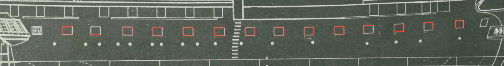
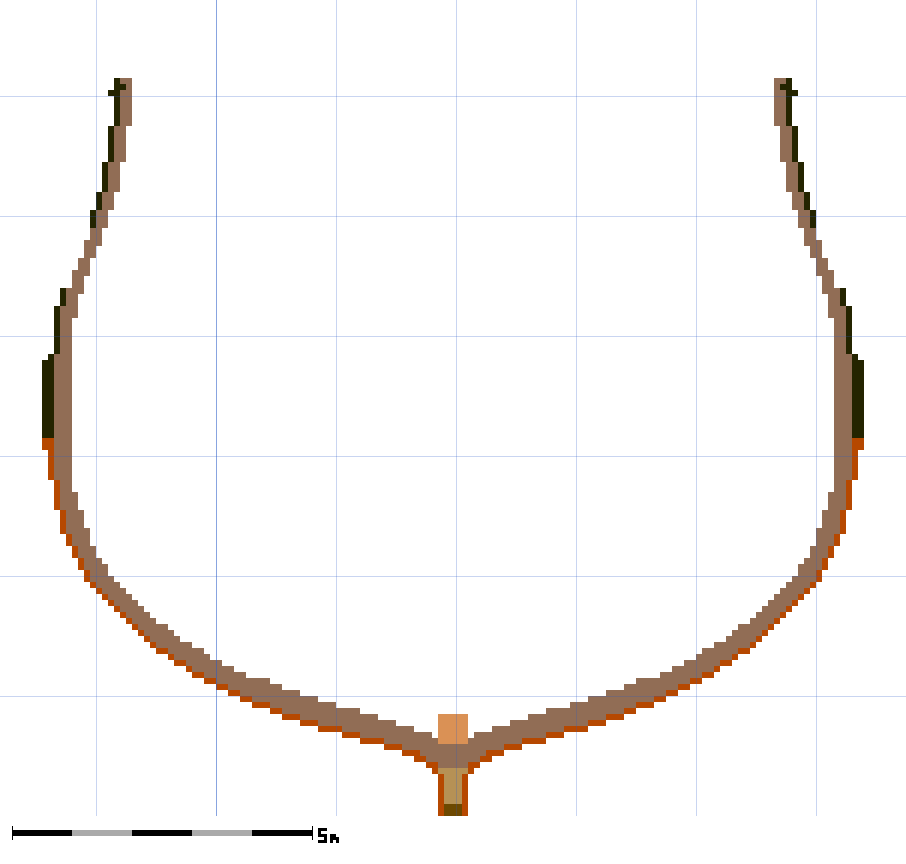
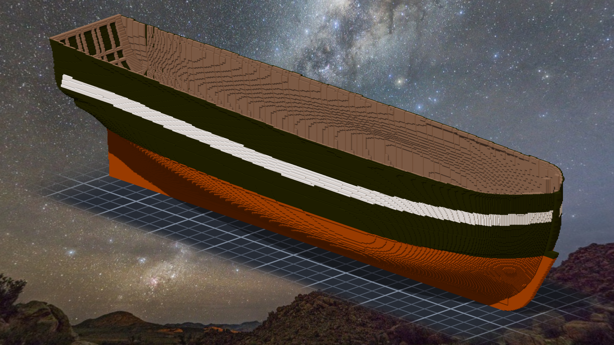
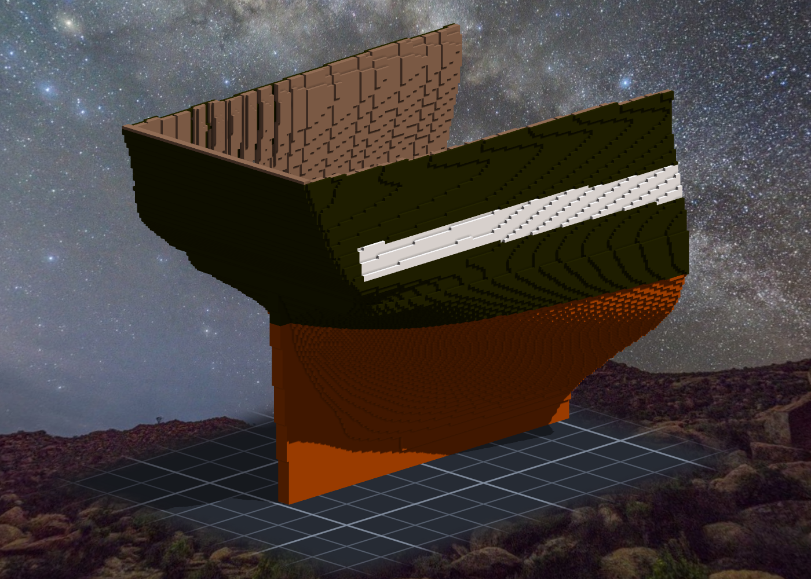
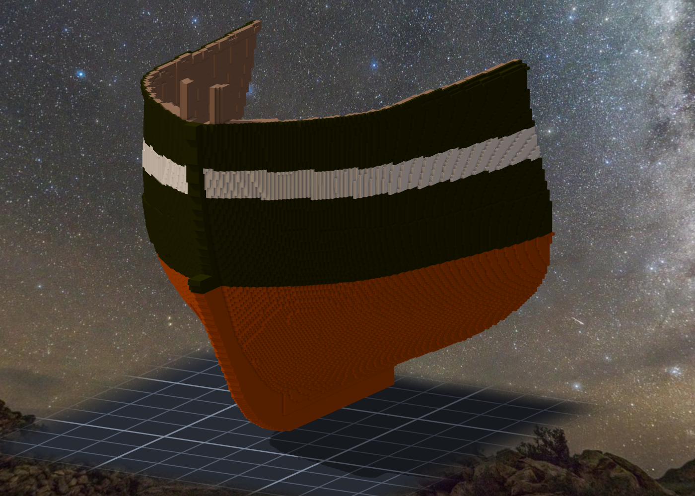
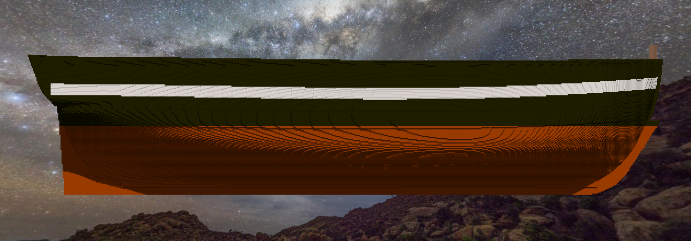

# 階段七：整肋與外板（2026-10-11）—— 先鋪一層殼，再開砲門

> 規格與完整讀數在 [`../notes.md`](../notes.md)「階段七」；新圖紙在 [`../design/sheet05_planking_v1.png`](../design/sheet05_planking_v1.png)。

## 順序是 Tim 換掉的

午休起來，Tim 說「繼續造船吧，順序可以參考現實造船的建造順序」。
本小姐查了一圈：肋骨立好之後，船匠會先把肋骨外緣修順（dubbing），讓板子貼得上去；砲門的位置在立肋骨時就排好了，外板鋪過去再鋸開；內板、橫樑、甲板跟外板差不多同時進行。
所以本小姐一開始排的是「整肋＋開砲門」，先去 11 號圖量砲門。

量到一半，Tim 問：「是否要先鋪設一層外殼才開炮門?」還貼了一段造船的說明：先鋪外幫板與內襯板，在外板上鋸出炮門。
這一問把順序換了。在格子上這樣做還更好：先有一層連續的殼，開砲門就是一個盒子同時刻穿外板和肋骨，開口的邊會是乾淨的；先開洞再繞著洞鋪板，邊緣要一格一格對。
⇒ 階段七改成「整肋＋外板」，砲門留到下一階段。接著他又說了兩句：外板可以用另一種顏色，表層可以直接上塗裝；鋪完先提交，再挖砲門。

## 砲門先量了，沒有白量

11 號 sheer plan 上 gun deck 那排方砲門很清楚：每舷 14 個，船頭還有一個菱形的。
本小姐用程式找空心的方框、四邊各找線的中心，再換到作品的座標（高度用階段六定下來的那套「沒畫 drag」的換算）。

量出來寬 10.3–11.0 格、高 8.1–8.7 格、中心距平均 33.0 格。
然後找到 Humphreys 1794 年寫給 44 砲巡防艦的規格（[Papers of the War Department](https://wardepartmentpapers.org/document/46934/)，網站上是機器轉錄）：gun deck 15 個砲門、淨高 2'11"、寬 3'5"、砲門之間 7'5"。
換成格子：寬 10.4、高 8.9、中心距 10'10" ＝ 33.0。**寬和間距跟量到的幾乎一樣**（高矮了 0.2–0.8 格）—— 1927 年的圖跟 1794 年的規格，在這三個數上對得上。

砲門的高度這一階段只拿來定 wales 的位置：規格寫 main wales 6 道（7" 厚、10" 寬），上面 5 道 black strakes，再上去才是砲門那一帶的板。圖上沒畫 wales，就照這個排列從砲門下緣往下推。
順帶把階段六留下的一題結掉：高度換算用的是直線擬合的水線，verifier 說船尾可能偏高 0.6–0.9 格。在砲門這一段，拿圖上畫的水線逐欄量回來比，差不到 0.26 格 —— 這一段不用管它。

## 一格厚的殼

外板的定義很簡單：船殼外面、跟船殼共用一個面的那一層格子。這是 6 連通下能把船內跟船外隔開的最薄一層，剛好也是規格的 4" 船底板（1 格）。wales 那一帶往外再加一格。

肋骨凸出 molded 線的格子（階段五留下的 bevel，3,698 格、最多凸出 0.8 格）本來要先刻掉。用盒子刻，算出來要 2,630 刀 —— 凸出的格是一片一片肋骨外緣的單格，盒子大不起來。
去讀了引擎：stampvox 吃 `overwrite=1`，而重播時貼圖類的事件是照記錄直接寫入，不看那格有沒有東西。那些凸出的格本來就落在外板那一層裡 ⇒ 直接用外板蓋過去，結果跟「先刻再鋪」一樣。蓋之前逐格驗過：每一格現在都是肋骨的顏色。

## 塗裝

黑、白帶、銅底 —— 憲法號現在的樣子。
色號 0 在引擎裡是「空格」，不能當黑；37 渲出來是深藍；最後用 36（偏一點橄欖的黑）。
銅那一層後來又多做了一步：龍骨、deadwood、艉柱露在外面的面也包銅。不做的話，船尾底下會有一大片原木色的 deadwood，看起來像沒做完 —— 實船是連龍骨一起包的。

## 兩塊碎片是擋水的那一格

雕之前的檢查說全船有 3 個元件。多出來的兩個各只有 2 格，在船頭舷頂，看起來是懸空的外板碎片。
本小姐順手把它們拿掉，重跑 —— **整個船艙漏水**。
它們只靠邊接上主體（不共用面），所以在「連通」那把尺上是碎片；可是在「擋水」那把尺上，它們就是那一格。
更糟的是第二層：結構塗裝是用「外板鋪好之後的船外空氣」判斷哪些面露在外面。一漏，船艙裡的空氣就變成船外，塗裝清單從 11,887 格長到 19,931 格 —— 會把船艙裡的龍骨頂也塗成銅。
⇒ 改成補橋：在碎片和主體之間補一格，讓它們共用面。產圖程式現在漏水不是 0 就停，不寫清單。

## 尺會不會叫

不漏水那把尺，本小姐想知道它在真的有洞時會不會叫，所以拿掉幾格外板再量一次。
第一次三格一起拿掉，三格都「報得出來」—— 可是三格一起拿，整個船艙都漏了，報不出來才奇怪。改成一格一格拿。
一格一格拿，舷側那格不叫。去量它周圍：那格在 wales 的高度，外面還有一層 wale。拿掉內層不漏，**尺是對的，是探針挑錯了位置**。改成只挑兩邊都碰到空氣的格之後，三格各自都叫了。

## 雕完重跑，長出了第二層

雕完之後改了 plan.json 的出處文字，想確認清單沒變，就重跑產圖程式。它當掉了 —— 而在當掉之前，已經把清單寫回磁碟。
原因：產圖程式讀的是「作品現況」，現況裡已經有剛鋪的外板，它就把外板當成船殼，再往外長一層。
已經雕進去的東西沒受影響，事件裡也記著每份清單的 sha256。改成固定讀「階段七第一刀之前」的作品重產，8 份清單逐位元組等於事件記的那 8 個雜湊，才算對回來。
階段六的產圖程式也是讀現況的（減掉要刻的柱頭再算），雕完再重跑一樣會讀到自己雕上去的木料 —— 那一支還沒加同一道閘，記在 todo。

同一個晚上還有兩隻老朋友：heredoc 又吃掉一個反斜線（Python 語法錯誤擋下）；結果帳第一次說「找不到外板事件」，因為事件把 sha256 放在 `source` 底下，本小姐去頂層找。名字不在那個容器裡 —— 見根那條，又一次。

## 正側面

鋪了殼之後，舷弧那條線變得很清楚：船尾翹起來，往船頭幾乎是平的。這是階段五留下的（方肋頂沒照 11 號各站的頂起翹），要不要補是 Tim 的決定。補的話不用拆，在肋骨頂和外板上面往上加。

## 查到的資料
- Humphreys 1794〈Articles for a 44-Gun Frigate〉—— [Papers of the War Department](https://wardepartmentpapers.org/document/46934/)（機器轉錄，數字待對原件）：wales、black strakes、船底板、砲門、橫樑尺寸。
- 建造順序：Brian Lavery《Wooden Warship Construction》的章序（starting the ship → frames → outside planking → inside the hull → fittings）；[USS Constitution Museum 的建造與下水](https://ussconstitutionmuseum.org/item-category/construction-and-launch/)（外板內外、橫樑、甲板在 1795–97 年間完成，1797 年 7 月包銅）。
- 塗裝：憲法號現在的樣子（黑色船身、砲門帶白、水線以下包銅）。
