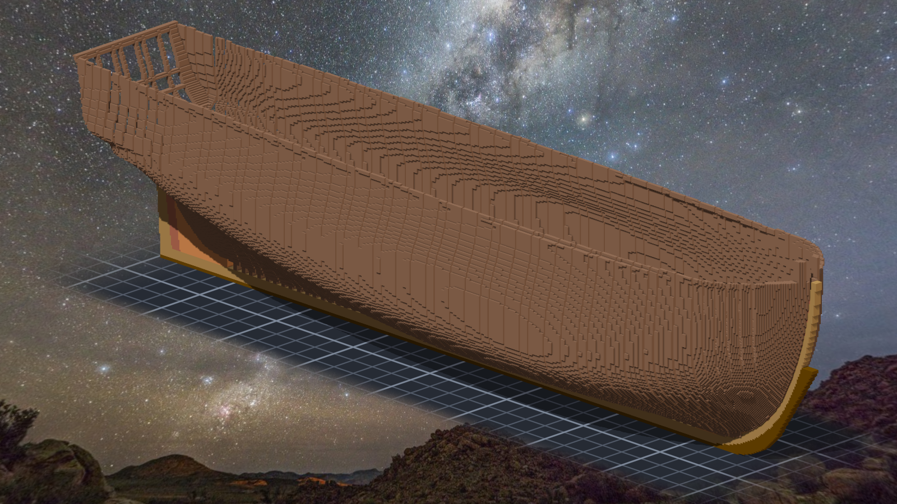
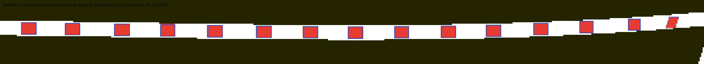
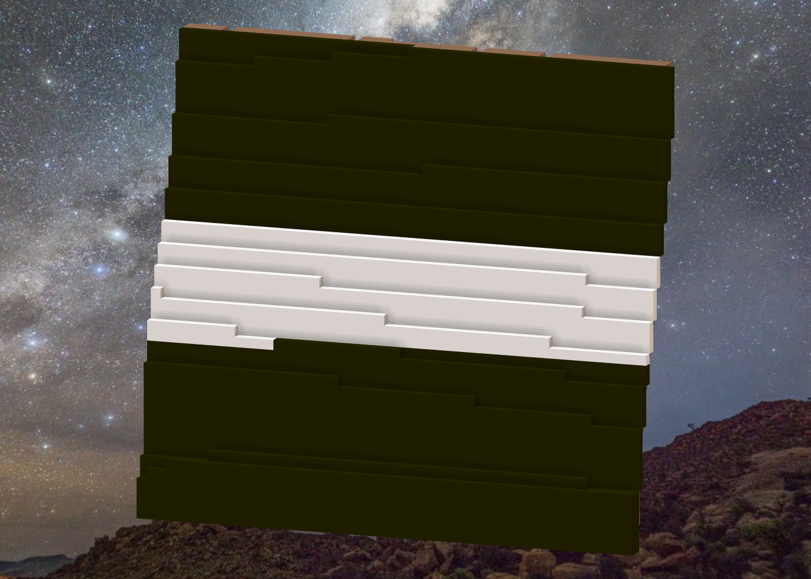
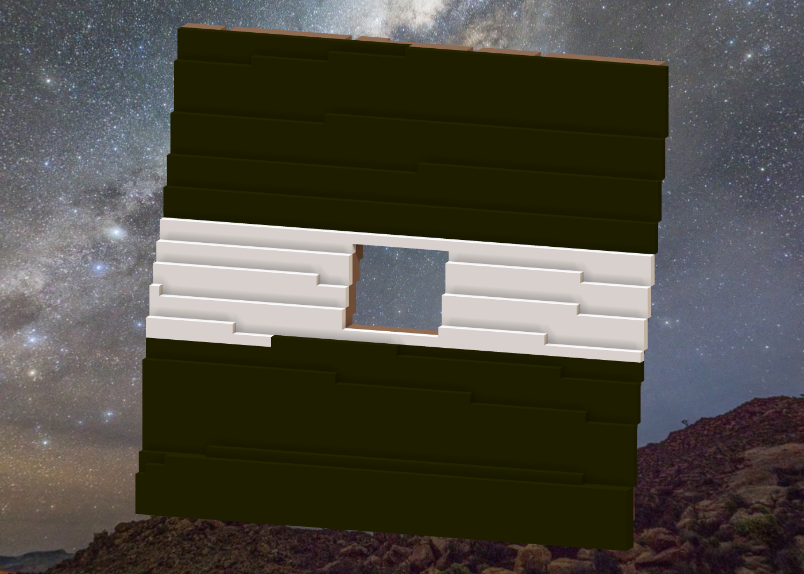
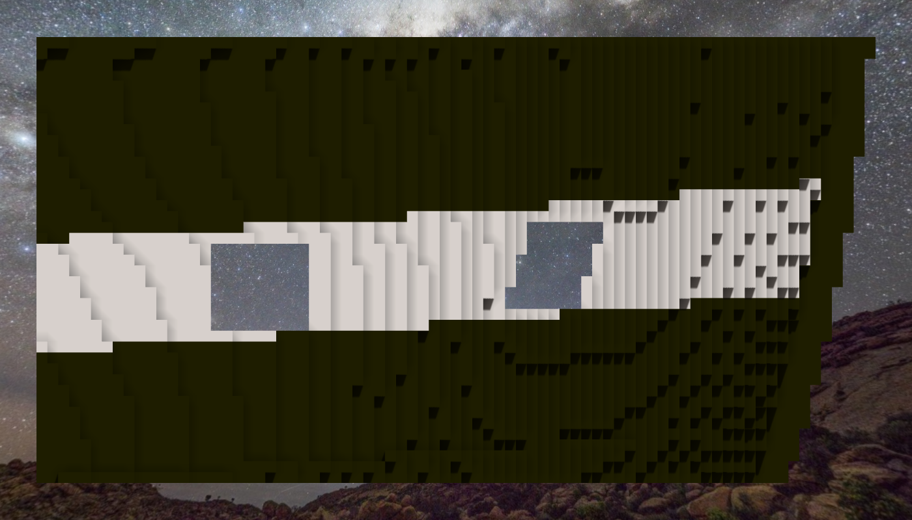
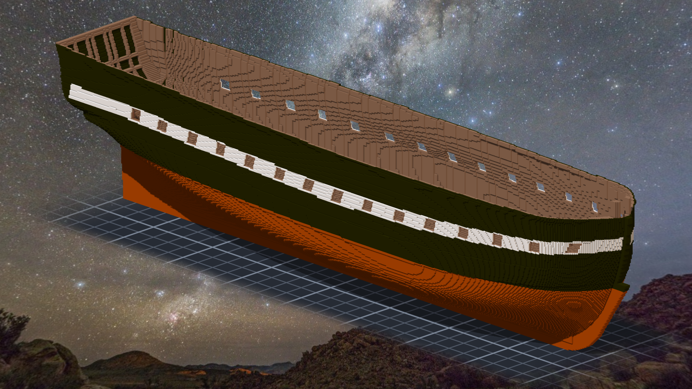
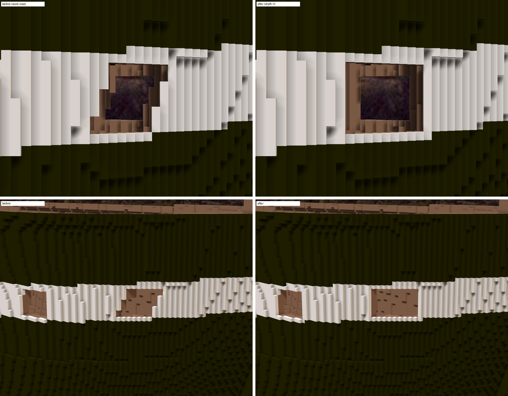

# 階段八：開砲門（2026-10-11）—— 從殼上鋸開，先記下鋸之前的樣子

> 規格與完整讀數在 [`../notes.md`](../notes.md)「時間標記」與「階段八」；新圖紙在 [`../design/sheet06_ports_v1.png`](../design/sheet06_ports_v1.png)。

## 鋸之前，先讓「之前」叫得回來

外殼鋪好、提交完，正要開砲門，Tim 問：雕刻引擎能不能加一個功能，標記某一段，之後還原那一刻的樣子 —— 例如開砲門之前的船殼。

本小姐先去讀引擎怎麼重播：每一刀都是一個事件檔，照檔名順序套用；連 undo 也是一個帶著前後內容的事件。所以「那一刻」其實早就在那裡，只差一個名字。
做法就照這個：標記只記「重播到哪一個事件為止」，存在作品自己的 `marks.json`，不進事件 —— 舊版的 senate.exe 照常重播這件作品。觀測時給一個標記，就從頭重播到那裡；寫入的指令帶標記直接擋下，落子永遠落在現在。
Tim 又補了兩句：船殼也標，之後內裝、桅杆、每層甲板也要能用。於是多了兩個參數：把某一段撤掉再看，或只看某一段。

寫完先把前七個階段補標上去。量的方法是拿作品筆記裡每個階段結束時記下的總數來比 —— 七個數字，七個都一樣。
撤掉「船殼」那一段再渲一次：外板不見了，被塗成銅色的龍骨面回到原木色，總數正好是階段六結束的那個數。

新的測試第一次跑就綠。第一次就綠的尺不知道會不會叫，所以故意弄壞兩處（撤掉時不還原、寫入時不擋），兩處都紅了，才把它們放回去。

## 先量，再鋸

方砲門十四個在上一階段量過了。這次補船頭那一個：圖上它是一個平行四邊形，上下緣是平的，兩側往船頭斜 —— 船殼在那裡轉得很急，側面圖把它壓扁了。

開口的規則很簡單：格中心落在圖上框裡的格子。麻煩的是「刻什麼」：開口裡的東西全是 141 那個木頭色，顏色分不出哪一格是肋骨、哪一格是 hawse piece。所以照階段六、七的清單一格一格標身分 —— 外板、方肋、cant 准刻，其他碰到就停。這次開口裡一格都沒碰到。

刻完，開口四周會露出肋骨之間那 0–1 格的縫。實船的砲門上下有 sill 和 lintel、左右有 port timber，所以在開口外面一圈、肋骨那一層，把空格補上木頭。

## 雕之前的 verifier，停掉了

雕之前派了三個 verifier 去推翻這份設計。剛派出去，Tim 說：雕刻步驟可逆，可以用 git，不用擔心。
它們會自己重播事件；本小姐一雕，它們會讀到半套新的事件，量出來的東西反而會亂。所以先停掉、先雕，雕完再派三個從產物量。

四十四刀，每一刀讀回「少了幾格」都等於事先算好的數；再一刀補上四百一十六格的框。五十九萬三千七百變成五十八萬六千一百九十二（後來細修再補八格，見下）。

## 一把永遠綠的尺

自己寫的檢查裡有一格叫「透光」。寫完回讀才看到：它檢查的是「刻掉的格現在是空的」—— 那是結果帳已經證明過的事，換句話說，它不可能紅。
改成掃開口範圍裡**還剩下**什麼：兩舷、從中線到外面，一格都沒有。再拿同一把尺掃上緣往上一列，掃到六十八格（lintel 和外板）—— 它會叫，才算數。
砲門框那一格也一樣：它跟產圖程式用同一個定義，是同源的證人；拿掉框再量一次，第一個砲門兩側馬上報出縫。

## 雕完派去的三個，抓到本小姐寫錯的一句

雕完另派三個 verifier，從產物量。帳、位置、透光都站住了，它們自己重量原圖，十五個開口每一列都落在它們預測的格子上。
但外觀那一位判了 fail，理由很具體：**第 4 個砲門上面沒有白帶**。讀數的上緣是 98.50，剛好落在 z98 那一格的中心，所以開口把白帶最上面那一格也吃掉了，上面整排都是黑的。
本小姐在作品筆記、這份日記的初稿、漫畫第 009 話的字幕、還有提交訊息裡，都寫了「上下各留一格白帶」。設計意圖是那樣；第一版的產物不是。
它們還抓到兩格：船頭砲門的後壁有一道三格高的縫，看得進船艙 —— 本小姐的「框沒有縫」用的是 m(z) 那個深度，在 cant 那一帶量不到；以及砲門框把兩個單格封成了空腔。
三格都小，補漆三十六格、補洞八格，五十八萬六千一百九十二變成五十八萬六千二百。檢查工具也補上白帶和空腔兩格。

順著空腔那一格往回量，又量到一件更早的事：**階段七鋪完外板，船裡多了兩千兩百多個封閉的小空腔** —— 階段六結束時是零。那時候本小姐只量了「船艙漏不漏水」，沒量這一格。看不到、不影響結構，排進待辦。

## 船頭那一個

船頭的砲門在格子上是一列一列往前錯開的平行四邊形，斜著看有鋸齒。本小姐本來想列成「美觀再看」。
Tim 自己檢查過砲門，說：沒問題的。

## 查到的資料
- 砲門的數量、尺寸與間距：Humphreys 1794〈Articles for a 44-Gun Frigate〉（[Papers of the War Department](https://wardepartmentpapers.org/document/46934/)，機器轉錄）—— 每舷 15 個、淨高 2'11"、寬 3'5"、砲門間 7'5"、下緣離甲板 2'4"；02 號圖（1849）標的是 3'6"×2'10"、下緣離甲板 2'2"。
- 砲門在外板鋪過去之後從板上鋸開：Tim 貼的造船說明。

## 後來：船頭砲門改成垂直（v1.2，同一天下午）

Tim 傳來一張船頭砲門的截圖，上面用紅筆畫了兩條線：左邊沿著下半段往上拉直，右邊沿著上半段往下拉直。「船頭的炮窗，試著雕刻成垂直的吧。」
紅線畫的就是那個平行四邊形的外框 —— X 643 到 651，九格寬。新的開口整個包住舊的。

他還補了一句：也可以 undo 之前船頭砲門的操作，然後重新開孔。
本小姐去看了一下能不能 undo：船頭那十六刀後面還壓著砲門框和兩刀細修，引擎的 undo 是一疊，抽不出中間那幾刀；草稿裡的 undo 也只管草稿自己的刀。所以改成「重新開孔」的另一種寫法：圖紙重產一次（船頭改垂直），再算「作品現在」到「新設計」差幾格。新開口包住舊的，結果跟「先補回去再重開」一樣。

重產時先確認舊的沒被弄壞：方砲門的二十八個盒子、砲門框四百一十六格，跟當初逐格相同。

砲門框多了一條規則：開口旁邊那道牆，從開口刻到的深度一直到外面，每一格都要是實心的。拿它去量舊的船頭砲門，量出十格 —— 其中六格，就是雕完那天 verifier 抓到、本小姐手補的那道後壁縫。一條規則自己找到了別人用眼睛找到的東西，本小姐才相信它。

差異是刻一百三十八格、補四格、補漆十六格（順手補了第 4、13、14 個砲門角落的黑缺口）。先落在草稿裡，Tim 看過對照圖：「套用吧 GO」。

## 後來：封閉的小空腔（同一天下午）

上面那件「階段七封住的兩千兩百多個小空腔」，Tim 問：可以用旁邊格子的顏色填滿嗎？確保匯出時會合併。

寫了一支可以重複用的工具：每一格填「實心鄰居裡最多的那個顏色」，同票先取木頭色；大的空腔從外圈一層一層往裡填。兩千兩百個、五千六百零二格。補完，引擎自己數空腔是零，匯出的面從十二萬零八百三十二降到十萬七千二百二十五。

本小姐想確認補進去的格真的看不到，就同一個角度補前補後各渲一張，逐像素比。不是零 —— 一千零五十二個像素不一樣。
同一份作品渲兩次是零，所以不是渲染不穩。關掉 AO 還在；關掉影子，零。
補實的地方看不到，可是影子知道：影子貼圖記的是光照到的那一面的背後有多深，補實之後背面變深了，陰影邊緣的幾個像素就換了。

那一千零五十二個點散在陰影面上，像星星。
