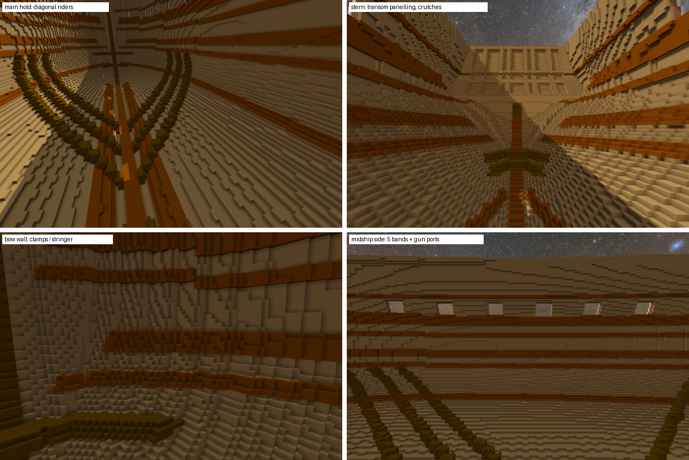
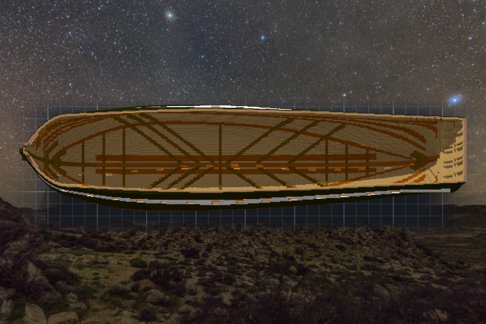
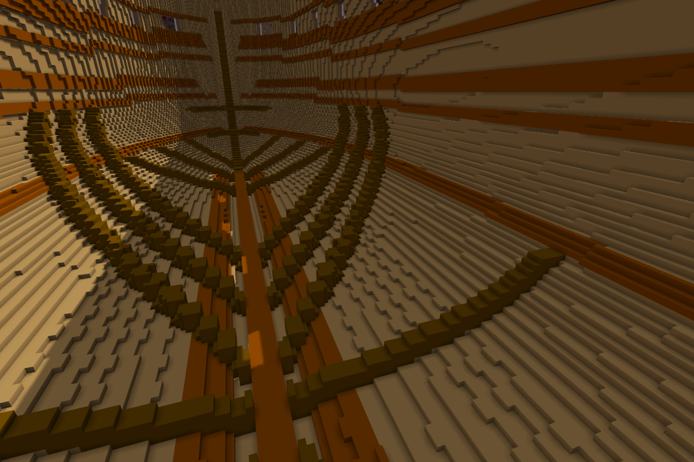

# 階段九：船殼內部（2026-10-11）—— 從艙裡看出去，不該看到外面的漆

> 規格與完整讀數在 [`../notes.md`](../notes.md)「階段九」；設計與每一格的出處在 [`../design/plan.json`](../design/plan.json) `interior`；新圖紙 [`../design/sheet07_interior_v1.png`](../design/sheet07_interior_v1.png)。

## 委託

Tim 傳來兩張圖：一張風帆戰艦的剖面插畫（甲板、橫樑兩端彎彎的肘、中線一排柱子、底艙一根沿著船殼彎上去的木頭），一張砲甲板的照片（赭黃的牆、木頭甲板、一排砲）。
他說：蓋甲板之前，先把船殼內部處理一下 —— 現在從裡面看，看得到外殼的漆，實際應該是別的結構才對吧？內裝也是美觀為主，由妳設計圖紙；甲板希望大致平整，要彎的話讓彎曲處落在房間的接縫；艙內用原木色比較好看。甲板骨架跟房間之後開子作品。

他說得對。肋骨之間有縫，外板只有一格厚，所以從船艙裡看出去，縫裡就是外面那層黑、白、銅。真船的肋骨內面會再鋪一層內板（ceiling），從裡面看不到外板。

## 先找這裡已經有什麼

最好的資料就在作品自己的資料夾裡：04 號是照 Humphreys 規格畫的船中剖面，15 號是 1928 年的船中剖面，兩張都把內部畫出來、還標了尺寸。派了一個人讀這兩張圖、另一個人專門去推翻它讀到的數字。推翻成功三格（04 號 spar deck 的高度讀到了藏在艙口底下的橫樑、limber 厚板的位置、15 號 gun deck clamp 的上下緣），之後都用推翻那位量的。

另一路去查資料，帶回來最有用的是 Martin 的《Constitution Close Up》：日誌裡記著船艙、berth deck、gun deck 的舷側和頂面，每兩三個月就刷一次白灰水。還有 1816 年的 orlop 平面圖、1931 年的內部側面圖（站位、甲板的 sheer、橫樑、breast hooks 的高度）。

所以憲法號的艙內，史料上是白的。Tim 說原木色比較好看 —— 這裡美觀優先，本小姐照他的，把史料寫進出處欄，讓之後想改回刷白的人知道依據在哪。

## 甲板定在哪裡

clamps 要釘在甲板橫樑底下，所以甲板高度得在這一階段定。15 號的甲板，放進作品比砲門低了兩三格（之前就記下的落差：作品的砲門照 1927 年的 11 號圖）。Humphreys 規定砲門下緣離 gun deck 2'2"～2'4"，所以四層甲板一起往上兩格：gun deck 船中在 Z 82，砲門下緣在甲板上六到八格。

Tim 要甲板大致平整。真船的甲板是跟著舷弧彎的，船頭比船中高將近七格；一格一格地彎，在格子上就是一道道台階。所以每層甲板拆成幾段平的，高低差只放在艙壁上 —— 艦長室前艙壁、前艙口、前桅後的 bitts、manger。每個砲門下緣離甲板都在六到九格之間（Martin 寫到，1833 年才把砲門下緣統一成兩英尺，之前本來就不齊）。

## 一把會數「看得到幾面漆」的尺

動手之前先做尺：從船艙裡的空氣出發，數它碰到幾面外板或外板的漆。現在是兩萬四千多面。做完要是零 —— 砲門開口裡那一百一十六面除外，從裡面看穿砲門，看到開口邊緣的外板是應該的。

內板就是「艙內空氣碰到船殼的那一層」，鋪一格。肋骨之間一格寬的縫先當成實心看，內板才不會順著縫鑽進去。

## 顏色比了三次

第一版的構件用跟肋骨同一個 141、斜肋用 105，渲出來木頭帶著紫灰 —— 兩個顏色的藍色分量都是 85。換成藍色分量 0 的木色，帶子變成芥末黃。最後是內板米棕、構件栗棕、live oak 深棕。三次都是在草稿裡蓋色、同一個角度渲出來比的。

## 請三個人來挑

美觀、真實性、資料各一位，每一位後面再跟一位專門推翻它的。二十條，八條站住、九條部分成立、三條被推翻。（這個數字本小姐當下跟 Tim 說成十一、七、二 —— 沒從檔案加總，憑印象寫的。寫這一段時回讀才對出來。）

最顯眼的一條：clamps 在船頭船尾碎成一塊一塊的磚。本小姐的「往內一格」只沿著左右方向找，船殼轉向前後的地方就斷了。改成沿著船殼的法向找，再補一次斜接，船頭從兩百四十塊變成七塊。

最該記的一條是寫在本小姐自己身上的：斜肋的位置，本小姐在出處欄寫了「前組頭在船頭數來第八、六、四根橫樑」，出處寫 USNI。評審說研究裡找不到這句。去找原文：USNI 那篇回 403，另一篇沒有這句。那句話是更早一次搜尋工具給的摘要 —— 本小姐沒讀過原文，就把它寫成了出處。拿掉，改用 15 號立面圖上畫的位置，加上一筆論壇轉述的範圍，出處欄照實寫「轉述」。

還有一條是本小姐自己量到的：被當成實心的那些縫，內板蓋住之後還有兩萬五千格從船底一路通到舷頂的開口。從艙裡看不到，從上面看是一條條深縫。在舷頂封一百七十格，整條縫就變成封閉的空腔，跟其他空腔一起補實。

## Tim 預覽的時候問了一個問題

他從上往下看，圈了兩個地方：斜著交叉的深色木頭是什麼？一般船內部的骨架應該要垂直於龍骨吧？

是。憲法號的肋骨也是垂直的，一百三十二片，階段五雕的，現在被內板蓋住了。他圈的是斜肋（diagonal riders）—— Humphreys 的規格裡寫了 six pair each side，疊在內板上，把船頭船尾的重量引到船中的龍骨。據說 1820 年左右被拆掉，1992 到 1996 年修復時照規格裝回去。他貼的那張剖面圖裡，那根沿著船殼彎上去、垂直龍骨的，才是一般巡防艦常見的橫向 rider。

他說：維持斜肋吧。過了一下又說：再加幾根橫向吧。

挑了跟斜肋、hooks 都不交叉的肋骨站位，每四個肋位一根：船尾三根、主艙口正中一根、船頭三根，每舷七根。重產的時候，其他七份清單逐位元組不變。

## 套上去

兩筆草稿 apply：二十二萬九千六百三十四格，再四千四百三十四格。五十九萬一千六百六十八變成八十二萬一千四百四十四。

從艙裡看得到的外板漆：零面。把內板拿掉再數一次，數到五千三百二十二面 —— 那把尺是會叫的。

多了二十三萬格，匯出的面反而從十萬七千降到九萬九千：肋骨之間一條條鋸齒狀的縫，被一層平的內板蓋掉了。

## 查到的資料
- 04 號（依 Humphreys 1795 規格的船中剖面）、15 號（1928 Navy Yard Boston 船中剖面）：美國國家檔案館 RG 19（Use: Unrestricted），`Sculpture/references/uss-constitution-1927/`。
- Humphreys 1794〈Articles for a 44-Gun Frigate〉——[Papers of the War Department](https://wardepartmentpapers.org/document/46934/)（機器轉錄）：running ceiling 4"、limber／bilge streaks、各層 clamps、spirketting、橫樑、肘、柱子、breast hooks、diagonal riders six pair。
- T. G. Martin, *Constitution Close Up*（[USS Constitution Museum](https://ussconstitutionmuseum.org/download/constitution-close-up-minutiae-for-modelers-and-artists/)）：刷白灰水的日誌紀錄、berth deck 與 orlop 的配置。
- 1816 Waldo orlop 平面圖、1931 inboard profile、1931 gun deck 配置圖（[USS Constitution Museum](https://ussconstitutionmuseum.org/download/inboard-profile/)）：房間、桅、艙口、甲板的 sheer、breast hooks／crutches 的高度。
- [USS Constitution Museum — Decks](https://ussconstitutionmuseum.org/2016/07/14/decks/)：甲板用的木料、holystone 磨過的淡奶油色。
- 斜肋：[Iver Franzen](https://iverfranzen.com/Constitu.html)（1992–96 修復時照 Humphreys 規格設計 diagonal riders）；Marquardt《Anatomy of the Ship》的位置與角度是論壇轉述，沒有讀到原書。
