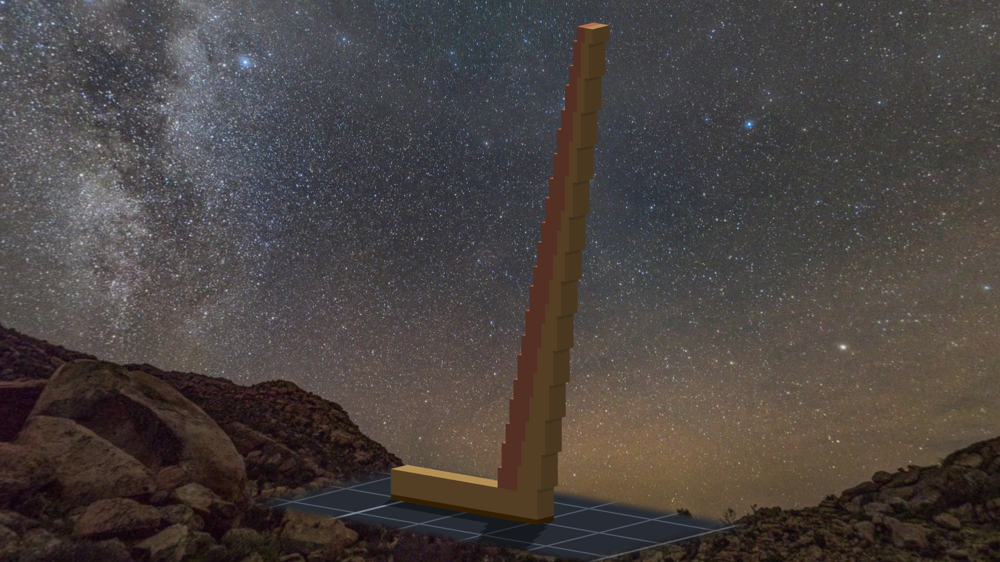
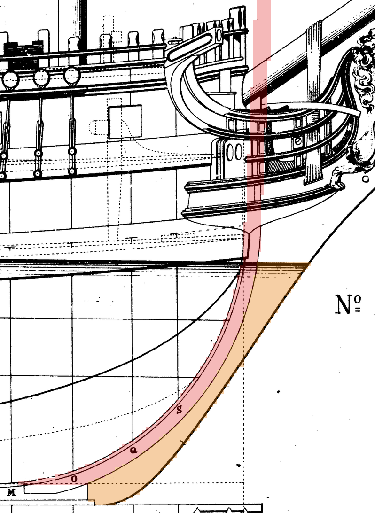
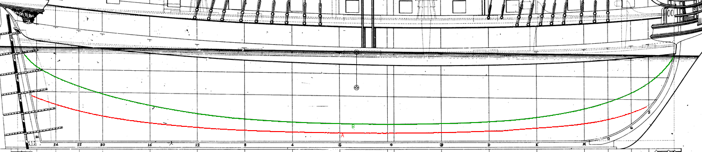
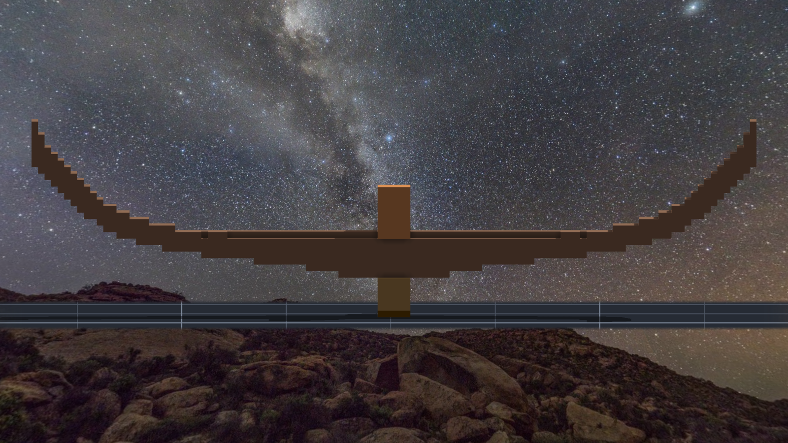
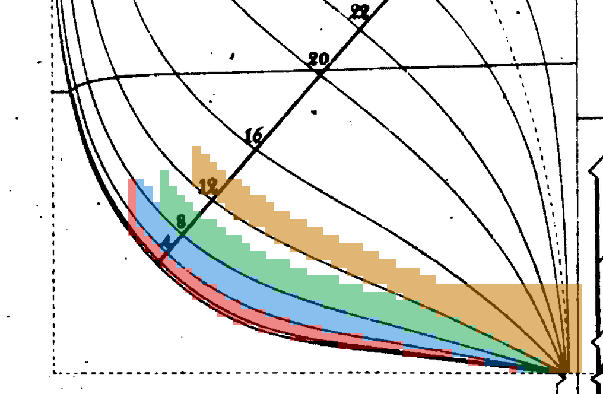

# 階段零～一：圖紙與龍骨（2026-10-13 晚到深夜）

規格與讀數以 `../notes.md` 為正本；這裡記的是過程裡在想什麼、在哪裡停下來。

## 圖紙：疊回去才看得到的四件事

線形圖 v1 第一次疊回 Pl. LI，紅線在船頭往前衝出去兩公尺多。我的第一個判斷是「舊讀數 `stem_outer` 追錯了」——
那條粗線一路從龍骨延伸到船頭像下面，看起來不像船頭柱。我照著這個判斷重追了一次，追到的還是同一條線。
再把整張圖攤開看才懂：Chapman 把船頭柱、gripe 和船頭的 knee 畫成一條連續的外緣。讀數沒錯，錯的是我的程式拿它往後平移當 rabbet。
真正的 rabbet 是內側那對細線，Q 站和 S 站的直線都剛好停在它上面 —— 這是我拿來確認的那一格。

同一輪還抓到：船尾柱舊斜度只用了 3 列（重擬合 363 列是 8.24°，而且它不在我以為的原點上）、船中橫切面在 z 1.3–1.7 跳線、
半寬圖內側那條粗線根本不是水線。四件都是「數字是真的，住址是我補的」。

倍數也改了：當初估 ×1.308 時外板只抓 0.1 m，照讀數是 0.13 m，寬度就會超過我自己定的上限。
改成讓程式從上限算（1.2852），不寫死。

## 龍骨

Tim 看完圖紙：「單層提交吧 然後開始下龍骨」。

Chapman 的龍骨分兩層：龍骨 0.374 m、護龍骨 0.114 m，前端錯開一個台階讓船頭柱的腳接上去。
放大後是 4.8 格與 1.5 格，我取 5＋1，讓龍骨頂面落在整數格 Z 6。

兩刀 stampvox，讀回 2,260 與 11,250，跟清單一樣。結果帳 0 差。
原圖探針裡船尾有一根報 3.2 格 —— 一看是那一列的黑帶被舵的鐵件蓋住，探針挑到別的黑段。
改的是探針，不是龍骨：黑段要夠寬才算黑帶，那一列跳過、照實寫下來。

## 階段二：船頭柱・gripe・船尾柱・內艉柱（2026-10-13 深夜）

這一段讀圖用的是同一招：在一列上把所有黑段都標出數字、畫在圖上看，再決定哪一條是哪一條。
船頭有三條線在吃水線附近收攏 —— 兩條細的成一對（rabbet）、中間一條（船頭柱前面）、外面一條粗的（連 gripe 和 knee 的外緣）。
船尾是黑帶加 L1、L2／L3：L1 往上一路收到快沒了，一開始我以為那不可能是船尾柱的前面；
攤開憲法號的筆記才看到，那艘船的船尾柱也是下寬上窄、上面由內艉柱接手。分件照憲法號，寫成「推定」。

探針這次改成在原圖那一列**重新找線心**，不拿設計時的追線 —— 拿追線去量用追線做出來的東西，只會永遠同意。
跳過的列照實寫：黑帶在鐵件那裡斷開、船頭 z 5.0 那一列正好壓在吃水線的粗線上。

## 階段三：deadwood・apron（2026-10-14 凌晨）

舊讀數裡那條「肋底上升線」，疊回去才看到它中段對、兩頭各跳到一條水線上變成水平線 —— 又是住址：同一個名字，前半段在一條線上、後半段在另一條上。
重新完整追一次，順便把它下面那條虛線也追了：兩條拿來對憲法號，正好是 A（cutting-down line）和 B（keelson 頂），相對位置也一樣（B 在 A 上面約 0.5 m）。
虛線兩頭點太稀，追線會斷，改成「每一欄只找小黑點、再擬合」。

這一段也把我自己寫錯的日期抓回來了：前一段筆記寫「10-14 凌晨」，量了才知道當時還是 10-13 的 23:59。
這一段開工時 date 才真的過了午夜 —— 所以這一節的「10-14 凌晨」是量過的。

## 階段四：底肋・keelson（2026-10-14 凌晨）

肋距是這一段最乾淨的一個讀數：船尾的站號本身就是肋位號，八個站擬合一條直線，殘差都在 2 公分以內。
船頭那邊的字母站怎麼換都差 0.6 個肋位 —— 沒讀懂它的編法，就不用，照實寫下來。

底肋頭用半寬圖那條粗的內線；它在船中是 4.27，翻回橫切面圖剛好落在 z 1.35 的船殼上 —— 兩張圖互相作證。
憲法號踩過的兩個坑（底肋凸進 keelson、keelson 底下空一格）這次在設計裡就擋掉了：每一欄用自己的 A，中線 A 以上只給 keelson。

這一段出錯的都是探針：一次抓到站線的毛邊，一次量到底肋頭以為是船殼。還有一次是迴圈本身 ——
第一片明明貼對了，比對字串時清單檔尾巴的 `\r` 讓它判成不對而停下。停下是對的，只是停的理由是假的。
