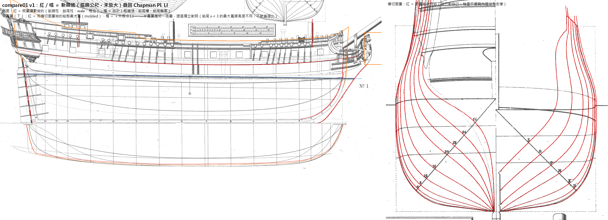
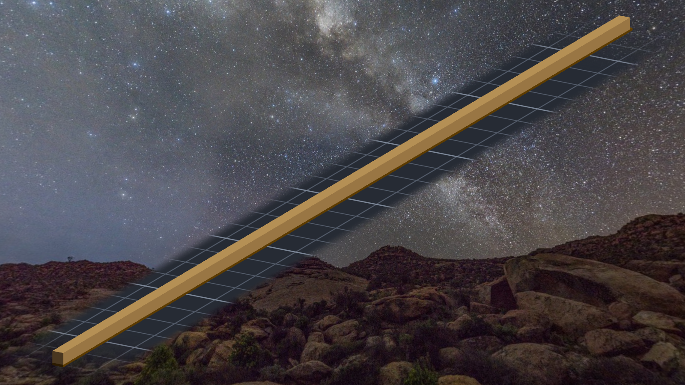
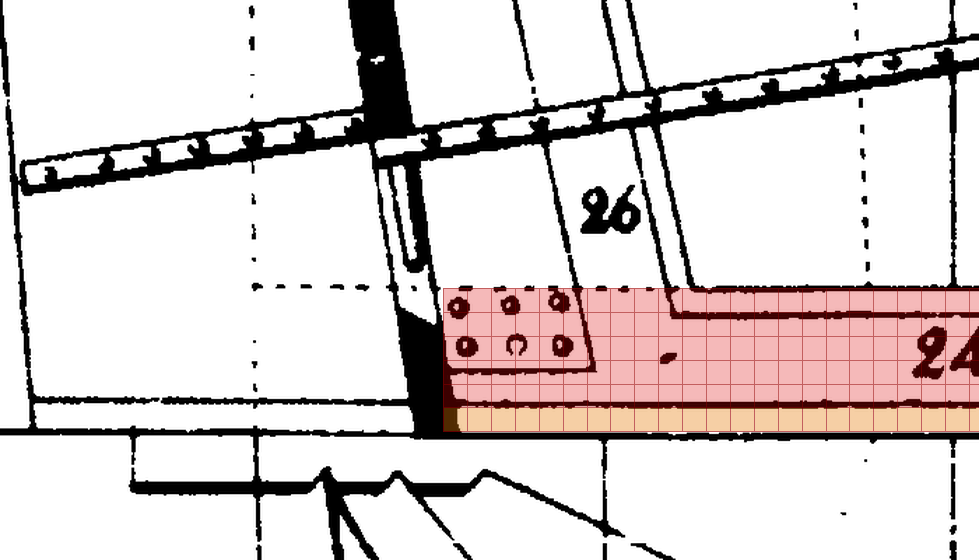
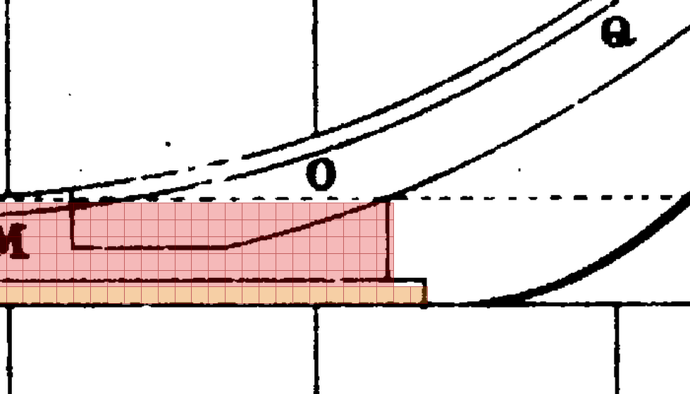

# 階段零～一：圖紙與龍骨（2026-10-13 晚到深夜）

規格與讀數以 `../notes.md` 為正本；這裡記的是過程裡在想什麼、在哪裡停下來。

## 圖紙：疊回去才看得到的四件事

線形圖 v1 第一次疊回 Pl. LI，紅線在船頭往前衝出去兩公尺多。我的第一個判斷是「舊讀數 `stem_outer` 追錯了」——
那條粗線一路從龍骨延伸到船頭像下面，看起來不像船頭柱。我照著這個判斷重追了一次，追到的還是同一條線。
再把整張圖攤開看才懂：Chapman 把船頭柱、gripe 和船頭的 knee 畫成一條連續的外緣。讀數沒錯，錯的是我的程式拿它往後平移當 rabbet。
真正的 rabbet 是內側那對細線，Q 站和 S 站的直線都剛好停在它上面 —— 這是我拿來確認的那一格。

同一輪還抓到：船尾柱舊斜度只用了 3 列（重擬合 363 列是 8.24°，而且它不在我以為的原點上）、船中橫切面在 z 1.3–1.7 跳線、
半寬圖內側那條粗線根本不是水線。四件都是「數字是真的，住址是我補的」。

倍數也改了：當初估 ×1.308 時外板只抓 0.1 m，照讀數是 0.13 m，寬度就會超過我自己定的上限。
改成讓程式從上限算（1.2852），不寫死。

## 龍骨

Tim 看完圖紙：「單層提交吧 然後開始下龍骨」。

Chapman 的龍骨分兩層：龍骨 0.374 m、護龍骨 0.114 m，前端錯開一個台階讓船頭柱的腳接上去。
放大後是 4.8 格與 1.5 格，我取 5＋1，讓龍骨頂面落在整數格 Z 6。

兩刀 stampvox，讀回 2,260 與 11,250，跟清單一樣。結果帳 0 差。
原圖探針裡船尾有一根報 3.2 格 —— 一看是那一列的黑帶被舵的鐵件蓋住，探針挑到別的黑段。
改的是探針，不是龍骨：黑段要夠寬才算黑帶，那一列跳過、照實寫下來。

