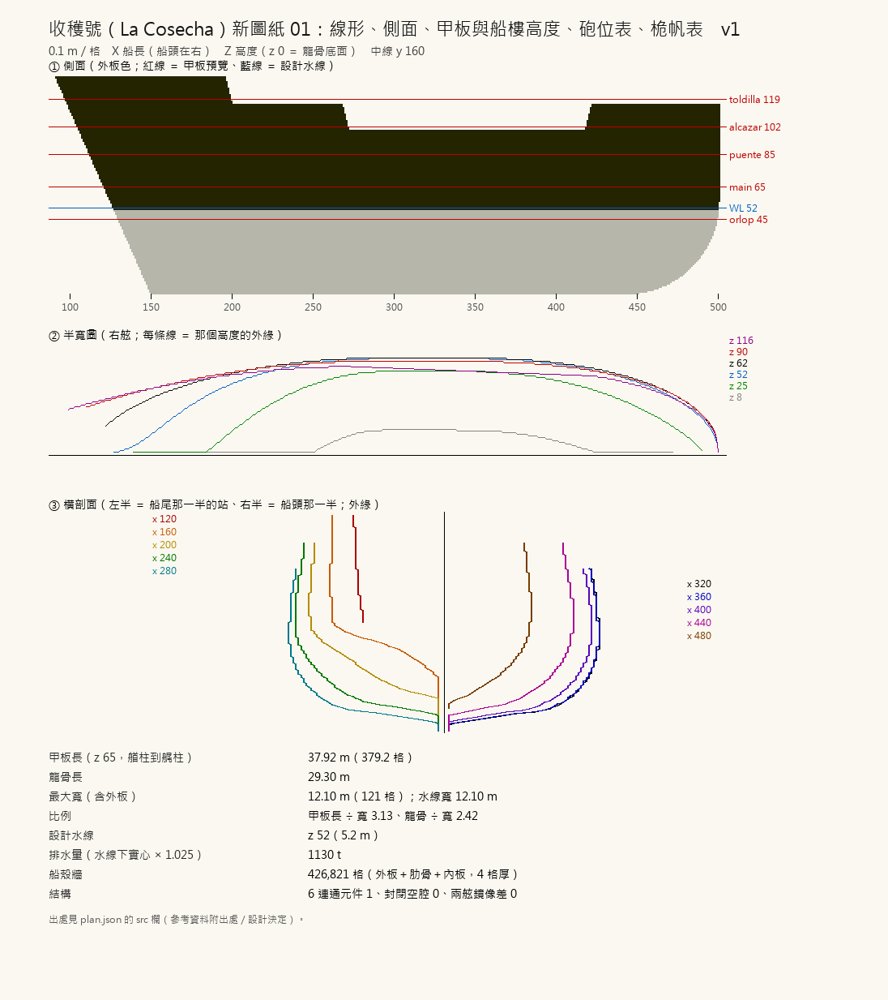
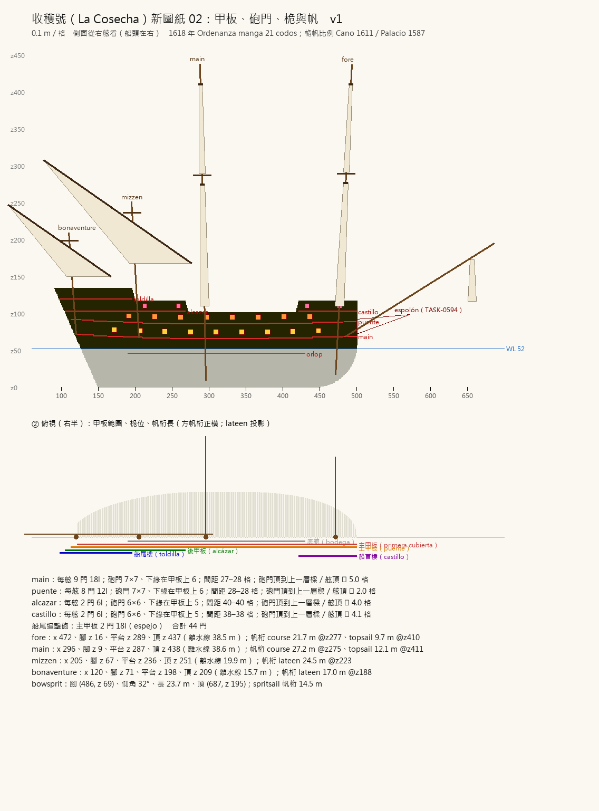

# 階段一 新圖紙（2026-10-15，TASK-0590）—— calli 的日記

## 先查表，再動筆
Tim 說「西班牙大帆船、可以找真實圖紙」。我派了兩個 agent 分頭查：一個只管法令與造船書（1607／1613／1618 年 Ordenanza、Palacio 1587、Cano 1611），一個查實船與複製船。兩份報告都交回來時，有一份文件兩邊都逐頁讀過 —— Fernández-González 2009 的 Ordenanza 論文。所以船殼的骨頭全照它的表 4 算，其他來源只拿來對量級。

## 我選了哪一格，為什麼
- 1618 年的表從 14 到 22 codos 都有。我挑 21 codos（946½ toneladas）：連 espolón 大約 46 m，跟遊戲裡其他船站得在一起。
- 第一次跑的試算值（研究回來之前）長寬比 3.49、龍骨比 2.75 —— 那是我憑印象寫的。表上的 21 codos 是 3.14、2.43：**我印象裡的 galleon 比法令的 galleon 瘦**。照表改。
- 表上算得到、我卻沒照做的只有一格：甲板間距。1618 是 3 codos（1.72 m），我用 1589 年 galleon 的 3½ codos（2.0 m），因為遊戲要人站得進去。這一格寫進 plan.json 的 src 和筆記，不藏。

## 對帳時被數字推回來的
- mura／cuadra（art.21）一開始兩站都是全寬 121 —— 我的長度方向收縮從太後面才開始。把 s_aft、s_fwd 照兩站的目標寬反推，mura 115（要 115.3）、cuadra 111（要 109.5，奇數格最近）。
- tumblehome 我原本寫 6 格／舷（印象裡 galleon 上面很窄）。法令 art.22 的規則是「puente 那一層跟 hold beams 那一層一樣寬」—— 量出來只要 1.4 格。我的印象又一次比法令誇張。上面的船樓我留了每 10 格收 1.2 格，那是設計決定，標了。

## 還沒量到的
- 桅帆比例只讀到部落格的轉述（Cano、Palacio），1618 年自己的桅帆條文（art.72–91）兩個 agent 都沒拿到。所以桅帆表的每一格都標了 ⚠ 二手。
- Red Bay 的實測線形在 Parks Canada 188 MB 的 PDF 裡，沒下載。剖面用的是法令的規則（plan、astilla、tumblehome），不是實測。
