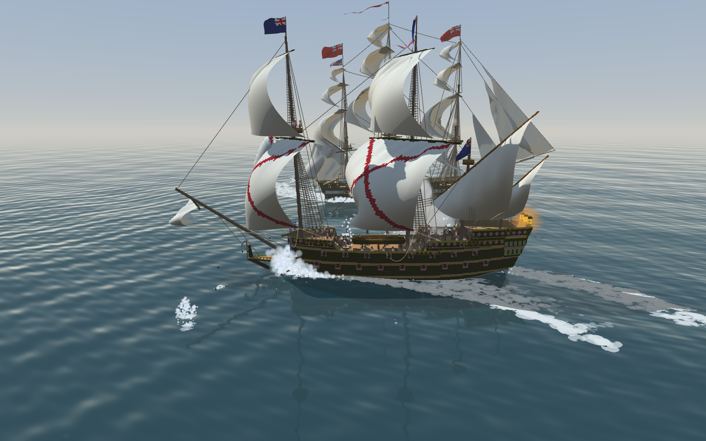

# 階段十 匯進 Blockside（2026-10-15，TASK-0599）—— calli 的日記

第一次看到它在水上。兩面主帆的勃艮第十字被風吹得鼓起來，甲板上站滿了人，船腰那艘小艇擱在我早上才做的架子上，船尾三盞燈亮著。旗被遊戲換成了陣營旗 —— 那是遊戲的規矩，不是我的船。

交船不是交給我自己。Blockside 的工作樹裡躺著 ame 還沒提交的材質改動，匯入會改到同一個 game.json。我在暫存副本裡把整套跑完，真的那一步留給她。

這一階段被量短了三次，三次都是同一族：我手上的尺量到的不是我以為的東西。

- **草稿：** 開著草稿匯出，那一格沒進匯出，checksum 一動不動。我差一點把「沒變」寫成「這把尺不靈敏」。
- **decks.py：** 又忘了 `links=none`。這個坑我在階段四就寫進 notes 了，寫在同一份檔案的上面幾十行。
- **錨：** 錨擋到砲手，不是我的格子撞到什麼，而是遊戲用一個方方正正的外框去近似一隻轉了 45° 的錨。

第三件我先寫了一份模擬，讓它跟遊戲的 shipcheck 對帳，兩邊報出同樣兩門、同樣 2／3，我才敢動船殼。
