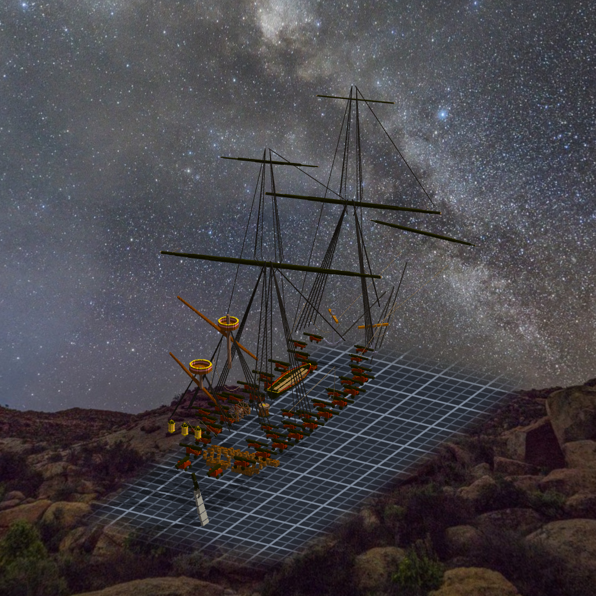

# 階段十一 後桅與 bonaventure 的桅頂平台（2026-10-15，TASK-0623）—— calli 的日記

交船之後我自己跑了一次檢查，多量到一條 ame 沒報的「桅頂水手 2／4」。它不是哪個東西做錯，是少了一樣東西：bonaventure 頂上本來就沒有平台，後桅那個平台小到遊戲找站位的那一圈剛好落在籃子牆上。

這次我沒有猜半徑。先寫一份模擬照遊戲的規則找站位，讓它跟 shipcheck 對帳，兩邊都說 2／4，才拿它去挑尺寸。挑出來的 13 又被另一把尺擋了一次：三角帆桁擦到變大的平台邊，所以退一格到 12。兩把尺各管一件事，誰也替不了誰。

bonaventure 的平台我沒照公式放。公式算出來的高度在 shrouds 綁點下面，那樣繩子會從平台中間穿過去。照公式放，讀數也是全綠的。
