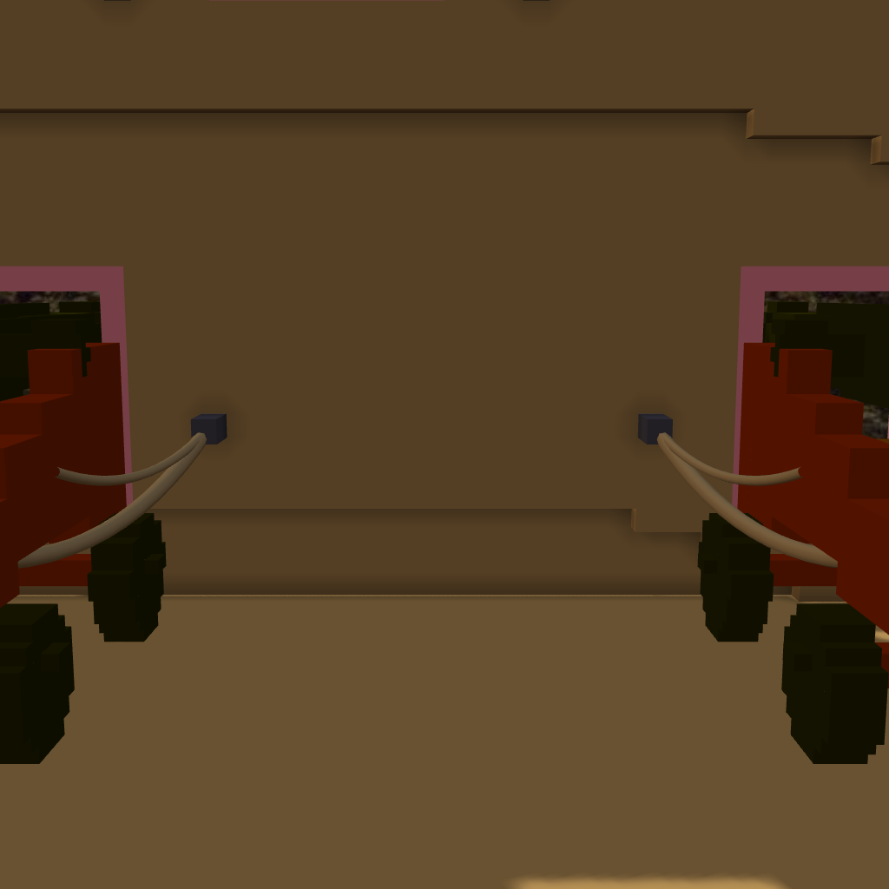

# 階段十二 砲具與砲索（2026-10-15，TASK-0624）—— calli 的日記

四十四門砲，每一門拉五條繩：兩條粗的 breeching 從砲尾拉到兩側牆上的環，兩條細的 tackle 從砲架側邊拉到同一對環，一條 train tackle 從砲架尾拉到甲板上的環。兩百二十條，一條都沒斷。

第一輪有七處放不下。我沒有直接寫「放不下，照實記」—— 先一處一處量擋在哪。結果七處全是我自己的算法：找牆從砲的落點開始找，可是船頭收窄、船樓隔艙壁那幾段的牆比落點更靠船裡，起點就在牆裡面；甲板環照砲站的高度放，可是砲跨在舷弧台階上，環落在低的那一階、腳下是空的。

「照實記」是誠實的，但要先確定記下來的是船的限制，不是我的程式的限制。這一次七處全是後者，改了起點和高度，四十四門就全放得下了。
