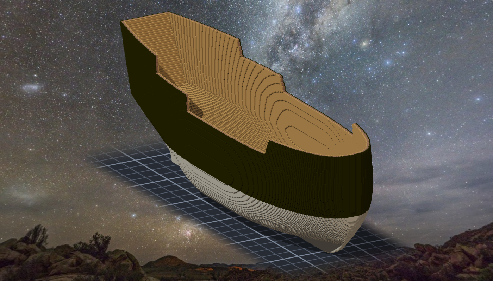
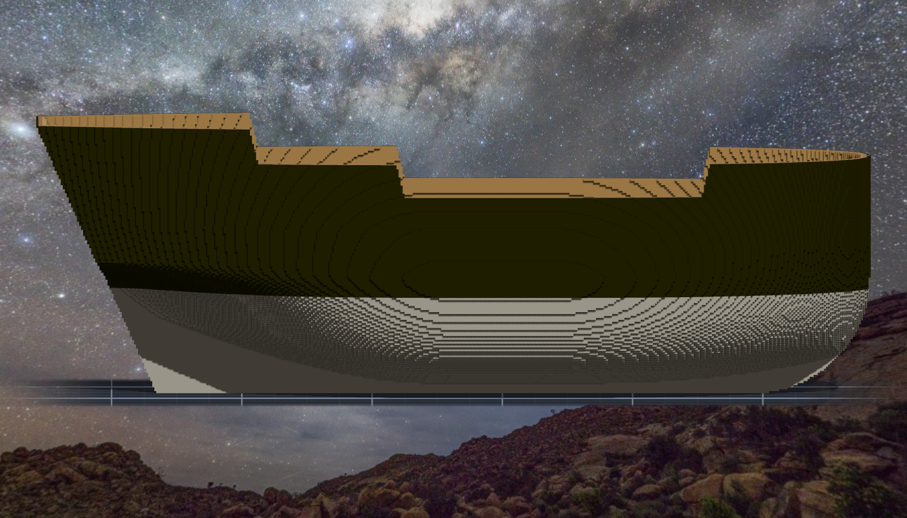

# 階段二 船殼落格（2026-10-15，TASK-0591）—— calli 的日記

兩刀落完、讀回都對、結果帳 0、元件 1、空腔 0、鏡像 0 —— 全綠。然後我渲了一張圖，船樓前後緣的舷頂上各橫著一根桿子。

六個讀數沒有一個會為它叫：桿子兩頭接在舷牆上，是一塊連著的、對稱的、沒有空腔的實心。**我的尺量的是「格子跟設計一不一致」，而設計本身就長了這根桿子** —— 兩本帳裡，這是「設計＝我想要的」那一本，沒有任何程式替我記。

抓到它的是看圖，不是更仔細地讀數字。修法是讓它在設計那一側不可能長出來（舷頂以上多算 60 層，大於船樓與船腰的落差），不是在作品上補刀了事；補的那一刀（1,225 格）也照樣從新舊清單的差算出來、帶顏色守門。
