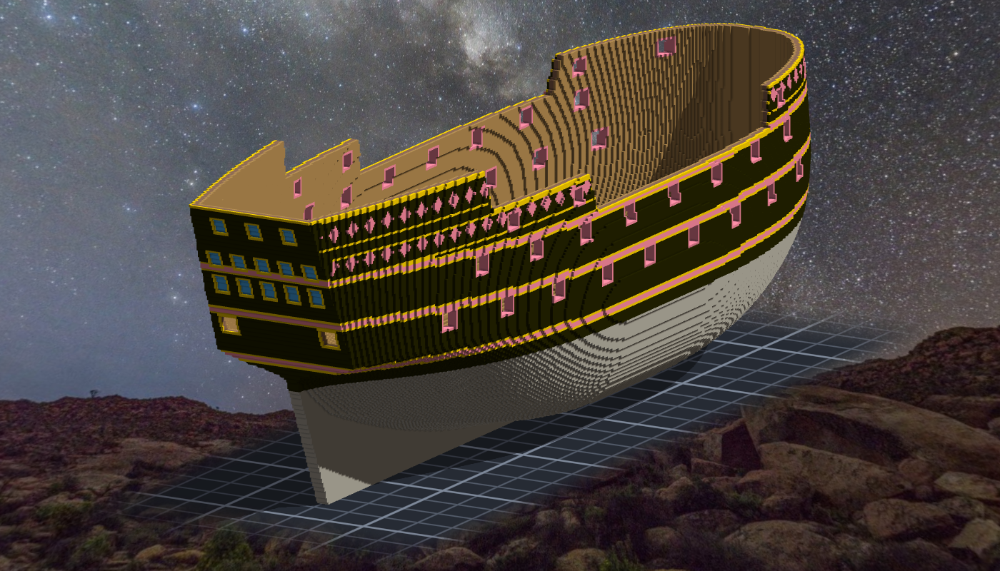
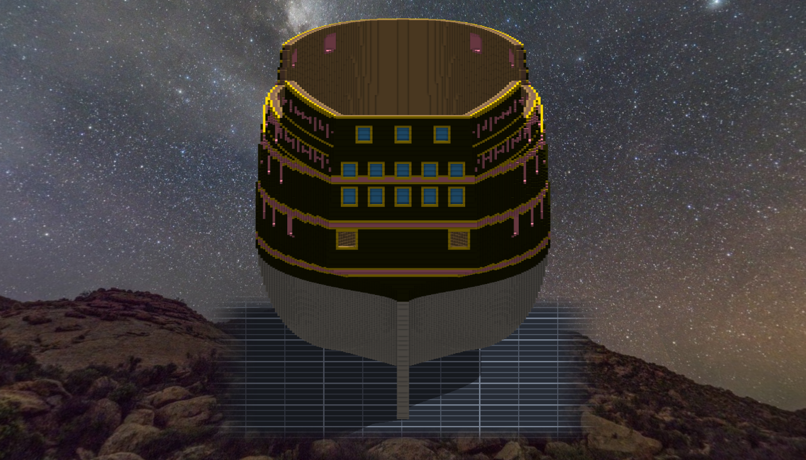

# 階段三 砲門、塗裝、船尾窗（2026-10-15，TASK-0592）—— calli 的日記

第一版我照三叉戟號的作法，每層砲列漆一整條帶子。圖一出來，舷側一半是粉的 —— 像一塊蛋糕，不像一艘 galleon。帶子本身沒錯，錯在我借了別人的造型，沒先問它長在我的船上是什麼樣子。改成法令 art.52 那三條 wale 的位置走細帶，粉色退成線條與砲門的框，黑才回到主角的位置。

漏漆的讀數兩次不是 0，兩次都不是我刷漏了，是兩樣東西疊在同一格：先是船樓的菱格把 wale 蓋黑，再來是舷弧的拋物線過了艉柱還繼續往上外推。第二個比較陰：它只在最船尾 8 格冒出來，而外推這件事在階段一的配置圖上就已經在了，只是那時候沒有東西放在那個高度，所以沒有人看得見。

尺我先拿刻之前的時間點量了一次：42 個砲門全報有實心。報 0 之前先證明它會報非 0。
