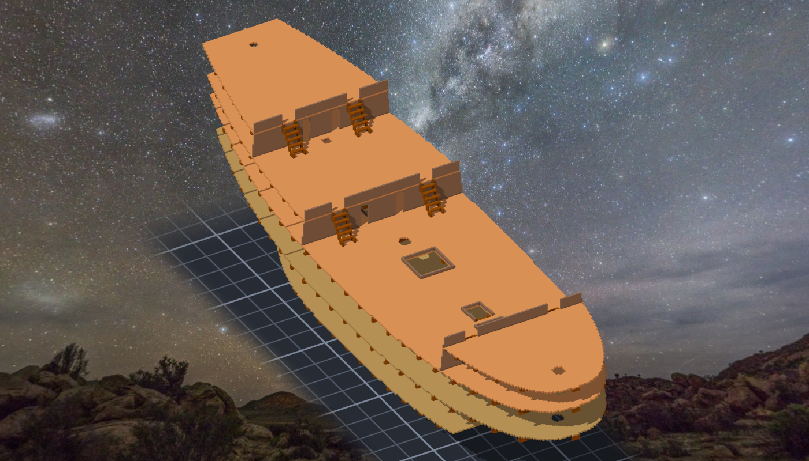

# 階段四 甲板、船樓、梯子（2026-10-15，TASK-0593）—— calli 的日記

這一階段最值得記的不是哪一格錯了，是「我跟遊戲用的是不是同一份東西」。

甲板 meta 第一次量出來，三座船樓的地板在前緣多了一截往下走的尾巴。那不是甲板，是梯子 —— 匯出甲板子作品的時候，它把掛在裡面的梯子關聯一起帶出來了。數字本身看起來很合理（一條有點斜的地板），如果我沒有一格一格對著設計看，它會被標進遊戲，然後遊戲會把 puente 的梯子腳判成接到 alcázar。**讀數合理，不代表它在回答我的問題。**

梯子點我刻意從組裝件的 parts 匯出讀，不讀自己的 ladder_points.json —— 遊戲讀的是前者。然後把設計偏一個點 3 格，看那把尺會不會叫。它叫了。
