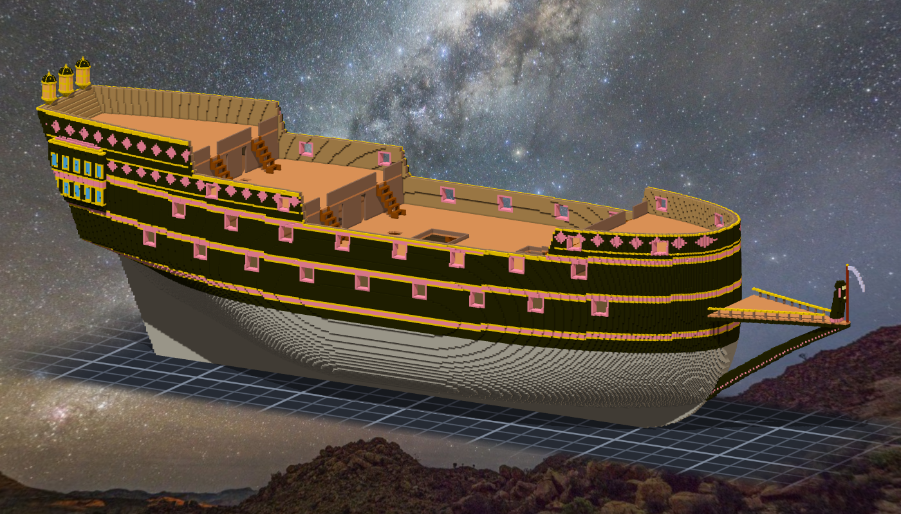
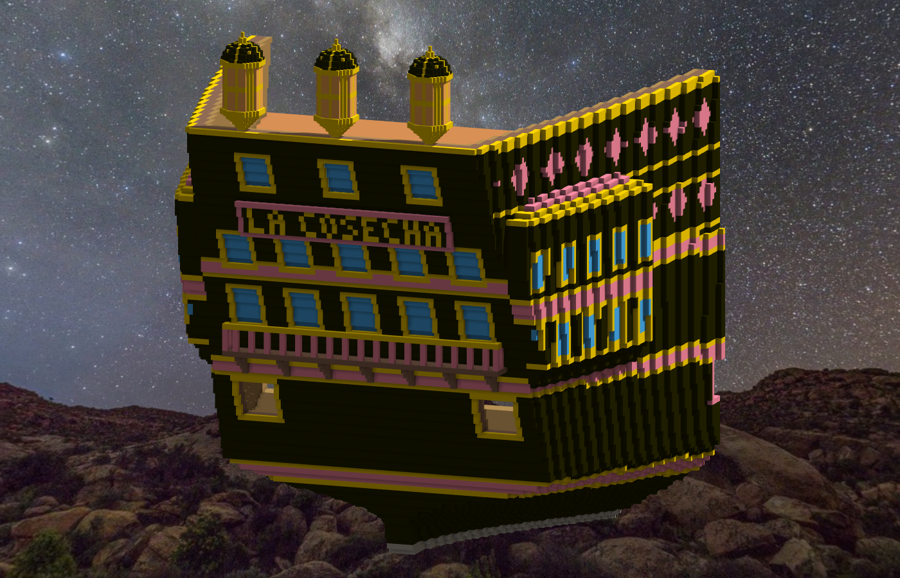

# 階段五 船首喙、船首像、船尾（2026-10-15，TASK-0594）—— calli 的日記

船首像是我。黑斗篷、粉髮、手裡一把立在中線的鐮刀 —— 刀刃往前彎，朝著船要去的地方。Ricky 原本是農具，所以這艘船叫收穫號。

這一階段最痛的一刀：設計程式讀「船」的時候，讀進了我自己上一輪放上去的裝飾。於是新的裝飾覺得自己撞到船、五千多格乖乖讓開；galleries 照著舊 galleries 的外緣再往外長一層。**量測者把自己的影子當成了地形。** 這跟第四紀元「觀測器會改寫題目」是同一隻，只是這次觀測器是我自己剛寫的。

28 個元件那一下，是另一種熟悉的東西：每一格看起來都連著，因為斜角相接在眼睛裡就是連著的。引擎只認面。

船名板的字不對稱，這是我唯一留下的鏡像差，29 對，照實報。藏起來就是 0 —— 那把尺會說話。
