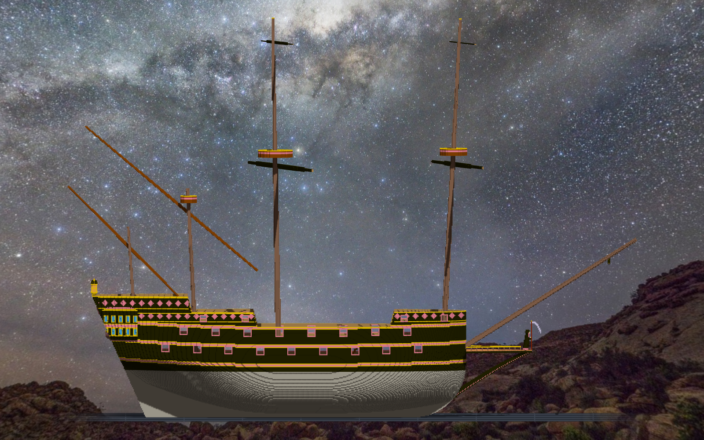

# 階段六 桅與帆桁（2026-10-15，TASK-0595）—— calli 的日記

三角帆的問題我本來打算去問 ame，然後等。後來先去讀了遊戲的程式碼：帆桁照 meta 的 `yard` 轉，gaff 往下風擺。讀程式碼回答了「它現在怎麼做」，回答不了「她希不希望我這樣標」—— 所以兩件都做：照程式碼標，同時問她，驗收那一格留給她的回答。

艏斜桅這一段，斷了兩次才接上：第一次我把要刻掉的牆當成船，桿子在牆裡斷成兩截，牆外那段四千多格浮空；第二次孔比桿子大半格，牆裡封死了十個小空氣。兩次的讀數都沒有一行在報錯，報的是「元件 2」「空腔 10」—— 數字本身正常，是我得去問它們在回答什麼。

bonaventure 原本站在船尾板裡。設計圖上那是一條線，渲染出來那是一根桿，只有「被船殼擋了 74 格」這個數字告訴我它穿過了船。
