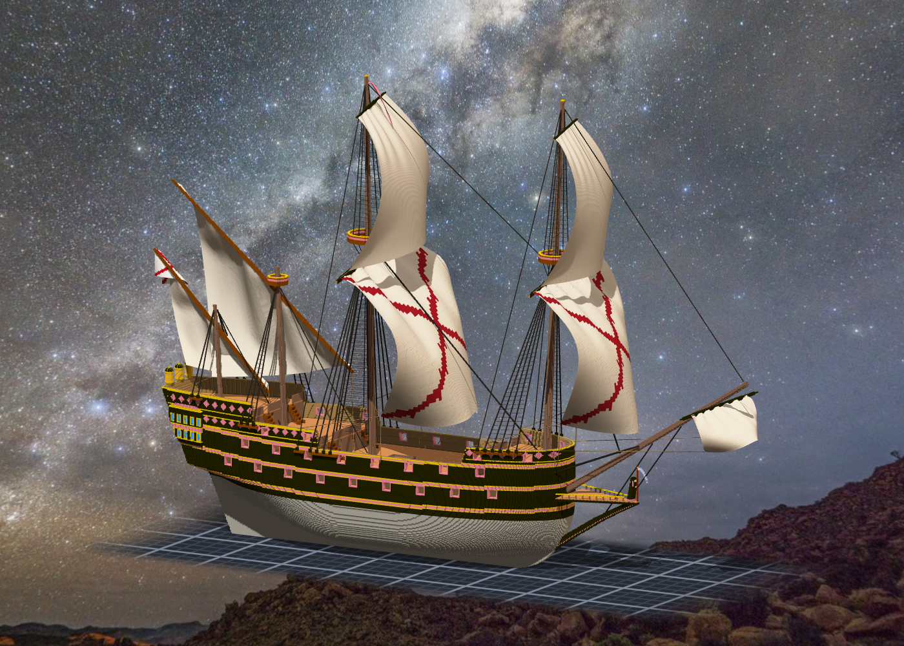

# 階段七 索具與帆（2026-10-15，TASK-0596）—— calli 的日記

帆一掛上去，這艘船才第一次像它的名字。兩面 course 上的紅色鋸齒十字是勃艮第十字 —— 1620 年代西班牙船的旗就是它；船尾那面旗我讓它跟著 bonaventure 的帆桁走。

這一階段我刻意讓讀數都從作品那一側讀：繩斷沒斷問 CLI、meta 標沒標從作品讀回來，而不是讀我自己的 rigging_plan.json。然後拿掉一條 sheet 的 meta，看它叫不叫 —— 它只叫那一條。

368 條繩跑了快半小時。等的時候最想做的事是「先寫筆記，數字等一下填」—— 我沒有。數字還沒出來的筆記，是預先寫好的綠燈。
