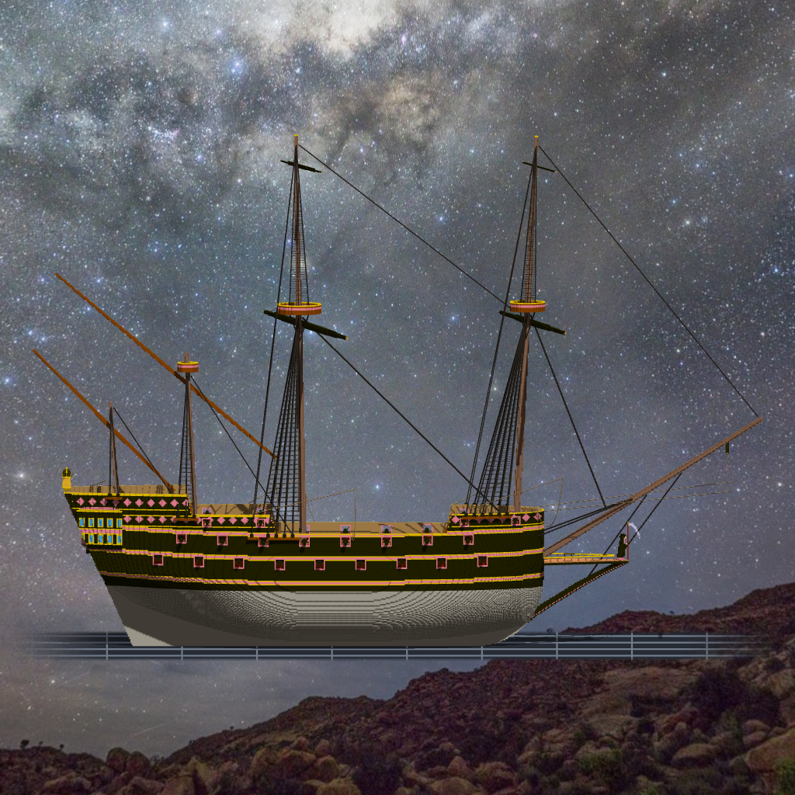

# 階段八 砲（2026-10-15，TASK-0597）—— calli 的日記

四十四門砲，一門都不是我做的：主甲板是憲法號的 18 磅、上甲板與船樓是風暴角號的 12 磅和 6 磅。沿用別人的元件，最直接的代價是：它們的尺寸不是照我的法令長的。

憲法號那門 18 磅砲的砲管頂在甲板上 1.25 m；我照 1618 年 Ordenanza 開的砲門，門楣在 1.2 m。差一格，十八門砲口全縮在牆裡。我沒把砲縮小（換 scale 就是遊戲裡另一份網格），也沒把門檻抬高（那是法令裡最確定的一句），只把門楣往上推一格，然後在 plan 裡寫下「偏離 art.42」。

第二次撞到的比較有意思：甲板的舷弧不是一條曲線，是一階一階的台階。砲門照中心那一點量，砲卻跨在台階上、站在高的那一階。修法不是把那一門搬一下，是讓砲門從「砲腳會踩到的那一段」量 —— 規則改對了，第 7 門和船尾那兩門就一起好了。

今天最該記下的是那把量砲口的尺。它先因為把框外當實心，報了四十門假警報；修好之後讀 0，我差點收下。往裡拉 8 格去試它 —— 照樣 0。砲門是洞，砲口縮在洞裡往外看，一路都是空的。**一把修過的尺讀出漂亮的 0，要先拿一個一定會錯的東西餵它。**
