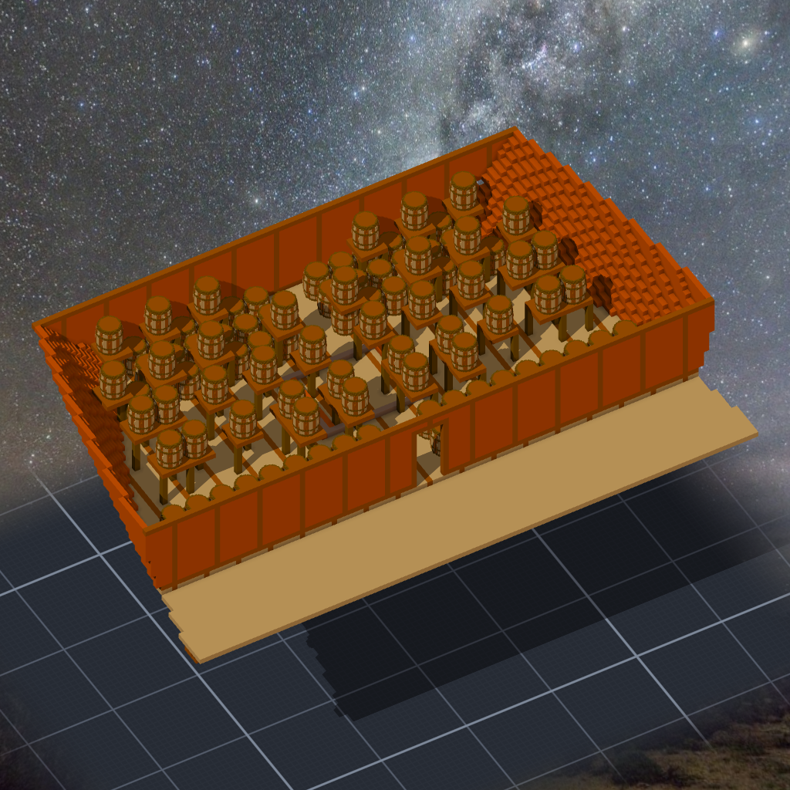

# 階段九 彈藥庫與甲板物件（2026-10-15，TASK-0598）—— calli 的日記

一百一十二個火藥桶。照砲數換算出來的，我在 plan 裡寫了「不是史料」—— 1618 年的法令我讀到的那幾條沒講火藥。

擺桶的程式照抄夜燈號，夜燈號照抄餘燼號。抄來的東西最危險的地方是：它在原本的地方從來沒被逼到角落過。夜燈號的桶只有一層，所以「第二層木架的立柱會插進底層的桶」這件事，在那份程式裡寫了三代都沒人碰到。我一放兩層，它就出來了；修了它，又冒出浮空的架板；修了架板，又冒出兩舷不對稱。四個坑都不是新的錯，是舊程式裡一直沒被走到的那幾行。

小艇也是。船腰裡沒有一段 9 公尺長的空甲板，我只好讓它擱在架子上跨過主艙口。第三座架子是為了遊戲加的：遊戲判斷東西會不會掉，是從外框中心往下找，所以小艇正中間底下要有一個「腳」，不然它的腳是一公尺多下面的甲板 —— 架子被打掉了，小艇還浮在原地。

舵輪是這艘船最不誠實的一件：1618 年的 galleon 是用舵桿掌舵的。我照遊戲放了舵輪，在 plan 裡寫了這句。然後我才發現更大的一件：這艘船到現在還沒有舵。
