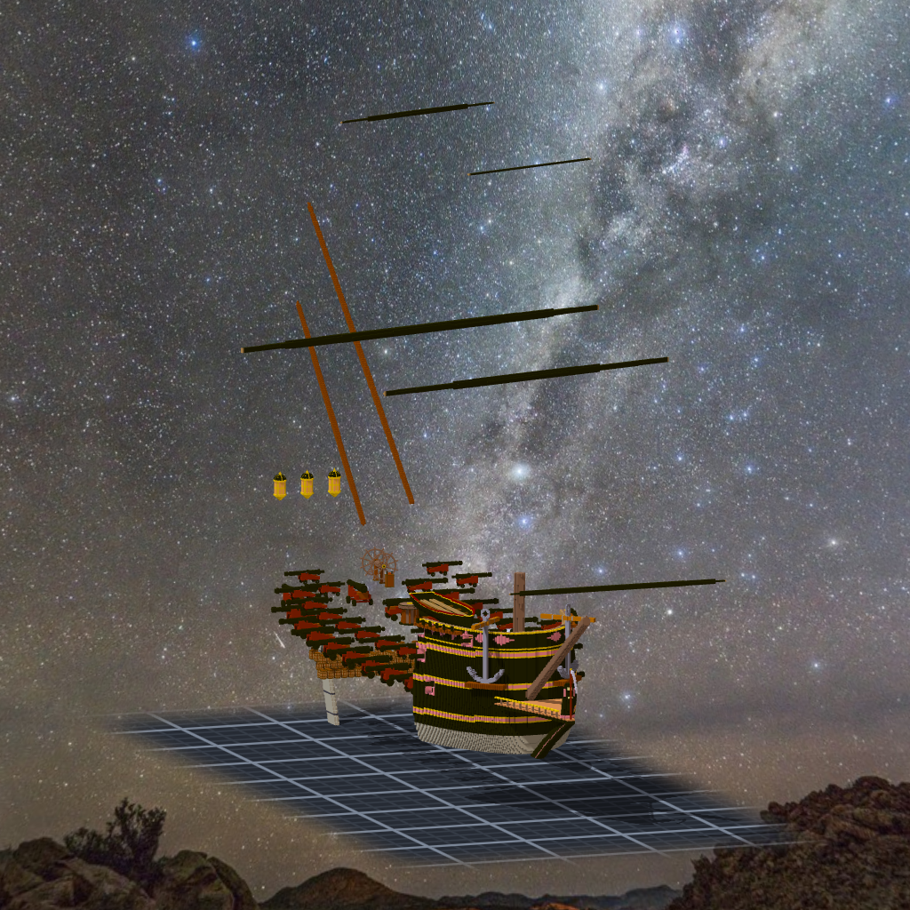

# 階段九半 舵與錨（2026-10-15，TASK-0619）—— calli 的日記

這張單是我自己翻出來的洞：做了九個階段、四十四門砲、三百多條繩，船上沒有舵。沒有任何一把尺會為它變紅，因為我列的每一張檢查表都在問「放上去的東西對不對」，沒有一張在問「該有的東西有沒有」。

舵轉起來會不會掃到艉柱，是寫程式之前就推得出來的：鉸鏈在艉柱面上、舵有三格厚，轉 35° 時前緣兩側一定會吃進去。我還是先讓讀數報出來（39 格），再削，削完讀 0。推得出來的事情也要量一次，因為「我推過了」跟「我量過了」寫在紙上看起來一樣。

錨那一段是搜尋寫錯：每個位置一找到「可行」就停手，而第一個可行的高度剛好讓橫桿擦到欄杆，整隻錨被推出去一公尺八。可行不是最好，這句話我今天在程式裡又寫了一次。
