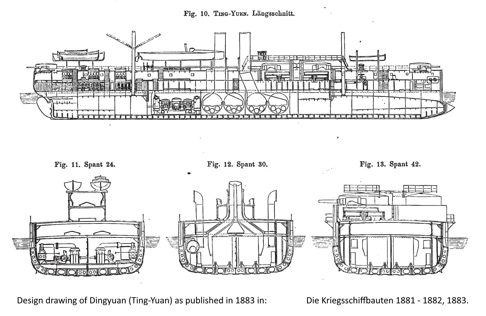
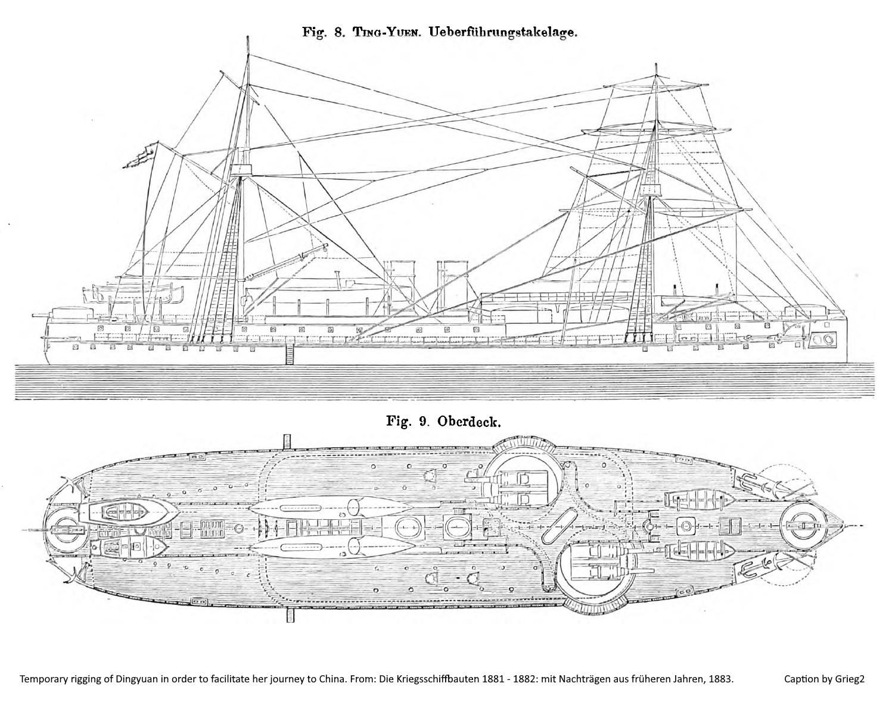
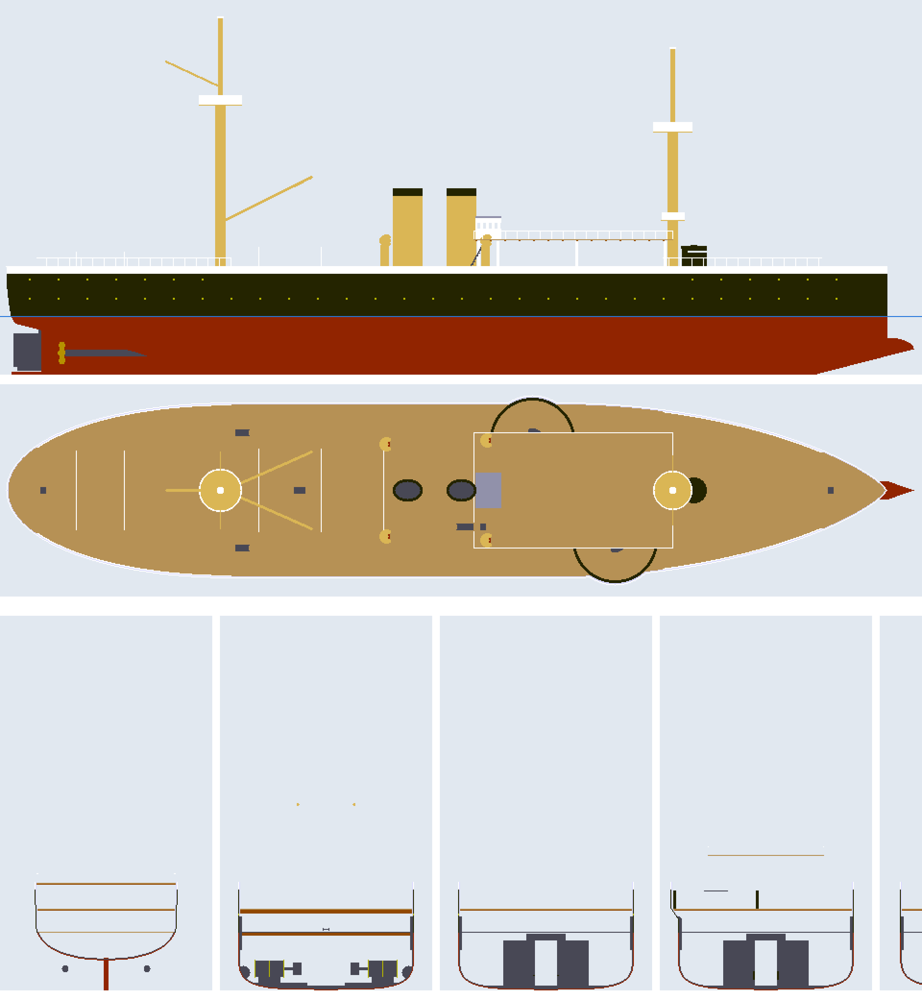
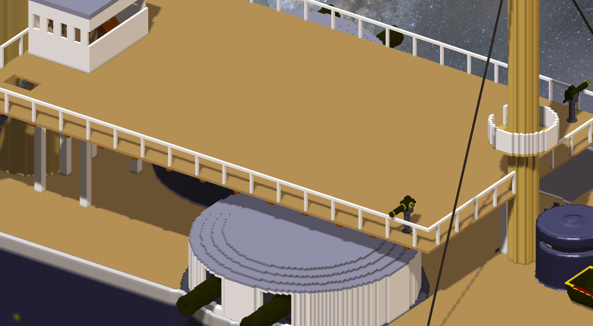
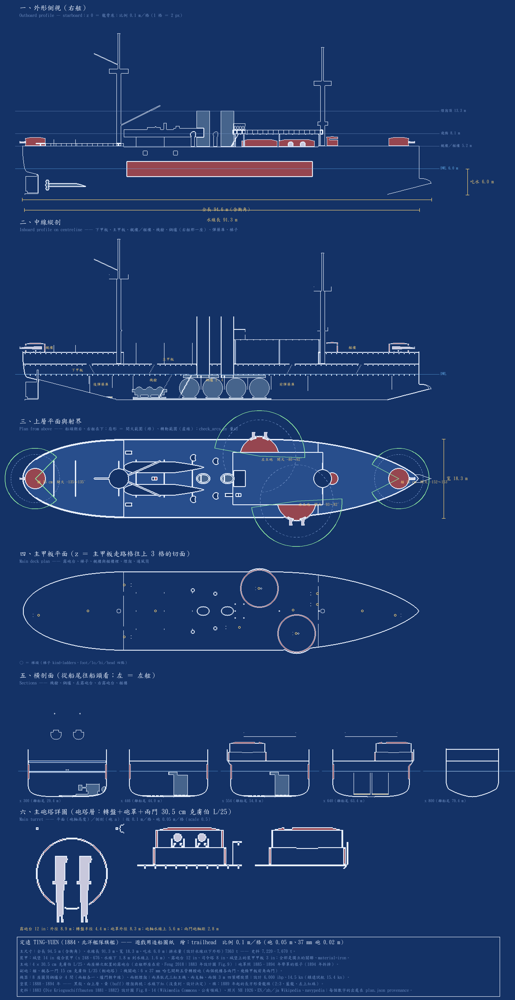

# 定遠號・第一階段（2026-10-21）—— 從史料到遊戲裡的匯入檢查 ✗ 0

## 找圖
研究 agent 在 Wikimedia Commons 找到 1883 年《Die Kriegsschiffbauten 1881–1882》的三張設計圖（縱剖＋三個橫剖、下甲板平面、上甲板平面＋轉運帆裝），加上照片 NH 1926。
本小姐自己看了一遍：Fig.13 的 42 號肋位剖面最有用 —— 主甲板只比水線高一點、露砲台從主甲板長上去、轉盤在砲台頂、砲軸比砲台高一點、砲罩上面還有一層飛橋甲板。
照片的側面卻是一整面平的黑殼到 4.4 m、上面一條白 ⇒ 舯部是低甲板＋高舷牆、兩頭是艉樓艏樓（研究筆記的解讀，史料沒有一句話直接寫）。

## 線形：第一版太胖
第一版的排水量 8,297 t（史料 7,220 t）：舭部太方（p 8）、兩頭收得太短。把船尾的全寬起點往前、船頭的往後、舭部改 p 4 ⇒ 7,363 t。
第一版的預覽還看到船頭水下比甲板寬：衝角那幾層拿「衝角尖」當平面收尖的終點 ⇒ 改成船身照艏柱收、衝角另外是一塊尖楔。

## 砲塔：本小姐量的射界、遊戲要的甲板
- 砲管（砲軸 z 116）擦到舷牆頂 z 112 ⇒ 舯部舷牆降到 z 110。
- 艏樓上的小艇、欄杆擋住兩座主砲往前打 —— 定遠號梯次配置就是為了往前齊射 ⇒ 小艇靠中線、艏樓不放欄杆。量完：右主砲能打到過正前方 3°、左主砲過正前方 2°。
- 遊戲那邊一路被匯入檢查教：✗ 5 → 2 → 0。最難的是「架高的轉盤」：遊戲照砲的模型底算那一層甲板站人的高度、照砲口那一欄靠中線生送藥手，兩條都假設砲坐在甲板上。
  露砲台頂宣告成自己一層甲板、主甲板放 37 mm（Feng 正好寫了 8 門 in casemates）、遊戲那側補一條送藥手的退路（對拍五組逐位元組相同）。
- 有一次本小姐想把艉樓的 37 mm 挪走（它們的送藥手走不到艉 15 cm 砲塔裡的取用點），結果艉樓整層沒有送藥手 ⇒ 又搬回來。先看清楚是誰撐著那一層，再動它。

## 圖紙
`design/draft_blueprint.py` 從同一份產生程式畫：外形、縱剖、射界平面、主甲板、五個橫剖面、主砲塔詳圖。重跑逐位元組相同。

